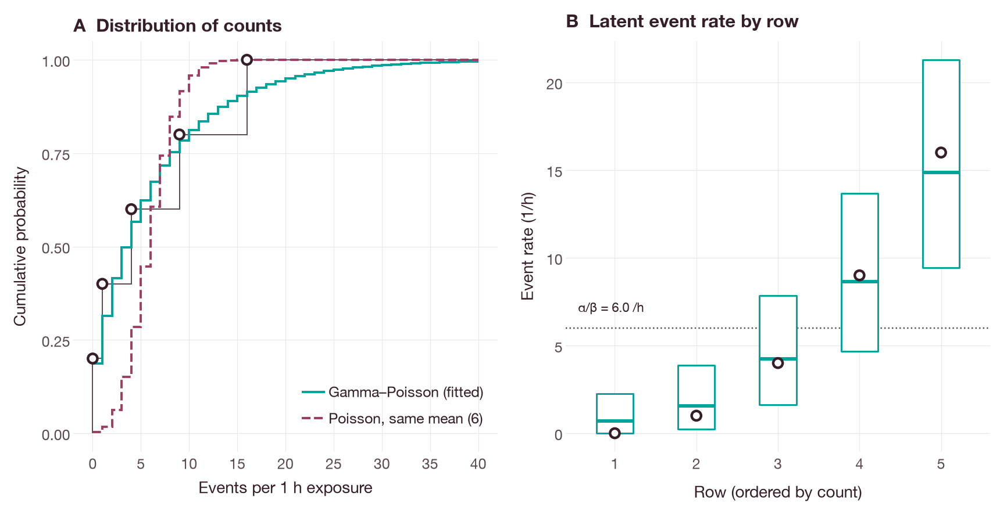
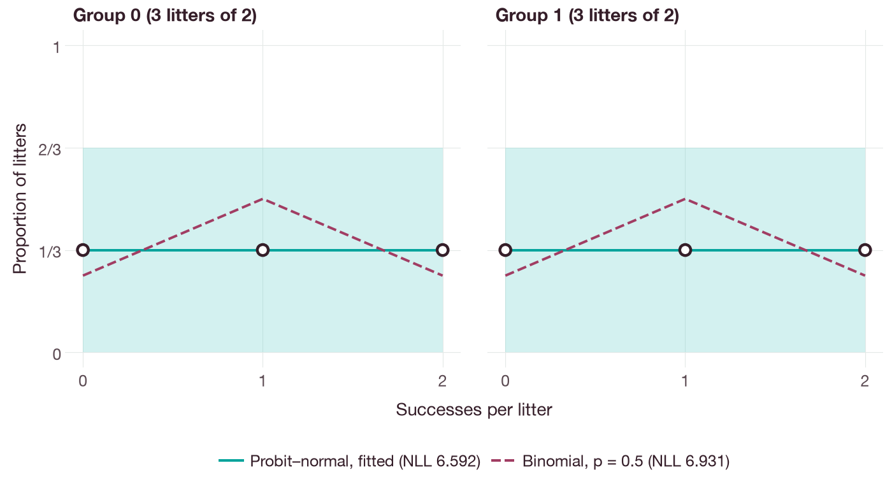

# Fitting count and binomial data

Two native workflows fit discrete observations without an ordinary differential
equation (ODE) model. Each workflow takes a complete versioned request and
returns bounded point estimates without confidence intervals. The commands are
run from the repository root after the interface in use has been
[installed](../installation.md).

The figures in this tutorial were produced by
`docs/examples/discrete_data_fitting_figures.py`, which repeats both fits with
the Python package and checks the estimates and likelihoods against the values
given here and against closed forms before drawing. The script requires the
`docs` extra.

## Event counts with measured exposure

This workflow fits independent integer counts whose underlying event rates vary
between rows. Each count has a positive exposure:

`Y_i | lambda_i ~ Poisson(exposure_i * lambda_i)`

`lambda_i ~ Gamma(shape=alpha, rate=beta)`.

Here `Y_i` is the count in a row, `exposure_i` is its exposure, `lambda_i` is
its latent event rate, and `alpha` and `beta` are the shape and rate of the Gamma
distribution. The latent rates are integrated out analytically [1, 2, 3]. All rows share
the estimated Gamma shape and rate. The complete
[synthetic request](../examples/gamma-poisson-fit.json) contains five counts,
each observed over one hour.

### Run from a source checkout

With Rust and Cargo installed, run from the repository root:

```sh
cargo run --release -p qspquest-cli -- fit-data docs/examples/gamma-poisson-fit.json
```

The expected result is `status = "converged"`, a shape of approximately
`0.772885`, a Gamma rate of approximately `0.128814 h` and a negative
log-likelihood of approximately `14.29792892`. The mean latent event rate is
`alpha / beta`, approximately `6 /h` in this example. The likelihood is
normalized and includes the factorial term of every count.

For an exposure of one hour, the fitted marginal distribution of a count is
negative binomial with mean `alpha / beta` (6) and variance
`alpha / beta + alpha / beta^2` (52.6). A Poisson distribution with the same
mean is too narrow for the five counts (Figure 1A). Given its count, the latent
rate of a row has the distribution `Gamma(alpha + Y_i, beta + exposure_i)`. Its
mean lies between the observed rate of the row and the shared mean
`alpha / beta` (Figure 1B).



**Figure 1.** Event-count example. (A) Empirical cumulative distribution of the
five observed counts (points and thin step line), and the analytical cumulative
distribution functions of the fitted Gamma–Poisson model (solid line) and of a
Poisson model with the same mean (dashed line). (B) Observed event rate of each
row, the count divided by the exposure (points), and the mean (middle line) and
5th–95th percentiles (box) of the conditional distribution of its latent rate
at the estimated shape and rate. The dotted line is `alpha / beta`. The
percentiles were computed by the figure script; they describe the latent rates
given the estimates and are not confidence intervals for the shape or rate.

### Python and Rust

After [installing the Python package from source](../installation.md), use:

```python
import json
from pathlib import Path
import qspquest

request = json.loads(Path("docs/examples/gamma-poisson-fit.json").read_text())
result = qspquest.fit_gamma_poisson(request)
print(result["status"], result["parameters"])
```

The Rust entry point is `qspquest_modeling::discrete_fit::fit_gamma_poisson`.
`gamma_poisson_objective` returns the normalized likelihood together with its
analytical gradient and Hessian in log(shape), log(rate) coordinates.

### R

After [installing the R package from source](../installation.md#r), run from
the repository root:

```r
request <- jsonlite::fromJSON("docs/examples/gamma-poisson-fit.json", simplifyVector = FALSE)
result <- qspquest::fit_gamma_poisson(request)
stopifnot(result$status == "converged")
print(result$parameters)
```

### Units and controls

Counts must be nonnegative integers, and every exposure must be finite and
positive. Exposure units must be compatible with `initial_rate.unit`; compatible
units are converted before fitting. In the shape–rate parameterization of the
Gamma distribution, beta has exposure units and lambda has reciprocal exposure
units. The shape is dimensionless. Use `unit = "1"` for explicitly normalized
exposure coordinates.

Supply positive, finite shape and rate bounds that contain the starting values.
The optimizer works on the log scale, and `gradient_tolerance` applies on that
scale. Check `status`, `projected_gradient_norm`, `evaluations` and
`iterations`; a fit that reaches an evaluation or iteration limit is incomplete.
`active_bounds` lists the estimates that ended at a bound.

The fit supports 2–4096 rows, at most one million observed events in total, and
at most twenty million operations, counted as
`(total observed events + number of rows) * max_evaluations`.
`max_evaluations` and `max_iterations` each support 1–10000.
The result is a point estimate for one shared Gamma distribution, without
confidence intervals. Group effects and rates shared across rows are not
supported.

## Correlated binomial outcomes

This workflow fits success counts from independent litters or clusters in two
groups. A normally distributed effect on the probit scale induces correlation
within each litter [4, 5]:

`Y_i | Z_i ~ Binomial(total_i, Phi(mean[group_i] + sd[group_i] * Z_i))`

`Z_i ~ Normal(0, 1)` independently across litters. Here `Y_i` is the number of
successes in a litter, `total_i` is its number of trials, `Z_i` is its litter
effect and `Phi` is the standard normal cumulative distribution function. The
means and standard deviations (SDs) are dimensionless probit coordinates. The
complete [synthetic request](../examples/probit-normal-binomial-fit.json) has,
in each group, one litter with each possible outcome of two trials.

### Run from a source checkout

With Rust and Cargo installed, run from the repository root:

```sh
cargo run --release -p qspquest-cli -- fit-data docs/examples/probit-normal-binomial-fit.json
```

The expected result is `status = "converged"`, `means` approximately `[0, 0]`,
`sds` approximately `[1, 1]` and a negative log-likelihood of approximately
`6.59167373`. In this synthetic example, each group assigns a probability of one
third to each of its three possible litter outcomes. The likelihood includes the
binomial coefficients.

With a mean of zero and an SD of one, the success probability of a litter,
`Phi(Z_i)`, is uniformly distributed between zero and one, so each of the
outcomes 0, 1 and 2 has probability 1/3 and the negative log-likelihood is
`6 ln 3`. A binomial model without a litter effect, with the pooled success
probability 0.5 in each group, assigns the probabilities 1/4, 1/2 and 1/4 and
has the larger negative log-likelihood `10 ln 2` (6.931). Figure 2 compares both
models with the observed outcomes. With three litters per group, the observed
proportions are compatible with either model.



**Figure 2.** Correlated binomial example, by group. Points are the observed
proportions of litters with 0, 1 and 2 successes. The solid line is the outcome
probability under the fitted probit–normal model, computed by Gauss–Hermite
quadrature at the estimates; the dashed line is the analytical binomial
probability with the pooled success probability. The shaded band is the
5th–95th percentile of the observed proportion among three litters if the
fitted model were true; it was computed by the figure script. The negative
log-likelihoods in the legend are totals over all six litters.

### Python and Rust

After [installing the Python package from source](../installation.md), run:

```python
import json
from pathlib import Path
import qspquest

request = json.loads(Path("docs/examples/probit-normal-binomial-fit.json").read_text())
result = qspquest.fit_probit_normal_binomial(request)
print(result["status"], result["means"], result["sds"])
```

The Rust function is
`qspquest_modeling::probit_normal::fit_probit_normal_binomial`;
its request type is `qspquest_core::probit_fit::ProbitNormalBinomialFitRequest`.
`probit_normal_binomial_objective` returns the normalized negative
log-likelihood, its gradient and its Hessian in the coordinate order
`[mean_0, mean_1, variance_0, variance_1]`.

### R

After [installing the R package from source](../installation.md#r), run from
the repository root:

```r
request <- jsonlite::fromJSON("docs/examples/probit-normal-binomial-fit.json", simplifyVector = FALSE)
result <- qspquest::fit_probit_normal_binomial(request)
stopifnot(result$status == "converged")
print(result$means)
print(result$sds)
```

### Inputs and work limits

Each litter requires an integer `successes` between zero and the integer
`total`, inclusive, and a `group` equal to zero or one. Supply at least two
litters per group, at most 128 litters in total, and 1–1000 trials per litter.
Means must lie within `[-8, 8]` and SDs within `[0, 3]`. Bounds must have
positive width and contain the starting values. An SD of zero is supported,
including as a starting value.

`gradient_tolerance` applies to the projected gradient in mean and variance
coordinates. `active_bounds` uses the same order of the four coordinates. Check
the bounds and `projected_gradient_norm` before using the result.
`max_evaluations` and `max_iterations` each support 1–1000. If either limit is
reached, `status` reports an incomplete fit.

Set `max_quadrature_evaluations` between 1 and 20000000. This value limits the
numerical integration work for the whole fit; the number of evaluations actually
used is returned as `quadrature_evaluations`. Each litter evaluation is also
limited to 65536. When the budget is exhausted, a `work_budget` error is
returned. If the integration cannot reach the required accuracy, the fit returns
an error rather than an inaccurate result.

This workflow returns point estimates for the two group means and the two
litter-effect SDs, without confidence intervals.

## References

1. Greenwood M, Yule GU. An inquiry into the nature of frequency distributions
   representative of multiple happenings with particular reference to the
   occurrence of multiple attacks of disease or of repeated accidents. *J R Stat
   Soc*. 1920;83(2):255–279.
   [doi:10.2307/2341080](https://doi.org/10.2307/2341080)
2. Lawless JF. Negative binomial and mixed Poisson regression. *Can J Stat*.
   1987;15(3):209–225. [doi:10.2307/3314912](https://doi.org/10.2307/3314912)
3. Hilbe JM. *Negative Binomial Regression*. 2nd ed. Cambridge University Press;
   2011.
   [doi:10.1017/CBO9780511973420](https://doi.org/10.1017/CBO9780511973420)
4. Williams DA. The analysis of binary responses from toxicological experiments
   involving reproduction and teratogenicity. *Biometrics*. 1975;31(4):949–952.
   [doi:10.2307/2529820](https://doi.org/10.2307/2529820)
5. Ochi Y, Prentice RL. Likelihood inference in a correlated probit regression
   model. *Biometrika*. 1984;71(3):531–543.
   [doi:10.1093/biomet/71.3.531](https://doi.org/10.1093/biomet/71.3.531)
