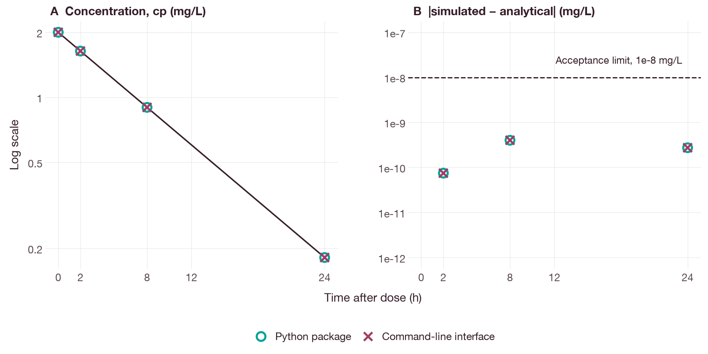

# A first simulation with QSPQuest

## Objective

This tutorial simulates a synthetic one-compartment model and saves the
result as a table with the inputs needed to rerun it. Three routes are
described: the Python package, the command-line interface (CLI) and the Model
Context Protocol (MCP) server. Each route uses the same 6 mg bolus, a clearance
of 0.3 L/h, a volume of distribution of 3 L and four post-dose observations.
The Python and CLI helpers compare the simulated concentration `cp(t)` with the
analytical solution `cp(t) = 2 * exp(-0.1 * t)` and require agreement within
1e-8 mg/L.

QSPQuest 0.1.1 is distributed as Python wheels on PyPI and as an MCP server
image on GitHub Container Registry. The CLI is built from source.

## Python package

The wheel contains the model, the request and an executable example. A Rust
compiler, a source checkout and the analysis packages are not required. With
CPython 3.10+ on macOS or Linux, run:

```sh
python3 -m venv .venv
. .venv/bin/activate
python -m pip install qspquest
python -m qspquest.first_run --out developer-results
```

On Windows PowerShell:

```powershell
python -m venv .venv
.\.venv\Scripts\Activate.ps1
python -m pip install qspquest
python -m qspquest.first_run --out developer-results
```

To run the model from Python directly:

```python
from qspquest import CompiledModel
from qspquest.first_run import synthetic_inputs

source, request = synthetic_inputs()
result = CompiledModel(source).run(request)
print(result["identity"])
print(next(column for column in result["outputs"] if column["name"] == "cp"))
```

## Command-line interface

Build the CLI from a source checkout as described in the
[README](../../README.md#build-the-cli-from-source). The helper script uses the
result writer from the Python wheel, so the wheel must also be installed as
described above. With that environment active, run from the source root on
macOS or Linux:

```sh
cargo build --release --locked -p qspquest-cli
python docs/examples/scientist_first_run.py --binary target/release/qspquest \
  --model conformance/models/synthetic-one-compartment.qsp \
  --request docs/examples/first-run.json --out scientist-results
```

On Windows, pass `--binary target\release\qspquest.exe`. The script runs the
model, compares all four observations with the analytical solution and saves six
files. To obtain the JSON result without the helper, run `target/release/qspquest run
conformance/models/synthetic-one-compartment.qsp docs/examples/first-run.json >
simulation.json`.

## MCP server

The published image contains the same synthetic model, so no model files or
library settings are required. An MCP client starts the server over standard
input and output (stdio) with:

```sh
docker run --rm -i --network none --read-only --cap-drop ALL \
  --security-opt no-new-privileges \
  ghcr.io/unibio-intelligence/qspquest-mcp:latest --profile local
```

The [agent and Docker quickstart](agents-docker.md) describes how to connect an
MCP client over stdio or HTTP and run the same simulation. The agent is asked to
inspect the server capabilities, search for `synthetic_one_compartment`, read the
full model card and default scenario, inspect a simulation plan, and simulate
with `detail: full`, `outputs: ["cp"]` and the returned plan hash. The server
runs locally. A chat client, however, may send the model, requests and results
to its AI provider and should be configured according to the user's data
requirements.

## Results

The Python and CLI routes print the following table; the MCP tools return the
same values:

```text
time_h,side,cp_mg_per_L
0,post,2.000000
2,post,1.637462
8,post,0.898658
24,post,0.181436
```

`post` denotes the value immediately after the bolus at time zero. Time is in
hours and `cp` is in mg/L. The Python and CLI routes give the same
concentrations. At 2, 8 and 24 hours each differs from the analytical solution
by less than 1e-9 mg/L, well within the 1e-8 mg/L limit (Figure 1).



**Figure 1.** Synthetic one-compartment model after a 6 mg intravenous bolus.
(A) Concentrations simulated with the `diffsol_bdf` solver by the Python
package (open circles) and the CLI (crosses) at the four observation times; the
line is the analytical solution `cp(t) = 2 * exp(-0.1 * t)`. (B) Absolute
difference between each simulated concentration and the analytical solution at
2, 8 and 24 hours; the dashed line is the 1e-8 mg/L acceptance limit. At time
zero the difference is exactly zero and cannot be shown on the logarithmic
scale.

The Python and CLI helpers save six files, all of which should be retained:

| File | Purpose |
| --- | --- |
| `model.qsp` | Exact synthetic model source |
| `request.json` | Dosing, solver, tolerances, budgets and observations |
| `result.json` | Full result, including units and run identity |
| `first-run.csv` | Four numerical observations |
| `first-run.csv.manifest.json` | Column meanings, units and file hashes |
| `checks.json` | Comparison against the exact analytical answer |

The manifest uses `qspquest.table-manifest/v1`, with `producer` equal to `cli`
or `python`.

## Figures

Figure 1 was produced by `docs/examples/first_run_journeys_figures.py`, which
uses plotnine with the shared style in `docs/examples/figure_style.py`. The
script runs the Python and CLI helpers in a temporary directory, checks the
saved tables against the values above and against the analytical solution, and
writes the figure to `docs/tutorials/figures/`. It requires the built CLI and
the `docs` extra (`python -m pip install '.[docs]'`).

## Limitations

The manifest records `not_assessed` and `qualified: false`. Agreement with the
analytical solution in this example does not validate other models or clinical
use. Checksums detect changed files; they do not establish who produced them.

## Troubleshooting

Each run requires a new output directory whose parent directory exists. If
installation fails, compare the operating system, processor architecture and
Python version with the [supported wheels](../installation.md). A wheel should
not be renamed to force installation. The analytical tolerance should not be
relaxed to make a failing check pass.

To run a named model, install the model library and follow the
[shared-model workflow](../site/shared-models.md). Review the model's units,
default scenario and limitations before running it.
