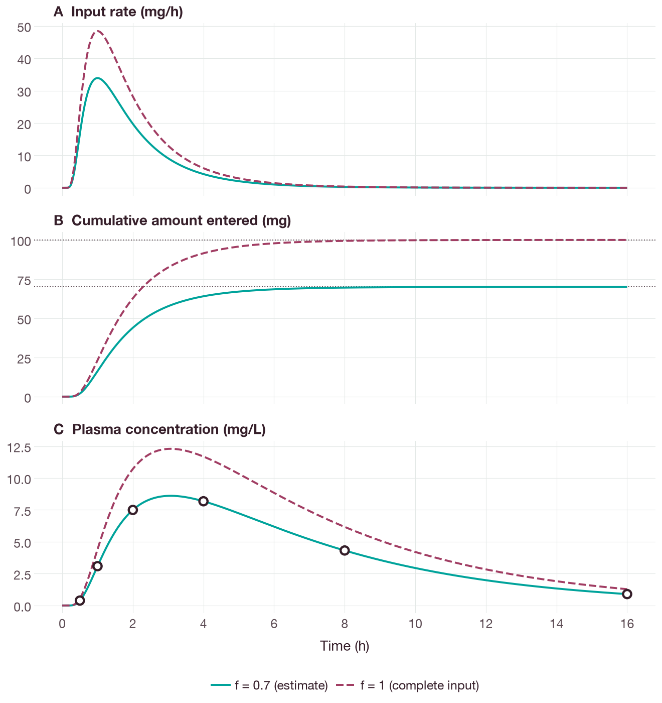
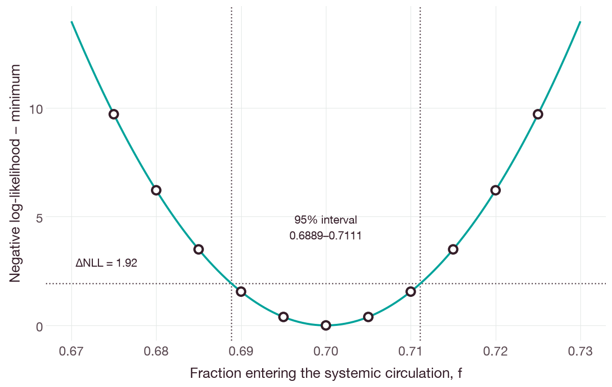

# Estimation of an input fraction with an inverse Gaussian input function

## Objective

This example estimates the fraction `f` of the administered amount that enters
the systemic circulation, using synthetic concentrations after a delayed
systemic input. The input rate has a fixed inverse Gaussian shape [1, 2], elimination
is linear and the observation error is independent, additive and Gaussian.

The complete [model](../examples/inverse-gaussian.qsp) and
[fit request](../examples/inverse-gaussian-fit.json) are included.

## Running the example

The example requires the source checkout and its pinned Rust toolchain. From the
root of the checkout, build the command-line interface (CLI) and run the
supplied example:

```sh
cargo build --locked --release -p qspquest-cli
target/release/qspquest fit docs/examples/inverse-gaussian.qsp docs/examples/inverse-gaussian-fit.json
```

The result should have `status: "converged"` and an estimate of `f` within
`0.00001` of `0.7`. The administered amount, volume, elimination rate constant,
mean input time and shape are fixed. The observations are synthetic, with an
additive standard deviation of `0.1 mg/L`.

The figures in this tutorial were produced by
`docs/examples/inverse_gaussian_input_figures.py`, which fits the same request
with the Python package (`CompiledModel.fit_scalar`) and checks the estimate,
the likelihood and the simulated concentrations against closed forms before
drawing. The script requires the `docs` extra.

## Input function

`inverse_gaussian_density(time, mean, shape)` takes three quantities with the
same dimension and returns a value with the inverse dimension. For positive
time, mean and shape, its value is

```text
sqrt(shape / (2*pi*time^3))
    * exp(-shape*(time-mean)^2 / (2*mean^2*time)).
```

Its integral over positive time is one. At nonpositive time the value and its
derivatives are exactly zero. The mean and shape must be positive even when time
is zero. Invalid arguments, or results too large to represent, produce a domain
error.

The product of the density and an amount is an input rate. In the supplied
model, an amount in `mg` and times in `h` give a rate in `mg/h`. The shape
parameter has the dimension of time; it is not a dimensionless coefficient of
variation. For a squared coefficient of variation `cv2`, use
`shape = mean / cv2`.

In the supplied model, `mean_time` is 2 h and `shape_time` is 4 h, so `cv2` is
0.5. Figure 1 shows the input rate, the cumulative amount that has entered the
systemic circulation and the plasma concentration, at the estimate and for
complete input (`f = 1`). The cumulative amount approaches `f * dose`, which is
70 mg at the estimate.



**Figure 1.** Delayed systemic input of a 100 mg dose at the estimate, `f` =
0.7 (solid lines), and for complete input, `f` = 1 (dashed lines). (A) Input
rate and (B) cumulative amount entered, both calculated analytically from the
inverse Gaussian density and its distribution function; dotted lines mark
`f * dose`. (C) Plasma concentration simulated with the BDF solver, which agrees
with a quadrature solution of the convolution integral to within 1e-6 mg/L.
Open circles are the six synthetic observations, which were simulated at
`f` = 0.7 without measurement error. The panels share the time axis.

## Fit request

For scalar fitting, the fitted parameter must lie within the bounds of the
request and be marked `estimated`. Observation row numbers index the requested
output times in order, starting with the row at time zero. The input rate should
be computed with the density function directly rather than constructed from
conditional expressions.

When the other parameters are fixed, the concentration is proportional to `f`.
The negative log-likelihood is therefore a quadratic function of `f`, and the
estimate equals the linear least-squares solution (Figure 2). With the additive
SD of 0.1 mg/L, the values of `f` whose negative log-likelihood lies within 1.92
of the minimum range from 0.6889 to 0.7111.



**Figure 2.** Negative log-likelihood of the six observations minus its
minimum, as a function of `f`, with all other parameters and the SD fixed. The
line is the analytical quadratic; points were calculated from concentrations
simulated with the BDF solver. Dotted lines mark a difference of 1.92, half the
95th percentile of the chi-squared distribution with one degree of freedom, and
the corresponding likelihood-based 95% interval for `f`. The interval was
computed by the figure script; the fit result contains only the point estimate.

## Limitations

The example does not estimate population variability and does not demonstrate
biological validity.

## References

1. Chhikara RS, Folks JL. *The Inverse Gaussian Distribution: Theory,
   Methodology, and Applications*. CRC; 2024. Reissue of the 1989 Marcel Dekker
   edition. [doi:10.1201/9781003573746](https://doi.org/10.1201/9781003573746)
2. Csajka C, Drover D, Verotta D. The use of a sum of inverse Gaussian functions
   to describe the absorption profile of drugs exhibiting complex absorption.
   *Pharm Res*. 2005;22(8):1227–1235.
   [doi:10.1007/s11095-005-5266-8](https://doi.org/10.1007/s11095-005-5266-8)
