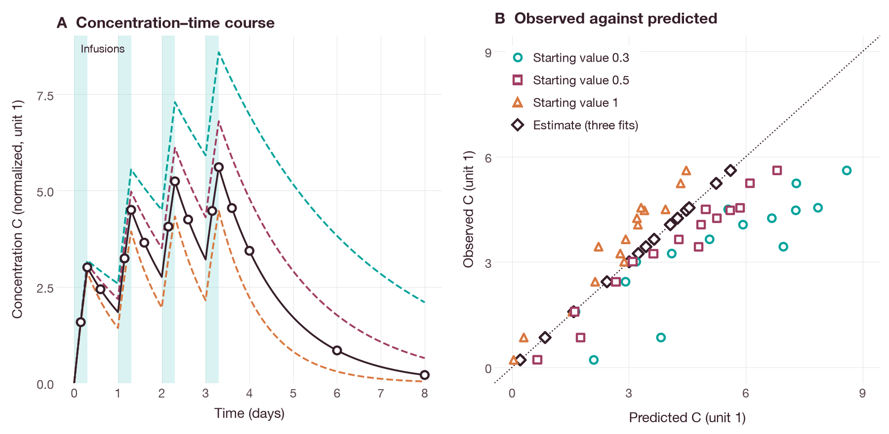

# Discover and run an archived synthetic fitting workflow

This tutorial uses a local Model Context Protocol (MCP) server to select a model
version, choose one of its fitting workflows, preview the plan, run the fit and
save the diagnostics. A model that can be simulated cannot necessarily be
fitted; only models with a ready fitting workflow can be fitted.

The tutorial requires Python 3.10+, a matching QSPQuest MCP executable, an
extracted model library that includes a ready fitting workflow, and the client
below, which uses only the Python standard library. All computation is local. If
a chat client is used instead, it may send prompts and results, including
observations, to its AI provider.

The model library includes synthetic fitting workflows for
`qspquest_diffdose_2026_idr_benchmark` (scalar recovery) and
`qspquest_serkland_2025_rituximab_ms_pkpd` (individual recovery), at version `0.3.0`.
Use the supported workflows `diffsol_bdf-start-1` through `diffsol_bdf-start-3`.
Each workflow is a synthetic recovery test: known simulated data are fitted and
the estimates are compared with the true values.

## Inspect first

Use `search_models` and `get_model` with an exact `model_id` and `version`.
Read the `fitting` object, the units and the limitations. For
`qspquest.library-fitting/v1`, each workflow has the following fields:

| Field | Meaning |
| --- | --- |
| `id` and `operation` | Workflow ID and the fitting tool it uses (scalar or individual) |
| `parameters` | Names, units, bounds, starting values, true values and recovery tolerances |
| `native_request` | Observations, residual errors, solver, dosing, priors and estimator settings |
| `synthetic_observations` | Observation data stored in the same archive |
| `qualification` | How the workflow was checked, and the result |
| `limitations` | What the workflow does not cover |

A draft workflow has `qualification.status: not_assessed` and cannot be
fitted. V1 workflows support uncensored normal errors with fixed additive and
proportional components, with scalar or individual estimation. Censoring,
lognormal errors, priors and population fitting are not supported. These
workflows do not reproduce the population analysis of the original paper. Unit
`1` means that no physical unit is attached (the value is on the numerical scale
of the source); such a parameter should not be reported as a clearance or volume
in physical units on the basis of its name alone.

Read `qspquest://schema/library-fitting` for the full schema. The workflow fixes
the data, error model, bounds, starting values, solver and limits, and runs only
as stored. To fit variations, write a separate model and use the regular fitting
tools.

## Execute and retain the result

In a source checkout, the [client](../examples/mcp_library_fit.py) and its
[stdio helper](../examples/stdio_rpc.py) are in `docs/examples/`. Build the
server, then replace the model, version and workflow placeholders with the
values returned by `get_model`:

```sh
cargo build --release --locked -p qspquest-mcp
python3 docs/examples/mcp_library_fit.py target/release/qspquest-mcp \
  --library /absolute/path/to/extracted-model-library \
  --model MODEL_ID --version MODEL_VERSION --workflow WORKFLOW_ID \
  --out library-fit-results
```

On Windows PowerShell, use `python`, `target\release\qspquest-mcp.exe` and the
absolute library path on one line. Keep the downloaded library intact; it must
contain `catalog.json` and its archives.

For the normalized scalar example included in the source checkout, run from the
source root:

```sh
python3 docs/examples/mcp_library_fit.py target/release/qspquest-mcp \
  --library bindings/mcp/tests/library \
  --model qspquest_diffdose_2026_idr_benchmark --version 0.3.1 \
  --workflow diffsol_bdf-start-1 \
  --out normalized-scalar-fit
```

This command selects the archive's `diffsol_bdf-start-1` workflow. It estimates
`source_symbol_5`, the normalized elimination parameter, with the backward
differentiation formula (BDF) solver and bounds 0.2–1.2 in unit `1`. The true
value is 0.7, and the fit must recover it within 1e-5. The same request is
available as `qspquest://examples/fit/library-scalar`.

The archive contains two further workflows, `diffsol_bdf-start-2` and
`diffsol_bdf-start-3`, which differ only in the starting value (0.5 and 1.0
instead of 0.3). The 15 synthetic observations are values of the normalized
concentration `C` after four infusions of 0.3 days at daily intervals. They were
simulated at the true value without measurement error, so the predictions at
the estimate coincide with the observations (Figure 1).



**Figure 1.** Fits of the normalized scalar example. Open circles are the 15
synthetic observations stored in the archive. Predictions were simulated with
the archived native model and the BDF solver at each starting value (dashed
lines) and at the estimate (solid line); they agree with the closed-form
solution for repeated zero-order infusions to within 1e-8. (A) Concentration
against time; shaded bands mark the infusions. (B) Observed against predicted
values; the dotted line is the line of identity. The estimates of the three
workflows agree to within 1e-5, and their points coincide.

The fitting result contains the estimates but not the predictions. The figure
was produced by `docs/examples/library_fitting_figures.py`, which runs the
client for the three workflows in a temporary directory and simulates the
archived model with the Python package at the starting values and the
estimates. The script requires a built `qspquest-mcp` and the `docs` extra.

The client stops early if the model has no ready fitting workflow. Otherwise, it
previews the plan, runs it with `expected_plan_hash`, downloads the result and
saves the following files:

| File | Purpose |
| --- | --- |
| `model-card.json` | The model's fitting workflow and limitations |
| `arguments.json` | Exact inputs, including the plan hash |
| `plan.json` | The previewed plan |
| `result.json` | Full result, including estimates and run identity |
| `checks.json` | Convergence, parameter recovery and diagnostic summary |

Choose a new output directory whose parent directory exists. The JSON printed
on standard output reports file hashes and parameter checks.

## Interpret status and recover

A successful run has `fit_status: converged`, and every parameter-recovery
check passes. Also check the evaluation and iteration counts, parameters at
their bounds and, for individual fitting, the projected-gradient norm. A
parameter at a bound or a non-converged estimate should not be reported as a
final result.

The client saves failed or non-converged results and exits with status 1.
After an input error or a timeout, read the error message before retrying. A
simulation-only model returns `fitting_unsupported`. A modified request returns
`fitting_contract`; use the stored request unchanged. Recovery tolerances should
not be relaxed to make a run pass.

These are synthetic tests. They provide no information about clinical use,
real-world data or the population estimates of the original study.

## Select an exact model version

Inspect the catalog before choosing a model. In Python, call
`library.load(model_id, version=version)`; in MCP, provide both `model_id` and
`version`. The library command-line interface (CLI) accepts
`--model-version VERSION` together with `--model MODEL_ID`. If the version is
omitted, the current version in the catalog is selected. A missing version
causes an error; another version is never substituted.

Before changing versions, check the new model card, scenario and units. Reapply
any overrides with the parameter names and units of the new version, then
compare the results.
