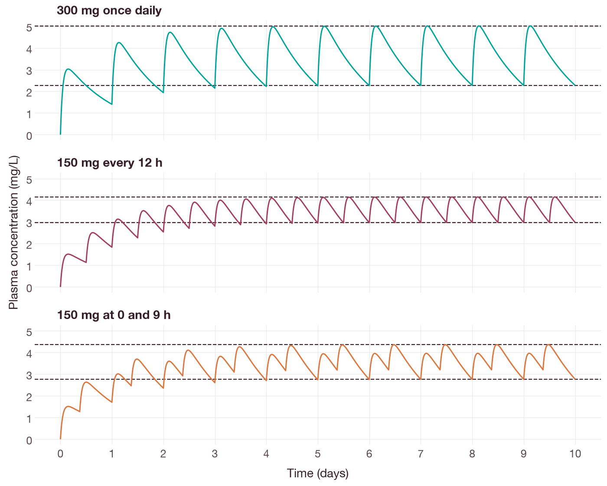
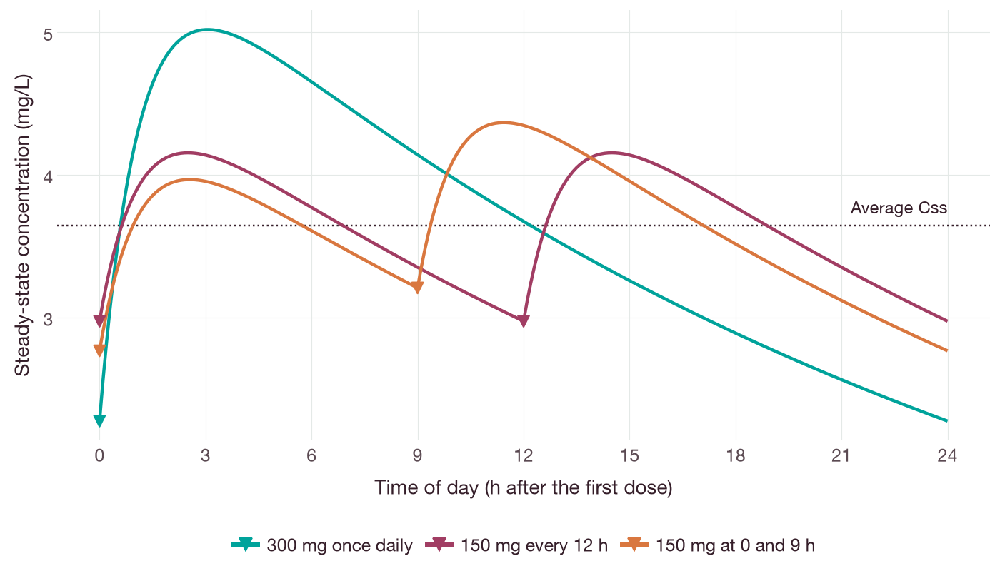
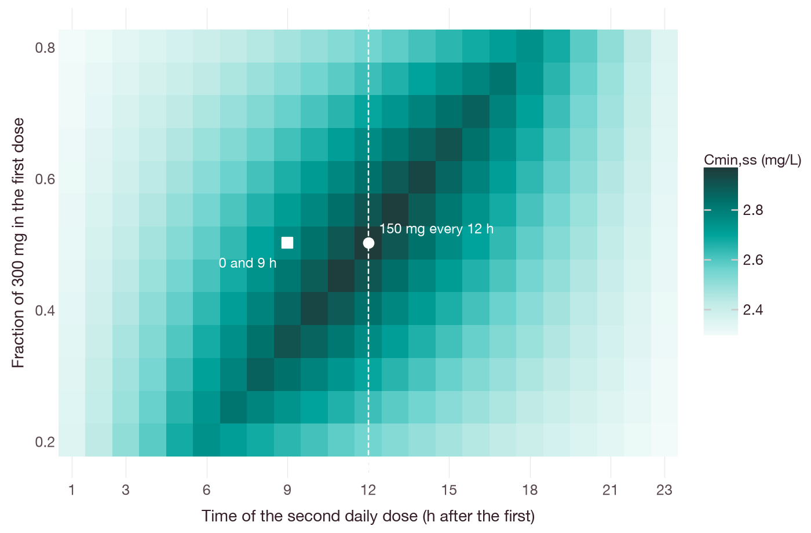
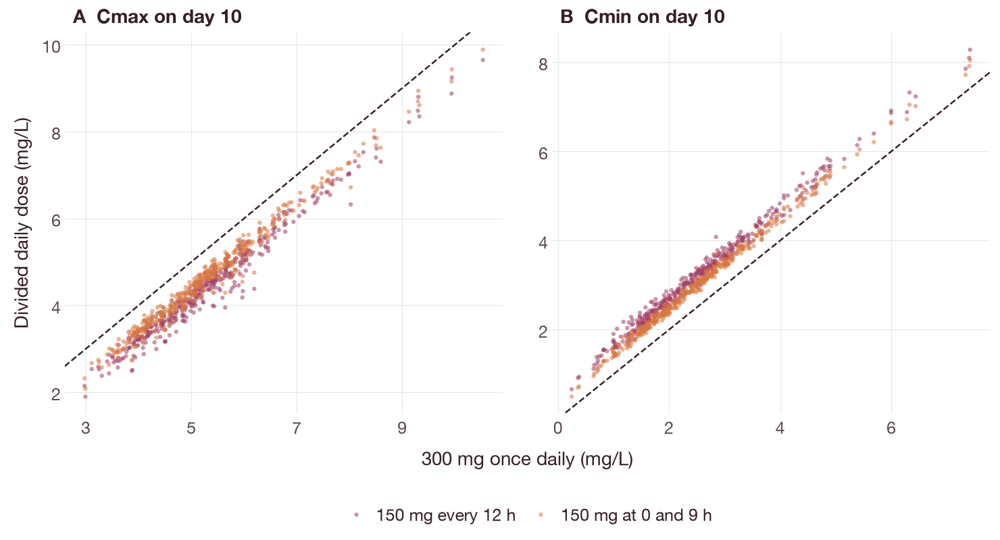

# Multiple-dose pharmacokinetics: comparison of daily dosing schedules

## Objective

This tutorial compares three oral schedules that deliver the same daily dose of
300 mg:

- 300 mg once daily;
- 150 mg every 12 h;
- 150 mg at 0 h and 9 h of each day, for example with breakfast and dinner.

It uses the synthetic drug from the [single-dose tutorial](single-dose-pk.md):
`CL` = 2.4 L/h, `V` = 60 L, `KA` = 0.9 h⁻¹, `F` = 0.7 and `t½` = 17.3 h. The
tutorial covers:

- accumulation and the time to reach steady state;
- the steady-state profile of each schedule;
- an IV loading dose calculated from the accumulation ratio;
- the effect of between-subject variability on the comparison.

The drug, its parameters and all results are synthetic.

## Background

For a linear system, the concentration after repeated doses is the sum of the
concentrations produced by each dose separately. This is the principle of
superposition [1]. For a dose `D` given every `τ` hours, summing the
contributions of `n` doses gives a geometric series. As `n` increases, the
concentration at each time after a dose approaches a limiting value: the steady
state. For a one-compartment model with IV bolus doses, the ratio of the
steady-state trough concentration to the trough after the first dose is the
accumulation ratio [2]:

`R = 1 / (1 − e^(−kτ))`  (1)

The fraction of steady state reached at time `t` after the start of regular
dosing is approximately `1 − e^(−kt)`, so 90% of steady state is reached after
about 3.3 half-lives. For drugs with more than one exponential phase, the
half-life that determines accumulation can differ from the terminal half-life.
Boxenbaum and Battle described this as the effective half-life [3], and Sahin
and Benet defined an operational multiple-dosing half-life [4].

## Dosing

Each daily dose is one administration with a `repeat` record. `interval`
corresponds to `II` and `additional` to `ADDL` in NONMEM datasets: the number of
doses after the first. A schedule with two doses per day consists of two
administrations, each repeated every 24 h:

```python
import qspquest as qq

def daily(at, dose, days=10):
    administration = qq.bolus("depot", dose, "mg", at=at, bioavailability=0.7)
    administration["repeat"] = {"interval": qq.quantity(24, "h"), "additional": days - 1}
    return administration

meals = [daily(0, 150), daily(9, 150)]
```

All doses of the expanded schedule must fall within the simulated time; a dose
after the end time is rejected rather than ignored. [Fixed administration
requests](../../spec/regimens.md) describes repeated doses, lag times and
infusions.

## Sampling at the time of a dose

A sample taken at the time of a dose can represent the state immediately before
or immediately after the dose. Each observation therefore has a `side`: `pre`
for the state before the events at that time, and `post` for the state after
them. A trough concentration is a `pre` observation. After an IV bolus, the
`post` concentration exceeds the `pre` concentration by `D/V`. An oral dose
enters the depot, so the plasma concentration is the same on both sides.
`run_request` assigns one side to all samples. To sample the concentration
before the first dose of each day, set the observations directly:

```python
model = qq.CompiledModel(open("multiple-dose-output/model.qsp").read())
run = qq.run_request(end=240, times=[24], administrations=meals,
                     solver="analytic_linear_pk")
run["regimen"]["observations"] = [
    {"time": qq.quantity(24 * day, "h"), "side": "pre"} for day in range(1, 11)]
troughs = model.run(run)
```

When both sides are sampled at the same time, the `pre` observation must be
listed first.

## Steady-state calculation

The steady state can be calculated directly rather than by simulating until
the trough concentrations stop changing. `periodic_steady_state` solves for the
amounts at the start of a dosing cycle that are the same at the end of the
cycle. The request contains one 24 h cycle with that day's doses and no
observations:

```python
cycle = qq.run_request(end=24, times=[24], solver="analytic_linear_pk",
                       administrations=[daily(0, 150, days=1), daily(9, 150, days=1)])
del cycle["regimen"]["observations"]
steady = model.periodic_steady_state({
    "run": cycle,
    "absolute_tolerance": qq.quantity(1e-9, "mg"),
    "relative_tolerance": 1e-9,
})
print(steady["initial_states"], steady["maximum_scaled_residual"])
```

The doses within the cycle need not be equally spaced. The result contains the
amount in each state immediately before the first dose of the cycle and the
largest scaled difference between the amounts at the start and at the end of
the cycle (the residual). To obtain the steady-state profile, these amounts are
used as initial states for a simulation of one cycle:

```python
cycle["initial_states"] = steady["initial_states"]
cycle["regimen"]["observations"] = [
    {"time": qq.quantity(i * 0.05, "h"), "side": "post"} for i in range(481)]
day = qq.exposure_summary(model.run(cycle), "cp")
```

The periodic steady-state calculation requires an `analytic_linear_pk` model.
The [kernel documentation](../LINEAR-PK-KERNELS.md#periodic-steady-state-kernel-api)
lists the requests that it does not accept.

## Running the example

From the root of the source checkout, with the analysis extra installed, run:

```sh
python docs/examples/multiple_dose_pk.py --out multiple-dose-output
```

The script prints:

```text
Half-life 17.33 h
Pre-dose concentration as a percentage of steady state
Schedule               Day 1   Day 2   Day 3   Day 4   Day 10
300 mg once daily       61.7    85.3    94.4    97.9   99.993
150 mg every 12 h       61.7    85.3    94.4    97.9   99.993
150 mg at 0 and 9 h     61.7    85.3    94.4    97.9   99.993

Steady state (one 24 h cycle)
Schedule              AUC0-24 (mg*h/L)  Cmax (mg/L)  Cmin (mg/L)  Cmax/Cmin  Residual
300 mg once daily                87.50        5.018        2.273       2.21   1.3e-14
150 mg every 12 h                87.50        4.154        2.973       1.40   0.0e+00
150 mg at 0 and 9 h              87.50        4.366        2.765       1.58   0.0e+00

IV 150 mg every 12 h: accumulation ratio 2.6232, loading dose 393.5 mg
With loading dose: Ctrough 4.0580 mg/L and Cmax 6.5580 mg/L at every dose
Without loading dose: Ctrough 1.5470 mg/L (dose 2) to 4.0040 mg/L (dose 10)

Day 10, 400 virtual subjects: median (5th-95th percentile)
Schedule              Cmax (mg/L)          Cmin (mg/L)          Change in Cmax vs once daily
300 mg once daily    5.18 (3.71-7.69)     2.42 (1.01-4.76)
150 mg every 12 h    4.34 (2.82-6.87)     3.12 (1.65-5.58)     -0.85 (-1.28 to -0.58)
150 mg at 0 and 9 h  4.55 (3.01-7.08)     2.90 (1.45-5.36)     -0.64 (-0.99 to -0.43)
```

The figures in this tutorial are produced by
`python docs/examples/multiple_dose_pk_figures.py`, which requires the `docs`
extra. The script repeats each simulation, compares the steady-state and
pre-dose values with the superposition solutions and writes the figures to
`docs/tutorials/figures/`.

The residuals of order 1e-14 depend on the platform. The virtual subjects are
generated from a fixed seed, so the percentiles are reproducible. The output
directory contains the model (`model.qsp`), the pre-dose concentrations
(`predose.csv`), the steady-state results (`steady-state.json`) and the
comparison of schedules (`regimen-comparison.json`).

## Results

### Accumulation

Each simulated pre-dose concentration agrees with the corresponding sum of
Equation 3 of the single-dose tutorial to within 1e-9 mg/L. All three schedules
reached 61.7% of their steady-state pre-dose concentration on day 1, 85.3% on
day 2 and 94.4% on day 3. These values equal `1 − e^(−kt)` at 24, 48 and 72 h.
The rate of accumulation depends on the half-life and not on how the daily dose
is divided (Figure 1).



**Figure 1.** Simulated plasma concentration over 10 days for three schedules of
300 mg per day. Dashed lines are the steady-state Cmin and Cmax obtained from
`periodic_steady_state` for each schedule.

### Steady-state profiles

**Table 1.** Steady-state exposure for three schedules of 300 mg per day.

| Schedule | AUC0–24 (mg·h/L) | Cmax (mg/L) | Cmin (mg/L) | Cmax/Cmin |
| --- | ---: | ---: | ---: | ---: |
| 300 mg once daily | 87.50 | 5.02 | 2.27 | 2.21 |
| 150 mg every 12 h | 87.50 | 4.15 | 2.97 | 1.40 |
| 150 mg at 0 and 9 h | 87.50 | 4.37 | 2.77 | 1.58 |

The steady-state pre-dose concentrations agree with the analytical sums to
within 1e-9 mg/L. All three schedules give the same AUC over 24 h, equal to
`F·D/CL` = 87.5 mg·h/L, because with linear pharmacokinetics the steady-state
AUC over one day depends only on the daily dose. Dividing the dose lowers Cmax
and raises Cmin. With doses at 0 and 9 h, the 15 h interval overnight
determines Cmin, so the fluctuation is between that of the other two
schedules (Figure 2).



**Figure 2.** Simulated steady-state concentration over one day. Triangles mark
the dose times. The simulated values agree with the superposition solution to
within 1e-9 mg/L. The dotted line is the average steady-state concentration,
`F·D/(CL·24 h)` = 3.65 mg/L, which is the same for all three schedules.

Figure 3 generalizes the comparison to all schedules with two doses per day. The
first dose is given at 0 h and the second at 1–23 h, and the fraction of the
daily dose given first ranges from 0.2 to 0.8. Cmin,ss is highest (2.97 mg/L) for
two equal doses 12 h apart. For a second dose given earlier or later, Cmin,ss is
highest when the first dose is roughly proportional to the interval that
follows it, so that the larger dose precedes the longer interval.



**Figure 3.** Steady-state Cmin for 299 two-dose schedules of 300 mg per day.
Each cell is one steady-state calculation followed by a simulated day sampled
every 0.25 h; every pre-dose value agrees with the superposition solution to
within 1e-9 mg/L. The circle marks 150 mg every 12 h and the square 150 mg at
0 and 9 h.

### Loading dose

For IV doses of 150 mg every 12 h, Equation 1 gives `R` = 2.623. A first dose of
`D·R` = 393.5 mg replaces the amount that previous doses would have left in the
body [5]:

```python
loading = qq.bolus("central", 393.5, "mg")
maintenance = qq.bolus("central", 150, "mg", at=12)
maintenance["repeat"] = {"interval": qq.quantity(12, "h"), "additional": 8}
```

With the loading dose, the trough concentration was 4.058 mg/L before every
maintenance dose, and the peak concentration was 6.558 mg/L after every dose.
The difference, 2.5 mg/L, equals `D/V`. Without the loading dose, the trough
concentration increased from 1.547 mg/L before the second dose to 4.004 mg/L
before the tenth. Equation 1 assumes a one-compartment model. For drugs with
multicompartment distribution, the choice of volume for the loading dose
determines whether the early concentrations are too high or too low [6]. The
accumulation ratio can also be defined from AUC, Cmax or Cmin, and these
definitions do not give the same value in general [7].

### Between-subject variability

The comparison above uses one set of parameter values. `compare_regimens`
simulates a population of virtual subjects and gives every subject every
schedule, so that the differences between schedules are not confounded with
differences between subjects. Individual parameters are log-normally
distributed, `CL_i = CL·e^(η_CL)` and `V_i = V·e^(η_V)`, with `η ~ N(0, Ω)`
(`ETA` and `OMEGA` in NONMEM notation). Variances of 0.09 and 0.04 correspond to
coefficients of variation of approximately 30% and 20%. Only the tenth day is
sampled, so the reported Cmax and Cmin are close to their steady-state values:

```python
day10 = [216 + 0.25 * i for i in range(97)]
regimens = {
    "300 mg once daily": [daily(0, 300)],
    "150 mg every 12 h": [daily(0, 150), daily(12, 150)],
    "150 mg at 0 and 9 h": meals,
}
comparison = model.compare_regimens(
    {name: qq.run_request(end=240, times=day10, administrations=doses,
                          solver="analytic_linear_pk")
     for name, doses in regimens.items()},
    {"cl": qq.quantity(2.4, "L/h"), "v": qq.quantity(60, "L"), "ka": qq.quantity(0.9, "1/h")},
    [[0.09, 0.0], [0.0, 0.04]], "cp", random_effects=["cl", "v"],
    subjects=400, seed=20261105)
```

Cmin varied widely between subjects; with once-daily dosing, its 90% range was
1.01 to 4.76 mg/L. The change in Cmax for each subject was more consistent. With
dosing every 12 h instead of once daily, Cmax decreased by 0.58 to 1.28 mg/L in
90% of subjects, and it decreased in all 400 subjects (Figure 4). Such within-subject
differences are obtained directly from paired simulations. With two independent
groups of subjects, they would have to be inferred from overlapping
distributions. The simulated profiles do not include residual error. Parameter
uncertainty can be included with bootstrap `parameter_draws` (see [analysis
workflows](../ANALYSIS.md)).



**Figure 4.** Day-10 Cmax (A) and Cmin (B) in 400 simulated virtual subjects.
Each point is one subject; the horizontal position is the value with 300 mg once
daily and the vertical position is the value with a divided dose. Points below
the dashed identity line in (A) and above it in (B) show that dividing the dose
lowered Cmax and raised Cmin in every subject.

## Limitations

The analysis assumes linear, time-invariant pharmacokinetics and complete
adherence. Variability is included for `CL` and `V` only. The interfaces differ:
all steps are available in Python, and the command-line interface and
WebAssembly build also provide the steady-state calculation. The R interface
supports the repeated-dose and pre-dose requests through `simulate_model`, but
it does not yet provide `periodic_steady_state`, `exposure_summary` or
`compare_regimens`.

The next step, [fitting individual oral PK data](oral-pk-analysis.md), estimates
the model parameters from observations. All tutorials are listed in the [PK/PD
tutorials](pk-pd-journeys.md).

## References

1. Thron CD. Linearity and superposition in pharmacokinetics. *Pharmacol Rev*.
   1974;26(1):3–31. [doi:10.1016/S0031-6997(25)06633-5](https://doi.org/10.1016/S0031-6997%2825%2906633-5)
2. Wagner JG. Drug accumulation. *J Clin Pharmacol J New Drugs*.
   1967;7(2):84–88. [doi:10.1002/j.1552-4604.1967.tb00290.x](https://doi.org/10.1002/j.1552-4604.1967.tb00290.x)
3. Boxenbaum H, Battle M. Effective half-life in clinical pharmacology.
   *J Clin Pharmacol*. 1995;35(8):763–766.
   [doi:10.1002/j.1552-4604.1995.tb04117.x](https://doi.org/10.1002/j.1552-4604.1995.tb04117.x)
4. Sahin S, Benet LZ. The operational multiple dosing half-life: a key to
   defining drug accumulation in patients and to designing extended release
   dosage forms. *Pharm Res*. 2008;25(12):2869–2877.
   [doi:10.1007/s11095-008-9787-9](https://doi.org/10.1007/s11095-008-9787-9)
5. Greenblatt DJ, Koch-Weser J. Clinical pharmacokinetics (first of two parts).
   *N Engl J Med*. 1975;293(14):702–705.
   [doi:10.1056/NEJM197510022931406](https://doi.org/10.1056/NEJM197510022931406)
6. Wada DR, Drover DR, Lemmens HJ. Determination of the distribution volume
   that can be used to calculate the intravenous loading dose.
   *Clin Pharmacokinet*. 1998;35(1):1–7.
   [doi:10.2165/00003088-199835010-00001](https://doi.org/10.2165/00003088-199835010-00001)
7. Li L, Li X, Xu L, Sheng Y, Huang J, Zheng Q. Systematic evaluation of dose
   accumulation studies in clinical pharmacokinetics. *Curr Drug Metab*.
   2013;14(5):605–615. [doi:10.2174/13892002113149990002](https://doi.org/10.2174/13892002113149990002)
