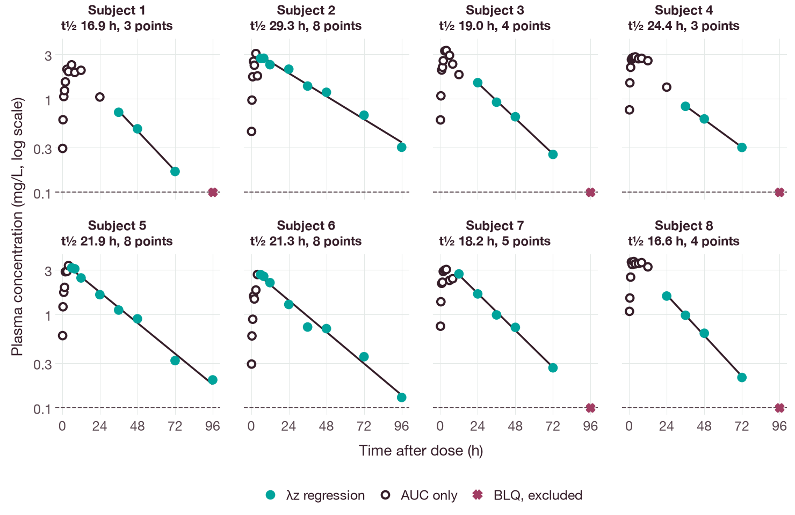
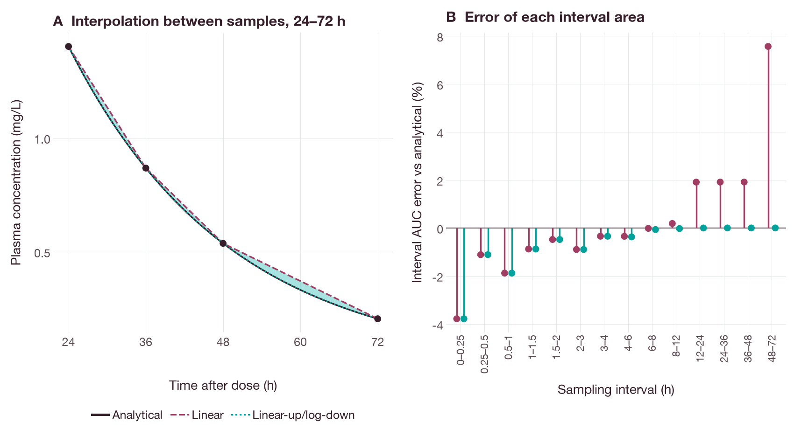
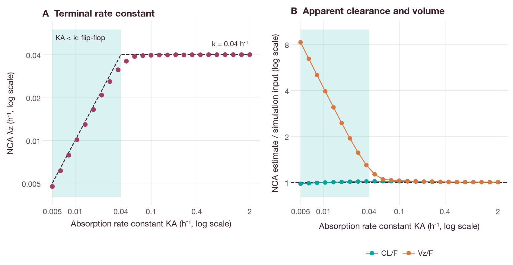

# Noncompartmental analysis of single-dose profiles

## Objective

This tutorial estimates conventional noncompartmental pharmacokinetic (PK)
parameters from single-dose concentration-time profiles. It uses
`noncompartmental_analysis` from the QSPQuest Python package. The estimates
are compared with closed-form values for a one-compartment model. The rules for
pre-dose samples, concentrations below the lower limit of quantification
(BLQ) and selection of the terminal phase are stated explicitly.

The drug and all data in this tutorial are synthetic. The concentrations were
simulated with the QSPQuest engine. They do not describe any real compound.

## Background

Noncompartmental analysis (NCA) derives exposure and disposition parameters
from observed concentrations without fitting a structural model
(Gabrielsson and Weiner, 2012). The notation below is used throughout.

| Symbol | Definition | Unit in this tutorial |
| --- | --- | --- |
| t | Time after the dose | h |
| C(t) | Plasma concentration at time t | mg/L |
| D | Administered dose | mg |
| F | Bioavailable fraction of an extravascular dose | dimensionless |
| Cmax, Tmax | Maximum observed concentration and its time | mg/L, h |
| Clast, Tlast | Last positive quantifiable concentration and its time | mg/L, h |
| λz | Apparent terminal rate constant | 1/h |
| t½ | Terminal half-life, ln 2 / λz | h |
| AUC | Area under the concentration-time curve | mg·h/L |
| CL, Vz | Clearance and terminal volume of distribution | L/h, L |

### Exposure parameters

Cmax and Tmax are read from the observed concentrations without interpolation
(FDA, 2022). AUClast is the area from the dose (t = 0) to Tlast. It is the sum of
the areas of the intervals between consecutive samples. For an interval from
t1 to t2, with Δt = t2 − t1, the linear trapezoidal rule gives

```text
AUC(t1, t2) = Δt · (C1 + C2) / 2
```

and the logarithmic trapezoidal rule gives

```text
AUC(t1, t2) = Δt · (C1 − C2) / ln(C1 / C2)
```

The logarithmic rule is exact for a monoexponential decline. The linear rule
overestimates the area of a convex declining curve, and the error increases
with the sampling interval. Chiou (1978) evaluated the potential error of the
linear trapezoidal rule in PK studies. Yeh and Kwan (1978) and Purves (1992)
compared numerical integration methods for AUC, including combinations of the
two trapezoidal rules.

### Terminal phase

λz is the negative slope of a least-squares regression of ln C on t over the
terminal points. Its adequacy is described by the adjusted coefficient of
determination,

```text
R²adj = 1 − (1 − R²) · (n − 1) / (n − 2)
```

where n is the number of points. The regression points span the interval from
LAMZLL to LAMZUL (h). LAMZSPN = (LAMZUL − LAMZLL) / t½ expresses this interval
as a number of half-lives (dimensionless). The FDA guidance recommends at least three
samples in the terminal log-linear phase and sampling over at least three
terminal half-lives (FDA, 2022). Scheerans et al. (2008) proposed a standardised
procedure for identifying the monoexponential terminal phase after oral doses.

The area extrapolated beyond Tlast is Clast/λz. Two versions of AUC to
infinity are reported:

```text
AUCinf,obs  = AUClast + Clast / λz
AUCinf,pred = AUClast + Clast,pred / λz
```

Clast,pred is the regression prediction at Tlast. The FDA guidance defines
AUC0-inf with the last measurable concentration (FDA, 2022). The percentage
extrapolated is 100 · (Clast/λz) / AUCinf,obs. ICH M13A states that AUC(0-t)
should cover at least 80% of AUC(0-inf) in bioequivalence studies (ICH, 2024).

### Clearance and volume

After an intravenous (IV) bolus, CL = D / AUCinf and Vz = D / (λz · AUCinf).
After an extravascular dose with unknown F, the same equations give the
apparent values CL/F and Vz/F. When absorption is slower than elimination,
the terminal phase reflects absorption rather than elimination. This is
flip-flop kinetics (Yáñez et al., 2011). In that case λz estimates the
absorption rate constant, and Vz/F is not a disposition volume.

### Parameter names

Results use the CDISC SDTM PK parameter short names (PPTESTCD) where a code
exists (CDISC, 2026). Examples are CMAX, TMAX, CLST, TLST, AUCLST, LAMZ, LAMZHL,
LAMZNPT, LAMZLL, LAMZUL, LAMZSPN, R2ADJ, AUCIFO, AUCIFP, AUCPEO, AUCPEP, CLO,
VZO, CLFO and VZFO. The suffix O denotes the observed Clast, and P the
predicted Clast.

## Data

The synthetic drug follows a one-compartment model with first-order absorption
and elimination:

```text
dA_depot/dt   = −KA · A_depot
dA_central/dt =  KA · A_depot − (CL / V) · A_central
C             =  A_central / V
```

A_depot and A_central are the amounts (mg) in the absorption and central
compartments. The simulation inputs are CL = 2.4 L/h, V = 60 L,
KA = 0.9 1/h and F = 0.7. The elimination rate constant is k = CL/V = 0.04 1/h,
and t½ = 17.33 h. Each dose is 300 mg.

Four data sets were simulated:

1. One oral profile with samples at 0.25, 0.5, 1, 1.5, 2, 3, 4, 6, 8, 12, 24, 36,
   48 and 72 h. A BLQ pre-dose sample is recorded at 0 h. No residual error is
   added.
2. One IV bolus profile at the same post-dose times, without residual error.
3. Eight oral profiles with log-normal between-subject variability. The
   standard deviations of the log parameters were 0.25 (CL), 0.15 (V) and 0.4
   (KA). A proportional residual error with a standard deviation of 10% was
   added, and the random seed is 2026. A 96 h sample was added. Concentrations
   below an assumed lower limit of quantification (LLOQ) of 0.1 mg/L are
   recorded as BLQ.
4. Twenty-five oral profiles without residual error, with KA on a geometric grid
   from 0.005 to 2 1/h and all other inputs unchanged. Samples were taken at the
   times of data set 1 and at 96, 120, 144 and 168 h. These profiles are used
   only for Figure 3.

For data sets 1 and 2, the closed-form solutions are AUCinf = F·D/CL and
AUCinf = D/CL. For the oral profile, Tmax = ln(KA/k)/(KA − k).

## Methods

Each observation row holds `subject`, an optional `occasion` (default 1),
`time` after the dose and either `concentration` or `blq=True`. Each subject
and occasion must have exactly one dose row with `amount` and `route`. The
route is `iv_bolus` or `extravascular`. Units are declared once:

```python
units = {"time": "h", "concentration": "mg/L", "amount": "mg"}
```

AUC is reported in the product unit of concentration and time, written in
UCUM notation as `mg/L.h`. CL and Vz are converted to L per time unit and L
when the declared units can be converted. For example, a dose in mg with
concentrations in ng/mL gives CL in L/h. A mass dose with a molar
concentration cannot be converted without the molar mass. CL and Vz are then
reported in the literal unit, for example `mg/(umol/L.h)`, and
`result["units"]["derived"]` is `literal` instead of `converted`.

The following rules were applied.

- **Pre-dose rows.** Rows at or before t = 0 are pre-dose rows. They must be
  BLQ or zero, otherwise the analysis stops with an error. The function does
  not apply the 5%-of-Cmax criterion for pre-dose concentrations described in
  the FDA guidance and ICH M13A. For extravascular doses, C(0) = 0. It is
  recorded as `predose_sample` or `imputed_zero`.
- **IV bolus C0.** C0 is back-extrapolated by log-linear extrapolation through
  the first two post-dose concentrations, C0 = C1 · (C1/C2)^(t1/(t2 − t1)). The
  analysis stops if these concentrations do not decline.
- **BLQ rows.** A post-dose BLQ row stops the analysis unless a rule is given
  for each position. A BLQ row is *leading* before the first positive
  concentration, *embedded* between positive concentrations and *trailing*
  after Clast. The rule used here sets leading BLQ rows to zero, stops on
  embedded BLQ rows and excludes trailing BLQ rows. Embedded BLQ rows may also be
  set to zero, which follows the ICH M13A convention (ICH, 2024).
- **AUC.** AUClast was computed with the linear-up/log-down rule. The
  logarithmic rule is used when C2 < C1 and both are positive. The linear rule
  is used otherwise. Results with the linear rule are shown for comparison.
- **Duplicate times** within a subject and occasion stop the analysis.
- **λz selection.** The candidate points are the positive concentrations up to
  Tlast. For extravascular doses, points at or before Tmax are excluded. For IV
  bolus doses, all post-dose points are candidates. Regressions are fitted to the
  last 3, 4, …, n candidate points. Fits with a non-negative slope are discarded.
  The fit with the largest R²adj is identified. Among fits whose R²adj is within
  1 × 10⁻⁴ of that maximum, the fit with the most points is selected. If fewer
  than three candidates remain, or no fit has a negative slope, λz is not
  estimated. The parameters that depend on λz are then `None`, and the reason is
  reported. A fixed number of last points can be requested instead with
  `lambda_z={"rule": "last_points", "points": n}`.

The analysis call for data set 3 was

```python
import qspquest as qq

result = qq.noncompartmental_analysis(
    observations,
    doses,
    units=units,
    auc_method="linear_up_log_down",
    blq={"leading": "zero", "embedded": "error", "trailing": "exclude"},
)
```

Each profile in `result["profiles"]` lists the parameters with units and CDISC
test names, the λz diagnostics, and the role of every row (for example `auc`,
`auc_and_lambda_z` or `trailing_blq_excluded`). `result["table"]` lists the
same parameters in long format.

## Running the example

Install the Python package as described in the
[installation guide](../installation.md#python); the analysis workflows need no extra. Then run the
[example script](../examples/noncompartmental_analysis.py) from the checkout
root:

```sh
python docs/examples/noncompartmental_analysis.py
```

The script prints the tables below. The run takes less than a second.

To regenerate the figures, install the `docs` extra
(`python -m pip install '.[docs]'`) and run the
[figure script](../examples/noncompartmental_analysis_figures.py):

```sh
python docs/examples/noncompartmental_analysis_figures.py
```

The figure script repeats the simulations and checks each plotted value against
the NCA result or the closed-form solution before drawing. It prints the values
quoted with Figures 2 and 3 and writes the figures to `docs/tutorials/figures/`.
The figures use plotnine with the shared style in `docs/examples/figure_style.py`.

## Results

### Simulated oral profile

The script first prints the largest difference between the simulated and
analytical oral concentrations:

```text
Maximum |simulated - analytical| oral concentration: 4.0e-10 mg/L
```

Table 1 compares the NCA estimates from the simulated
profile with the closed-form values.

Table 1. Oral profile, 300 mg with F = 0.7 (NCA of simulated data; analytical
values from the closed-form solution).

| Parameter | Linear | Linear-up/log-down | Analytical |
| --- | ---: | ---: | ---: |
| Cmax (mg/L) | 3.021 | 3.021 | 3.028 |
| Tmax (h) | 4.00 | 4.00 | 3.62 |
| AUClast (mg·h/L) | 83.73 | 82.26 | 82.36 |
| λz (1/h) | 0.03996 | 0.03996 | 0.04000 |
| t½ (h) | 17.35 | 17.35 | 17.33 |
| AUCinf,obs (mg·h/L) | 88.88 | 87.40 | 87.50 |
| AUCinf,pred (mg·h/L) | 88.89 | 87.41 | 87.50 |
| AUC%extrap,obs (%) | 5.79 | 5.89 | 5.87 |
| CL/F (L/h) | 3.375 | 3.432 | 3.429 |
| Vz/F (L) | 84.48 | 85.91 | 85.71 |

The script then prints the selected λz points for the default tolerance of
1 × 10⁻⁴ and for a tolerance of zero:

```text
λz points: 7 (6 to 72 h); adjusted R² 0.999996
Tolerance 0: λz points 4 (24 to 72 h); λz 0.04000 1/h
```

### Simulated IV bolus profile

Table 2. IV bolus profile, 300 mg (NCA of simulated data; analytical values
from the closed-form solution).

| Parameter | NCA | Analytical |
| --- | ---: | ---: |
| C0 (mg/L) | 5.0000 | 5.0000 |
| λz (1/h) | 0.04000 | 0.04000 |
| AUCinf,obs (mg·h/L) | 125.000 | 125.000 |
| CL (L/h) | 2.4000 | 2.4000 |
| Vz (L) | 60.000 | 60.000 |

### Simulated subjects with BLQ samples

Without a BLQ rule, the analysis stopped. The script prints the error message:

```text
Without a BLQ rule: subject 1 occasion 1 has a trailing BLQ row at time 96.0; pass blq={'leading': ..., 'embedded': ..., 'trailing': ...}
```

Table 3 gives the results with the BLQ rule stated in Methods. "Input t½" and
"Input CL/F" are the individual simulation inputs, ln 2 · V/CL and CL/F. All
other columns are NCA estimates from the simulated data. Units are mg/L for
Cmax, h for times and t½, mg·h/L for AUClast, % for AUC%extrap, L/h for CL/F
and L for Vz/F.

Table 3. Eight simulated subjects, 300 mg oral, LLOQ 0.1 mg/L.

| Subject | Cmax | Tmax | Tlast | BLQ excluded | AUClast | λz points (h) | Adj. R² | t½ | Input t½ | AUC%extrap | CL/F | Input CL/F | Vz/F |
| --- | ---: | ---: | ---: | ---: | ---: | ---: | ---: | ---: | ---: | ---: | ---: | ---: | ---: |
| 1 | 2.32 | 6 | 72 | 1 | 64.5 | 3 (36–72) | 0.9929 | 16.9 | 15.7 | 5.9 | 4.38 | 4.26 | 106.6 |
| 2 | 3.06 | 3 | 96 | 0 | 123.1 | 8 (6–96) | 0.9849 | 29.3 | 29.2 | 9.4 | 2.21 | 2.22 | 93.2 |
| 3 | 3.30 | 4 | 72 | 1 | 82.7 | 4 (24–72) | 0.9970 | 19.0 | 17.9 | 7.8 | 3.34 | 3.26 | 91.6 |
| 4 | 2.82 | 4 | 72 | 1 | 85.5 | 3 (36–72) | 0.9982 | 24.4 | 18.3 | 11.1 | 3.12 | 3.24 | 110.1 |
| 5 | 3.33 | 4 | 96 | 0 | 104.6 | 8 (6–96) | 0.9896 | 21.9 | 22.3 | 5.7 | 2.71 | 2.52 | 85.6 |
| 6 | 2.67 | 4 | 96 | 0 | 83.9 | 8 (6–96) | 0.9807 | 21.3 | 21.0 | 4.5 | 3.42 | 3.37 | 105.2 |
| 7 | 3.02 | 4 | 72 | 1 | 92.1 | 5 (12–72) | 0.9948 | 18.2 | 19.1 | 7.1 | 3.03 | 3.13 | 79.7 |
| 8 | 3.67 | 3 | 72 | 1 | 100.7 | 4 (24–72) | 0.9966 | 16.6 | 17.1 | 4.8 | 2.84 | 2.88 | 67.8 |

Figure 1 shows the points selected for the λz regression in each subject. The
rule selected 3 to 8 points. In subjects 2, 5 and 6, no sample was BLQ, and the
regression started at 6 h. In the other five subjects the 96 h sample was BLQ
and was excluded.



**Figure 1.** Terminal-phase selection in the eight simulated subjects (data set
3). Points are simulated concentrations with residual error. Filled points were
used for the λz regression; open points contribute to AUClast only. Crosses are
trailing BLQ samples, plotted at the LLOQ (dashed line) and excluded from the
analysis. The solid line is the estimated regression, exp(intercept − λz · t),
from LAMZLL to Tlast. The BLQ pre-dose sample at 0 h is not shown on the
logarithmic axis. Panel titles give the estimated t½ and LAMZNPT (Table 3).

## Interpretation and limitations

For the IV bolus profile, the NCA estimates equal the analytical values to the
printed precision. Log back-extrapolation and the logarithmic trapezoidal rule
are exact for a monoexponential profile.

For the oral profile, the linear rule overestimated AUClast by 1.7% relative to
the closed-form value. The linear-up/log-down rule underestimated it by 0.1%.
The difference arises mainly in the declining phase, where the linear rule
overestimates the area (Figure 2). Each 12 h interval from 12 to 48 h was
overestimated by 1.91%, and the 24 h interval from 48 to 72 h by 7.56%. In these
intervals the logarithmic rule differed from the closed-form area by at most
0.0014%. Before Tmax, both methods use the linear rule and give the same area. The observed Cmax and Tmax depend on the sampling times. Here
Tmax was 4 h, compared with the analytical 3.62 h.



**Figure 2.** AUC rules for the simulated oral profile (data set 1). (A) Simulated
concentrations (points) from 24 to 72 h, the analytical concentration (solid
line) and the interpolation implied by each rule. The shaded area is the
overestimate by the linear rule. (B) Percentage difference between the area of
each sampling interval computed by each rule and the analytical area of that
interval. The interval areas of each rule sum to the AUClast in Table 1.

The λz rule selected points from 6 h onward for the noise-free oral profile.
At 6 and 8 h the absorption term is small but not negligible. Its effect on
R²adj was below the tolerance of 1 × 10⁻⁴, so the rule preferred the larger
point set. λz was therefore 0.1% lower than k. With a tolerance of zero, λz
equalled k to the printed precision. The tolerance trades bias from early
points against the variance of fits with few points. Review the selected points
for each profile.

In the simulated subjects with residual error, t½ estimated from three or four
points differed from the input value by up to 6.1 h (subject 4). This
illustrates the imprecision of λz from few points. The percentage of AUC
extrapolated was below 20% in every subject. The trailing BLQ rows did not
change AUClast, which ends at Tlast. They were excluded from the λz regression,
as ICH M13A states for kel (ICH, 2024).

Figure 3 shows how flip-flop kinetics affects the estimates (data set 4). When
KA was at least 0.1 1/h, λz was between 0.03961 and 0.04000 1/h, close to
k = 0.04 1/h. When KA was below k, λz approached KA rather than k. λz did not
exceed the smaller of the two rate constants, min(KA, k). The shortfall was
largest near KA = k; for example, λz was 0.03601 1/h for KA = 0.0473 1/h. For the
slowest absorption (KA = 0.005 1/h), λz was 0.00474 1/h from three points
spanning 0.33 half-lives, and 50.7% of AUCinf,obs was extrapolated. This profile
does not meet the sampling recommendation of three terminal half-lives
(FDA, 2022) or the 80% AUC coverage criterion (ICH, 2024). CL/F was 3.352 L/h,
compared with the input value of 3.429 L/h; AUCinf = F·D/CL does not depend on
KA, and the difference arises mainly from the extrapolated area. Vz/F was 706.7 L,
compared with an input V/F of 85.71 L. Under flip-flop kinetics, Vz/F therefore
overstates the volume by about the ratio k/λz.



**Figure 3.** NCA estimates from 25 simulated oral profiles without residual
error (data set 4). (A) λz estimated by the adjusted R² rule (points). The dashed
line is the analytical limit min(KA, k). The shaded region marks KA < k. (B)
Ratio of the estimated CL/F and Vz/F to the simulation inputs CL/F = 3.429 L/h
and V/F = 85.71 L. The dashed line marks a ratio of 1.

The function has the following limitations.

- It analyses single doses only. Steady-state parameters such as AUCtau,
  accumulation ratios and multiple-dose profiles are not supported.
- IV infusion is not supported. Infusion profiles need candidate λz points after
  the end of the infusion and a different treatment of the area during the
  infusion.
- Area under the first moment curve (AUMC), mean residence time, partial AUCs,
  AUCall and lag time are not reported.
- Observation times must be times after the dose. Nominal and actual times are
  not distinguished. Regulatory guidance recommends actual sampling times
  (FDA, 2022; ICH, 2024).
- The pre-dose and BLQ rules are applied as stated. Exclusion of subjects or
  periods, for example by the 5%-of-Cmax criterion for pre-dose concentrations
  or the 80% AUC coverage criterion, is a decision for the analyst.
- Vz/F after extravascular doses has no disposition meaning under flip-flop
  kinetics (Yáñez et al., 2011).

## References

- CDISC (2026). SDTM Controlled Terminology, PK Parameters Code codelist
  (PKPARMCD, C85839), NCI EVS release 2026-09-25.
  <https://evs.nci.nih.gov/ftp1/CDISC/SDTM/>
- Chiou WL (1978). Critical evaluation of the potential error in pharmacokinetic
  studies of using the linear trapezoidal rule method for the calculation of the
  area under the plasma level-time curve. *J Pharmacokinet Biopharm* 6(6):539–546.
  <https://doi.org/10.1007/BF01062108>
- FDA (2022). Bioavailability Studies Submitted in NDAs or INDs — General
  Considerations. Guidance for Industry. U.S. Food and Drug Administration, Center
  for Drug Evaluation and Research, April 2022.
  <https://www.fda.gov/media/121311/download>
- Gabrielsson J, Weiner D (2012). Non-compartmental analysis. In: *Computational
  Toxicology*. Methods in Molecular Biology. Humana Press, pp. 377–389.
  <https://doi.org/10.1007/978-1-62703-050-2_16>
- ICH (2024). M13A: Bioequivalence for Immediate-Release Solid Oral Dosage Forms.
  Final version, adopted 23 July 2024.
  <https://database.ich.org/sites/default/files/ICH_M13A_Step4_Final_Guideline_2024_0723.pdf>
- Purves RD (1992). Optimum numerical integration methods for estimation of
  area-under-the-curve (AUC) and area-under-the-moment-curve (AUMC).
  *J Pharmacokinet Biopharm* 20(3):211–226. <https://doi.org/10.1007/BF01062525>
- Scheerans C, Derendorf H, Kloft C (2008). Proposal for a standardised
  identification of the mono-exponential terminal phase for orally administered
  drugs. *Biopharm Drug Dispos* 29(3):145–157. <https://doi.org/10.1002/bdd.596>
- Yáñez JA, Remsberg CM, Sayre CL, Forrest ML, Davies NM (2011). Flip-flop
  pharmacokinetics – delivering a reversal of disposition: challenges and
  opportunities during drug development. *Ther Deliv* 2(5):643–672.
  <https://doi.org/10.4155/tde.11.19>
- Yeh KC, Kwan KC (1978). A comparison of numerical integrating algorithms by
  trapezoidal, Lagrange, and spline approximation. *J Pharmacokinet Biopharm*
  6(1):79–98. <https://doi.org/10.1007/BF01066064>
