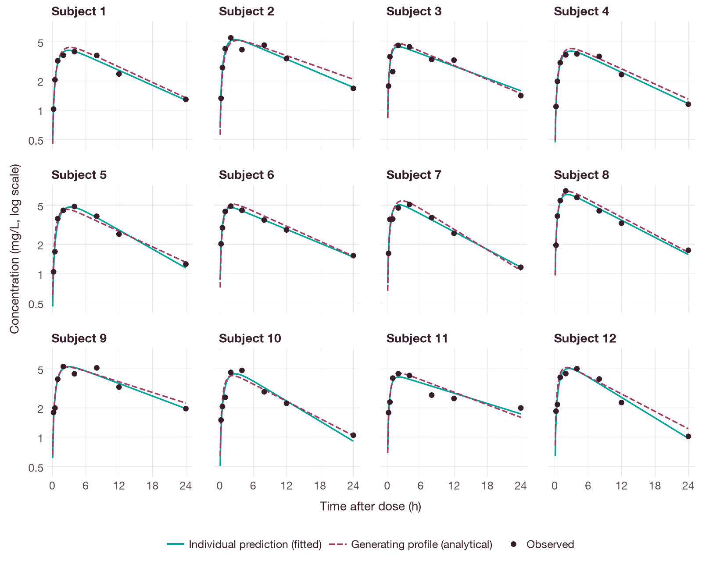
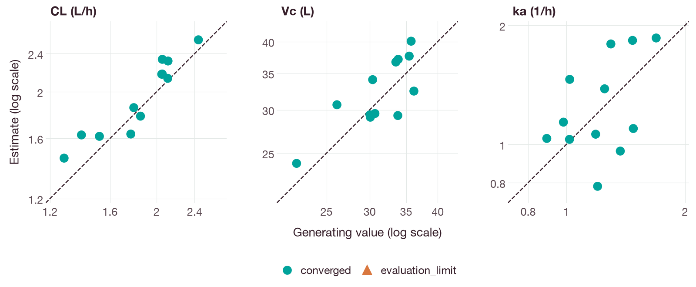
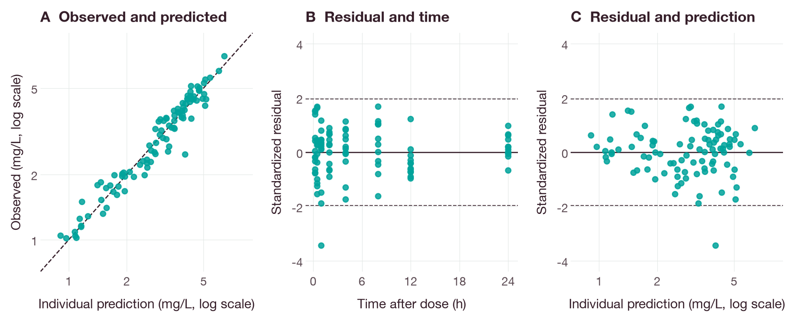
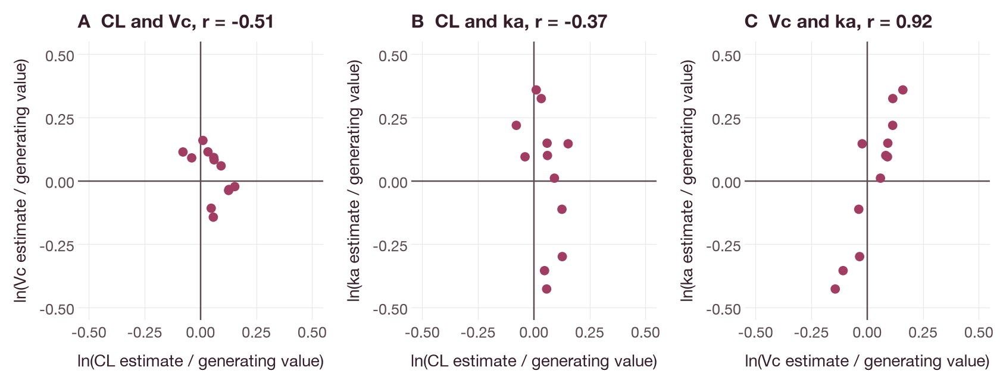

# Individual fitting of synthetic oral pharmacokinetic data

This tutorial fits a one-compartment model with first-order absorption to
synthetic pharmacokinetic (PK) data from 12 subjects and 96 observations. The
data are generated in the notebook by a seeded, independent analytical
generator. Each subject receives an oral dose and has its own clearance, volume
and absorption rate constant; additive and proportional observation noise is
then added. No dataset or download is required. The equations and the generated
data are distributed under the Apache-2.0 license.

Each subject is fitted independently with an additive and proportional
(combined) residual error model [1]. Predictions and residuals are inspected
with the graphical checks recommended for continuous pharmacometric data [2],
and a standalone HTML report and a CSV file of parameter estimates are saved.
These individual fits illustrate the workflow; they do not estimate a population
distribution or clinical effects.

## Start the notebook

Install the Python package with the analysis and notebook extras as described in
[Python installation](../installation.md#python), then run from the root of the
checkout:

```sh
python -m jupyterlab docs/tutorials/oral-pk-analysis.ipynb
```

Run the cells in order. Outputs are written to `oral-pk-output` in the kernel's
starting directory. The model equations are `dA_depot/dt = -ka*A_depot` and
`dA_central/dt = ka*A_depot - cl/vc*A_central`, with `cp = A_central/vc`. Here
`A_depot` and `A_central` are the amounts in the depot and central compartments,
`ka` is the absorption rate constant, `cl` is the clearance, `vc` is the central
volume of distribution and `cp` is the concentration in the central
compartment.

## Generate and inspect observations

```python
from pathlib import Path
import json
import sys

import qspquest as qq

root = next(p for p in [Path.cwd(), *Path.cwd().parents]
            if (p / 'docs/examples/oral_pk_analysis.py').is_file())
sys.path.insert(0, str(root / 'docs/examples'))
from oral_pk_analysis import synthetic_subjects, parameter_specs

output = Path.cwd() / 'oral-pk-output'
output.mkdir(exist_ok=True)
model, subjects, truth = synthetic_subjects(
    (root / 'examples/synthetic/absorption.qsp').read_text())
assert len(subjects) == 12
assert sum(len(s['observations']) for s in subjects) == 96
print('12 synthetic subjects, 96 observations; seed 2026')
```

## Fit one subject

Clearance, central volume and absorption rate constant are estimated by
maximizing the likelihood within parameter bounds. The additive and proportional
residual standard deviations are fixed.

```python
parameters = parameter_specs()
error = {'model': 'normal', 'additive': 0.2, 'proportional': 0.1}
individual = model.fit_data(subjects[0]['run'], subjects[0]['observations'],
                            parameters, error, method='derivative_free',
                            max_iterations=400, max_simulations=5000)
print(individual['status'], individual['parameters'])
```

## Inspect predictions and residuals

```python
diagnostics = qq.fit_diagnostics(individual)
print(diagnostics['residual_summary'], diagnostics['warnings'])
import matplotlib.pyplot as plt
rows = individual['fitted_observations']
plt.scatter([r['time'] for r in rows], [r['observed'] for r in rows], label='Observed')
plt.plot([r['time'] for r in rows], [r['prediction'] for r in rows], label='Fitted')
plt.xlabel('Time (h)')
plt.ylabel('Concentration (mg/L)')
plt.legend()
plt.show()
```

## Fit the other subjects

The same model, parameter bounds and residual error model are used for every
subject. With the seeded synthetic data, all 12 fits return `converged`. With
other data or another fitting configuration, the status of each fit should be
checked and retained in the exported table.

```python
fits = [individual]
for subject in subjects[1:]:
    fits.append(model.fit_data(subject['run'], subject['observations'],
                                parameters, error, method='derivative_free',
                                max_iterations=400, max_simulations=5000))
print({status: sum(f['status'] == status for f in fits)
       for status in sorted({f['status'] for f in fits})})
```

Figure 1 compares the observations of each subject with the individual
predictions at the estimated parameters and with the noise-free profile from
which the observations were generated. The individual predictions follow the
observations, and the deviations from the generating profile reflect the
observation noise in eight samples per subject.



**Figure 1.** Synthetic observations (points) after a 180 mg oral dose, one
panel per subject. Solid lines are the individual predictions simulated with
`analytic_linear_pk` at the estimated `cl`, `vc` and `ka`; dashed lines are the
analytical profiles at the parameter values used to generate the data, without
observation noise. An asterisk after the subject number marks a fit whose
status is not `converged`.

The estimates are compared with the generating values in Figure 2. The
deviations are largest for `ka`, because only four of the eight samples, from
0.25 to 2 hours, precede the peak concentration.



**Figure 2.** Individual estimates of `cl`, `vc` and `ka` against the values
used to generate the synthetic data, on logarithmic scales; each point is one
subject. The dashed line is the line of identity. The marker shows the status
returned by the fit.

Figure 3 shows the goodness-of-fit plots for all 96 observations. The
standardized residuals are the residuals divided by the standard deviation of
the fixed residual error model at the predicted concentration.



**Figure 3.** Goodness of fit for the 12 individual fits. (A) Observed
concentrations against individual predictions, with the line of identity
(dashed). (B) Standardized residuals, `(observed − predicted) / √(0.2² +
(0.1 · predicted)²)`, against time after dose. (C) Standardized residuals
against the individual prediction. The dashed lines in B and C are at ±1.96.

The estimation errors are not independent between parameters (Figure 4). Across
subjects, an overestimate of `vc` is accompanied by an overestimate of `ka`. With
few samples during absorption, a larger volume and faster absorption predict
similar concentrations near the peak, so these two parameters are not well
determined separately by the data of a single subject.



**Figure 4.** Logarithm of the ratio of the estimate to the generating value
for each pair of parameters; each point is one subject. `r` is the Pearson
correlation coefficient across the 12 subjects.

## Save and inspect the report

```python
import csv

for name, value in [('synthetic-truth', truth), ('subjects', subjects), ('fits', fits)]:
    (output / (name + '.json')).write_text(json.dumps(value, indent=2, allow_nan=False))
with (output / 'estimates.csv').open('w', newline='') as stream:
    writer = csv.DictWriter(stream, fieldnames=['subject', 'status', 'cl_L_h', 'vc_L', 'ka_per_h'])
    writer.writeheader()
    for subject, fit in zip(subjects, fits):
        writer.writerow(dict(subject=subject['id'], status=fit['status'],
                             cl_L_h=fit['parameters']['cl']['value'],
                             vc_L=fit['parameters']['vc']['value'],
                             ka_per_h=fit['parameters']['ka']['value']))
qq.write_analysis_report(output / 'report.html', title='Synthetic oral PK: subject 1',
                         fit=individual)
print(output / 'report.html')
```

`report.html` can be opened locally to inspect the estimates, predictions,
residuals and fit status for the first subject. `estimates.csv` contains the
estimates for all 12 subjects. The JSON files contain the synthetic observations,
the parameter values used to generate them and the complete fit results,
including engine identities. Population fitting and other analyses are described
in the [Python API](../api/python.md).

## Figures

The figures were produced by `docs/examples/oral_pk_analysis_figures.py`, which
uses plotnine with the shared style in `docs/examples/figure_style.py`. The
script generates the synthetic subjects, repeats the individual fits and checks
the simulated profiles against the analytical solution and the fitted values
against the fit results before drawing. It writes no files other than the
figures. Install the `docs` extra (`python -m pip install '.[docs]'`) to run it.

## References

1. Karlsson MO, Beal SL, Sheiner LB. Three new residual error models for
   population PK/PD analyses. *J Pharmacokinet Biopharm*. 1995;23(6):651–672.
   [doi:10.1007/BF02353466](https://doi.org/10.1007/BF02353466)
2. Nguyen THT, Mouksassi MS, Holford N, et al. Model evaluation of continuous
   data pharmacometric models: metrics and graphics. *CPT Pharmacometrics Syst
   Pharmacol*. 2017;6(2):87–109.
   [doi:10.1002/psp4.12161](https://doi.org/10.1002/psp4.12161)
