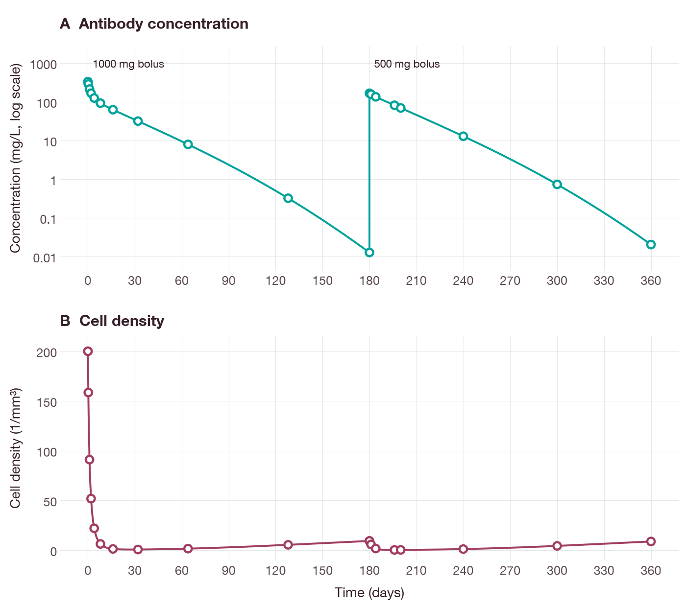
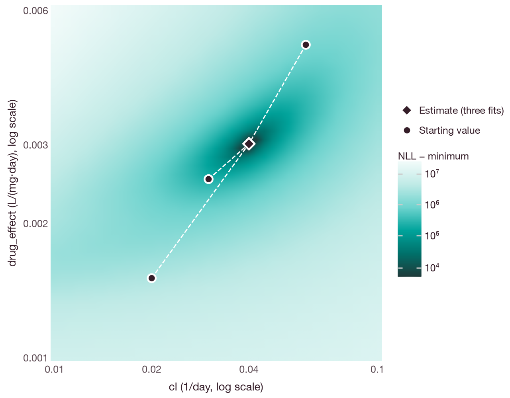

# Fit concentration and cell measurements together

This tutorial estimates two parameters of a coupled synthetic antibody–cell
model from both concentration and cell-count measurements, and saves the model,
doses and observations in an Open Modeling EXchange (OMEX) archive [3]. Fitting
both endpoints at once, rather than fixing the PK parameters first, follows the
simultaneous approach to PK/PD modeling [1, 2]. The
parameters and measurements are illustrative, not clinical data.

## Prerequisites and installation

Building the Python package from the source checkout requires Python 3.11 or
later and a Rust toolchain. Run these commands at the root of the checkout. The
interchange extra installs libSBML; on minimal Debian or Ubuntu systems, install
`libexpat1` if libSBML reports that it is missing. No downloads or accounts are
required. The complete
[synthetic model](../../conformance/models/paired-antibody-cell.json) and
[runnable client](../examples/paired_endpoint_fit.py) are included with this
workflow.

```sh
python3 -m venv .venv-paired
.venv-paired/bin/python -m pip install '.[interchange]'
.venv-paired/bin/python docs/examples/paired_endpoint_fit.py prepare --output paired-input
```

`prepare` computes an independent reference solution with the fourth-order
Runge–Kutta method (RK4) at 512 and 1024 steps per day, and stops if the two
solutions differ by more than `1e-7 + 1e-7*abs(fine_value)` at any sample. It
then records the 40 synthetic observations and three fit requests that use the
backward differentiation formula (BDF) solver, and writes `prepared.json`,
`paired-fit.omex` and `preparation.json`.

Then run the fits:

```sh
.venv-paired/bin/python docs/examples/paired_endpoint_fit.py run \
  --prepared paired-input/prepared.json \
  --output paired-results
```

Both output directories must be new; existing files are never overwritten.
`run` verifies that the prepared files are unchanged, then runs and saves every
fit. The run can take several minutes.

## Model and observations

The two equations, in physical units, are

```text
dC/dt = -cl*C - cell_loss*C*B
dB/dt = baseline*turnover - drug_effect*C*B - turnover*B
```

`C` is the antibody concentration in mg/L, `B` is the cell density in 1/mm³,
and time is in days. A bolus increases `C` by dose/volume, whereas `B` remains
continuous. The synthetic schedule gives 1000 mg on day 0 and 500 mg on day 180,
with follow-up to day 360. Observations are taken immediately before and
immediately after each bolus.

The estimated parameters are `cl` in 1/day and `drug_effect` in L/(mg·day). The
volume, cell-dependent concentration loss, baseline and cell turnover are fixed.
Each observation declares its own residual error: concentration uses an
additive standard deviation (SD) of 0.05 mg/L and cell density uses an additive
SD of 0.2/mm³. The errors are independent and normal, with no proportional
component. Because the units differ, the two endpoints cannot share one SD.

The data are long-format records with exactly the fields `row`, `endpoint` and
`value`. `row` is the zero-based index into the time grid of the result, not a
time. The endpoint mapping supplies the output name, value unit and residual
error. `individual_fit_dataset(records, template, endpoints=...)` preserves row
order and rejects duplicate row–output pairs, missing values, unknown endpoints
and extra columns. Empty samples and an explicit observation grid are required.
Data are never sorted, interpolated or imputed, and units are never inferred.

`dataset.plan(model)` and `CompiledSensitivities.plan_fit(request)` check the
parameters, bounds, units, observations and limits without simulating.
`CompiledSensitivities.objective(objective_request)` evaluates the likelihood
and its gradient without optimization. `dataset.fit(model)` returns the full fit
result, the plan and the row mapping. Check `fit.status` for convergence.

## Archive contract

`export_omex(model, scenarios, fits={name: native_request})` selects
`qspquest.omex.individual-fit/v1` when at least one fit is supplied. The archive
contains the model in Systems Biology Markup Language (SBML) and the exact fit
requests in JSON, including parameters, starting values, bounds, units, error
models, optimizer limits and doses. Both import and export validate the
requests. A fit is selected with `archive.plan_fit(name)` or `archive.fit(name)`.

Archived fits support uncensored individual fitting with a fixed additive normal
SD for each endpoint, no priors, and either sensitivity solver. Population fits,
lognormal or proportional errors, censoring and priors are not supported in the
archive; the regular fitting API supports more options. Archives without `fits`
use the original run-only `qspquest.omex/v1` format.

This format is a QSPQuest extension to OMEX. It does not run arbitrary
Simulation Experiment Description Markup Language (SED-ML) files or import
projects from other estimation software.

## Expected output and interpretation

The final `report.json` records three BDF fits from different starting points
and five failure controls. `passed: true` requires native convergence, recovery
within 1e-5 for `cl` and 1e-6 for `drug_effect`, complete observations,
agreement with the independent reference solution and the expected errors from
the failure controls. A failed check exits with status 1 and retains the failed
cases. Failures should not be removed, and limits should not be relaxed, to
obtain a pass.

The synthetic observations are the independent RK4 solution at the true
parameters, `cl` = 0.04 1/day and `drug_effect` = 0.003 L/(mg·day), without
measurement error. All three fits recover these values, and the curves simulated
at the estimates pass through the observations of both endpoints (Figure 1).
Figure 2 shows the negative log-likelihood within the bounds of the two
estimated parameters. It increases least along a diagonal on which a larger
`cl` is paired with a larger `drug_effect`, and the three starting points lead
to the same estimate.



**Figure 1.** Synthetic observations (open circles) and the curves simulated
with the BDF solver at the estimates of `diffsol_bdf_start_0` (lines). The
observations are the RK4 reference solution at the true parameters, without
measurement error. (A) Antibody concentration on a logarithmic scale; the
pre-dose value of zero on day 0 is not shown. The vertical segment on day 180
is the second bolus. (B) Cell density. Both panels share the time axis.



**Figure 2.** Negative log-likelihood of the 40 observations minus its minimum
(color, logarithmic scale), evaluated with `CompiledSensitivities.objective` on
a 41 × 41 grid within the parameter bounds. Circles are the three starting
values. The diamond is the estimate, which is the same for all three fits within
the recovery limits. Dashed lines join each starting value to its estimate; they
are not optimizer paths.

The figures were produced by `docs/examples/paired_endpoint_fitting_figures.py`,
which runs `prepare` and `run` in a temporary directory and checks every fit
against the true values and the independent reference solution before drawing.
The script requires the `interchange` and `docs` extras.

Each case retains its full native result, prediction grid and diagnostic rows.
The diagnostics include the source row, result row, endpoint, time and side,
observed and predicted values, units, residuals, standardized residuals and the
negative log-likelihood sum for each endpoint. These are ordinary individual-fit
residuals, not conditional weighted residuals (CWRES) or normalized prediction
distribution errors (NPDE). Negative contributions to the negative
log-likelihood can occur when the SD is small, because the normalized density
can exceed one.

`evaluation_limit`, `iteration_limit` and `line_search_failed` indicate failed
convergence. Check the starting points, bounds, data and residual error
assumptions before raising limits. If the compiled model changes, run `prepare`
again. Incorrect units or rows are rejected with an error.

Recovery of known parameters from synthetic data does not show that they can be
identified from real data, and it does not support a dosing recommendation. When
regimens are compared, state whether follow-up is measured from day 0 or from
the last dose.

## References

1. Sheiner LB, Stanski DR, Vozeh S, Miller RD, Ham J. Simultaneous modeling of
   pharmacokinetics and pharmacodynamics: application to d-tubocurarine.
   *Clin Pharmacol Ther*. 1979;25(3):358–371.
   [doi:10.1002/cpt1979253358](https://doi.org/10.1002/cpt1979253358)
2. Zhang L, Beal SL, Sheiner LB. Simultaneous vs. sequential analysis for
   population PK/PD data I: best-case performance. *J Pharmacokinet
   Pharmacodyn*. 2003;30(6):387–404.
   [doi:10.1023/B:JOPA.0000012998.04442.1f](https://doi.org/10.1023/B:JOPA.0000012998.04442.1f)
3. Bergmann FT, Adams R, Moodie S, et al. COMBINE archive and OMEX format: one
   file to share all information to reproduce a modeling project. *BMC
   Bioinformatics*. 2014;15:369.
   [doi:10.1186/s12859-014-0369-z](https://doi.org/10.1186/s12859-014-0369-z)
