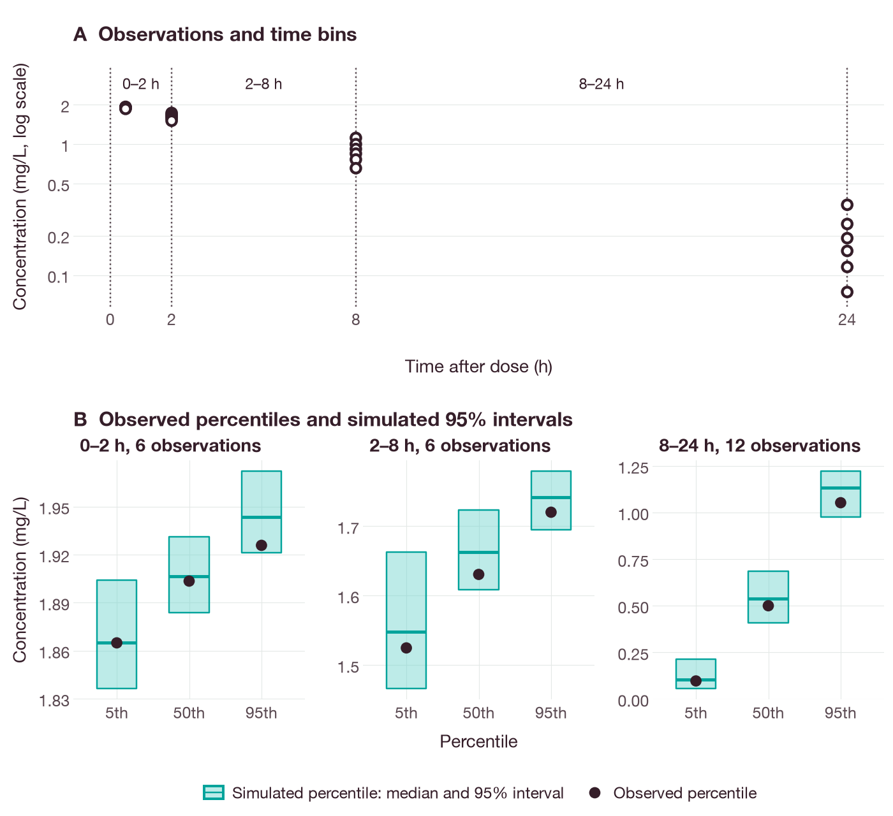

# Visual predictive checks with parallel simulation

This tutorial compares concentrations observed in a synthetic cohort with
concentrations simulated from a one-compartment model after a bolus dose, using a
visual predictive check (VPC) [1, 2, 3]. The observations are synthetic, not
patient data. The replicates can be simulated in parallel; the result does not
depend on the number of workers. The example requires the QSPQuest source
archive and CPython 3.10+. For the source installation below, Rust 1.89 or newer,
Cargo and a native compiler must be on `PATH`.

The [complete runnable example](../examples/parallel_vpc.py) reads the included
[synthetic model](../../conformance/models/synthetic-one-compartment.qsp).

## Install and run

Run the following from the root of the extracted project, in a new virtual
environment:

```sh
python3 -m venv .venv
. .venv/bin/activate
python -m pip install .
qspquest-doctor --analysis --json
python docs/examples/parallel_vpc.py \
  --workers 1 --output vpc-serial.json
python docs/examples/parallel_vpc.py \
  --workers 2 --output vpc-parallel.json
```

Workers are native threads; each runs one simulation at a time. The default is
one worker; `workers` accepts 1..8. Start with two workers and measure the run
time before adding more; the speedup depends on the workload.

Both runs should print `status: complete`, 16 successful replicates, zero failed
replicates and 102 native simulations: six baseline simulations and 16
replicates of six subjects each. The script does not overwrite an existing
output file; delete the file or choose another name before rerunning. All
computation is local; only `pip install` downloads files.

## Inspect and compare results

The synthetic design uses a 6 mg bolus, a volume of distribution of 3 L and a
typical clearance of 0.3 L/h. Individual clearances in the observed cohort range
from 0.22 to 0.42 L/h. Concentration is expressed in mg/L and follows
`2 * exp(-clearance / 3 * time)` before perturbation. The VPC samples log
clearance with a variance of 0.09 and adds residual error with a standard
deviation (SD) of 0.02 mg/L. The saved `bins`
contain observed and simulated concentration quantiles and replicate intervals.

The HTML report shows these intervals as lower and upper replicate bands. The
bands assume that the supplied population parameters, variability and residual
error are exact; if these values were estimated, the bands do not include their
estimation uncertainty.

The observations are grouped into three time bins (Figure 1A). The 0–2 h and
2–8 h bins each contain the six samples taken at 0.5 h and 2 h, respectively;
the 8–24 h bin pools the samples taken at 8 h and 24 h. In each bin, the
observed 5th, 50th and 95th percentiles lie within the 95% intervals of the
corresponding simulated percentiles (Figure 1B).



**Figure 1.** Visual predictive check of the synthetic cohort (six subjects,
24 observations). (A) Observed concentrations (open circles) on a logarithmic
scale; dotted lines are the bin edges at 0, 2, 8 and 24 h. (B) For each bin and
percentile, the box spans the 95% interval of the percentile across 16 simulated
replicates, and the line inside the box is its median across replicates. Filled
circles are the percentiles of the observed concentrations. With 16 replicates,
the interval limits are themselves imprecise. The simulated values are identical
with one and two workers.

The figure was produced by `docs/examples/parallel_predictive_checks_figures.py`,
which runs the example with one and two workers in a temporary directory,
checks the saved results against the values given in this tutorial and recomputes
the observed percentiles before drawing. Install the `docs` extra
(`python -m pip install '.[docs]'`) to run it.

The following check confirms that the worker count does not change the
scientific results or the random number streams:

```sh
python - <<'PY'
import json
from pathlib import Path
a = json.loads(Path('vpc-serial.json').read_text())
b = json.loads(Path('vpc-parallel.json').read_text())
for key in ('bins', 'replicate_records', 'identity', 'seed', 'simulations'):
    assert a[key] == b[key], key
assert a['successful_replicates'] == b['successful_replicates'] == 16
print('Scientific results, stream receipts and identity match.')
PY
```

Results do not depend on the worker count, because each replicate draws from
its own random substream, identified by its `stream_id`. `execution.workers`
records the count used. To reproduce results exactly, use the same QSPQuest
version and platform; results may differ slightly across platforms.

## Failures, cancellation and restart

A failed replicate is recorded with its error code and message, the overall
status becomes `incomplete`, and confidence intervals are null. Medians from the
successful replicates are intended for diagnosis only and are not a final
result. Exhausting the budget returns an error and no report.

Use `control=qspquest.AnalysisControl(checkpoint='vpc-checkpoint.json',
checkpoint_every=1)` when calling the Python API to save completed work. A
progress callback can call `control.cancel()`; running workers stop after their
current simulation. To resume, pass a new control with `resume=True`; the worker
count may change, but the inputs, code and software versions must match. Work
repeated on resume counts against the original budget, so the budget should
include a margin; if the budget is exhausted, start a new analysis with a larger
budget.

VPC observation-draw storage is limited to two million cells.

## References

1. Holford N. The visual predictive check: superiority to standard diagnostic
   (Rorschach) plots. *PAGE*. 2005;14:Abstr 738.
2. Post TM, Freijer JI, Ploeger BA, Danhof M. Extensions to the visual
   predictive check to facilitate model performance evaluation. *J Pharmacokinet
   Pharmacodyn*. 2008;35(2):185–202.
   [doi:10.1007/s10928-007-9081-1](https://doi.org/10.1007/s10928-007-9081-1)
3. Bergstrand M, Hooker AC, Wallin JE, Karlsson MO. Prediction-corrected visual
   predictive checks for diagnosing nonlinear mixed-effects models. *AAPS J*.
   2011;13(2):143–151.
   [doi:10.1208/s12248-011-9255-z](https://doi.org/10.1208/s12248-011-9255-z)
