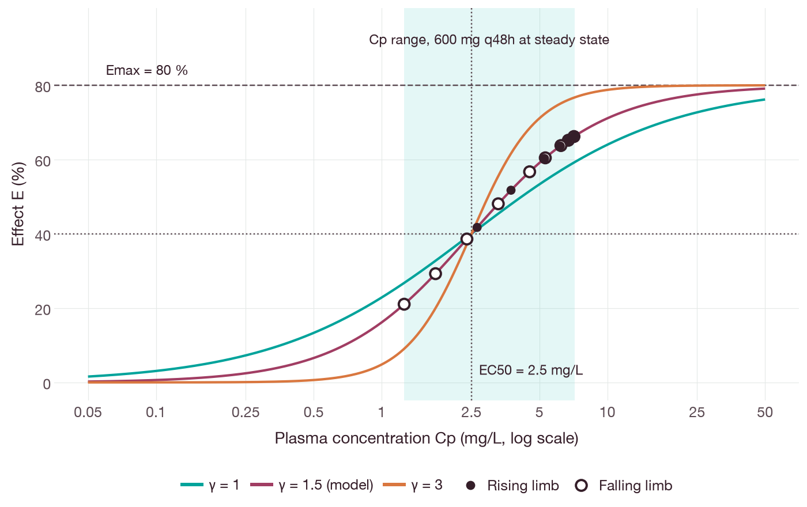
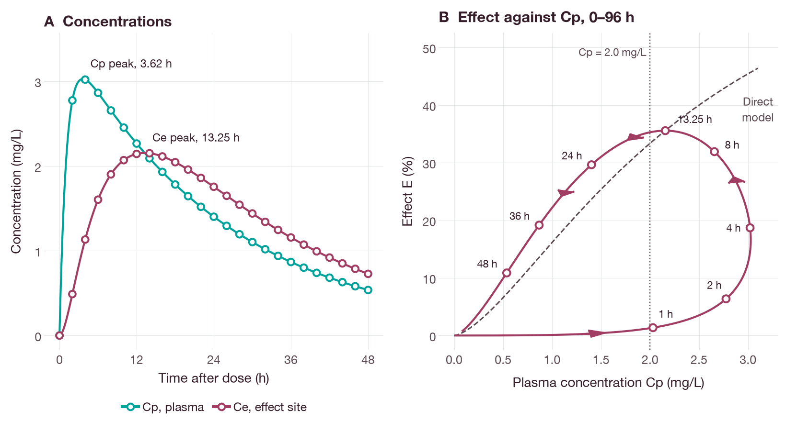
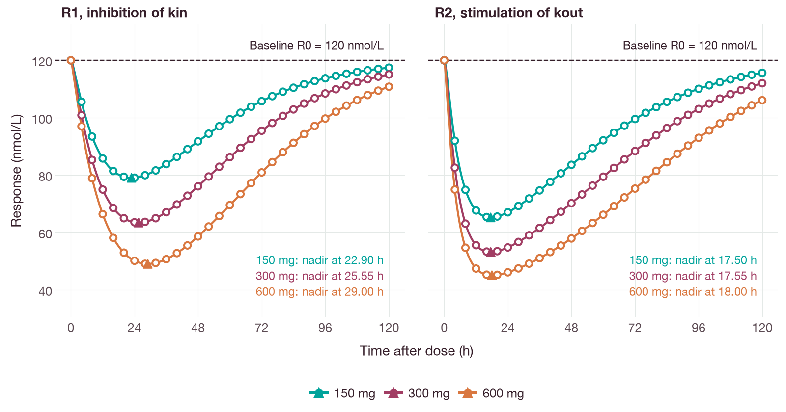
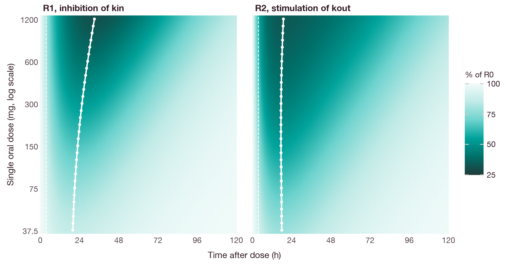
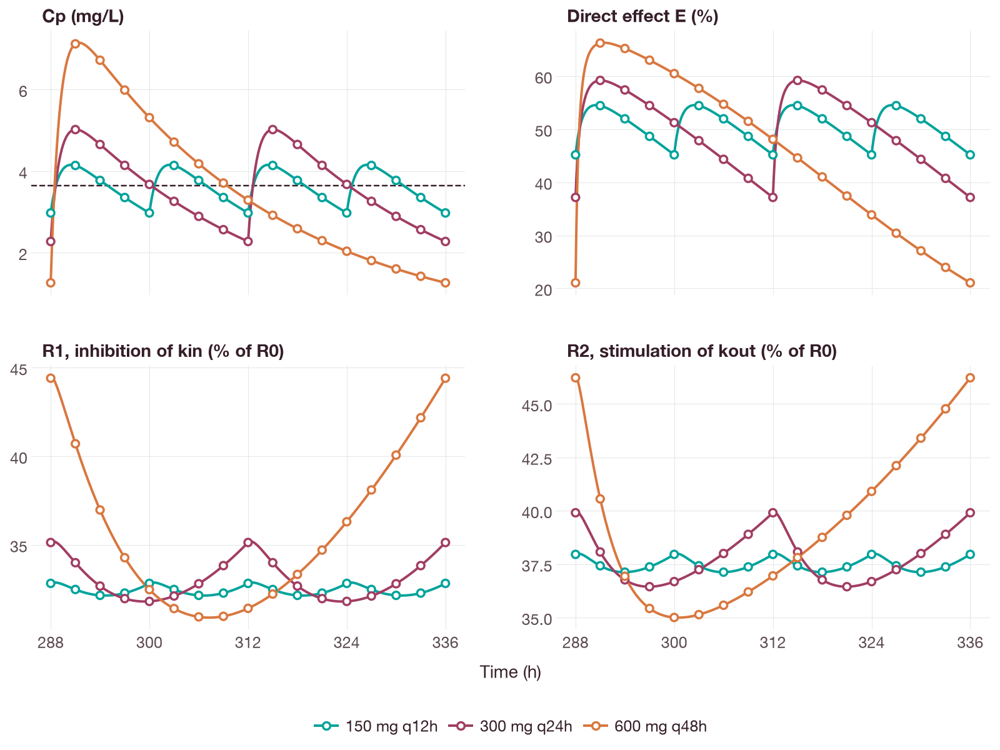
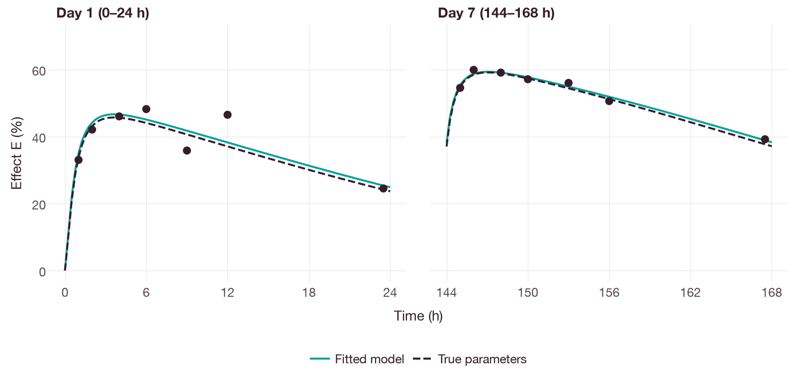

# Direct, effect-compartment and indirect response models

## Objective

This tutorial links one oral pharmacokinetic (PK) model to three types of
pharmacodynamic (PD) model:

1. a direct sigmoid Emax model driven by plasma concentration;
2. an effect-compartment model, in which the effect lags plasma concentration;
3. indirect response models, in which the drug inhibits the production of a
   response or stimulates its loss.

The tutorial then compares three dose regimens with the same average daily
dose on the response endpoints. Each simulated profile is compared with a
closed-form solution or with an independent numerical solution. One section
estimates Emax and EC50 from synthetic response data.

The drug, its parameters and all data in this tutorial are synthetic. They do
not describe a real compound and support no clinical conclusion.

## Background

A PK/PD model has two parts. The PK model describes how plasma concentration
changes with time after a dose. The PD model describes how the measured
response depends on concentration. Derendorf and Meibohm classified PK/PD
models by four attributes. The first is whether the effect site
is linked directly or indirectly to the measured concentration. The second is
whether the response follows concentration directly or indirectly [5].

In a *direct response* model the effect is a function of the current plasma
concentration. Holford and Sheiner reviewed such concentration-effect models
and their clinical application [1]. The sigmoid Emax model is a common form
of this function; its Hill coefficient sets the steepness of the curve [6].
The effect then peaks at the same time as plasma concentration.

In many data sets the effect peaks later than plasma concentration. Sheiner and
colleagues described this delay with a hypothetical *effect compartment*. It is
linked to plasma by a first-order process, and its drug mass does not enter
the PK solution [2]. The effect-site concentration then drives a sigmoid Emax
function. When the response lags concentration, a plot of response against
concentration forms a counterclockwise loop, or *hysteresis* [6]. A large
equilibration rate constant `ke0` means that the effect-site concentration
closely follows plasma concentration. A small `ke0` means slow equilibration [6].

*Indirect response* models describe drugs that alter the production or the loss
of a mediator of the measured response. Dayneka, Garg and Jusko compared four
basic forms: inhibition or stimulation of the production rate `kin`, and
inhibition or stimulation of the loss rate constant `kout` [3]. Their simulated
responses had a slow onset and a slow return to baseline. The time of maximal
response depended on the model and on the dose [3]. Sharma and Jusko reviewed
the properties and clinical uses of these models [4]. This tutorial uses two of
the four forms: inhibition of `kin` and stimulation of `kout`.

## Models

### Pharmacokinetics

All three models share one PK model: first-order absorption from a depot into
one compartment with first-order elimination.

```text
dA_depot/dt   = -ka * A_depot
dA_central/dt =  ka * A_depot - (CL / V) * A_central
Cp            =  A_central / V
```

`A_depot` and `A_central` are drug amounts (mg). `Cp` is plasma concentration
(mg/L). Time `t` is in hours (h). Each dose `D` (mg) adds `F * D` to the depot.

| Symbol | Meaning | Value | Unit |
| --- | --- | --- | --- |
| `CL` | clearance | 2.4 | L/h |
| `V` | volume of distribution | 60 | L |
| `ka` | absorption rate constant | 0.9 | 1/h |
| `F` | oral bioavailability | 0.7 | dimensionless |

The elimination rate constant is `k = CL/V = 0.04` 1/h. The elimination
half-life is `ln(2)/k = 17.3` h (analytical).

### Direct sigmoid Emax

```text
E = Emax * (Cp / EC50)^gamma / (1 + (Cp / EC50)^gamma)
```

`E` is the effect (%), with a baseline of zero. `Emax` is the maximum effect
(%). `EC50` is the concentration that gives half of `Emax` (mg/L). `gamma` is
the dimensionless Hill coefficient.
The values are `Emax = 80` %, `EC50 = 2.5` mg/L and `gamma = 1.5`. This form is
algebraically equal to `Emax * Cp^gamma / (EC50^gamma + Cp^gamma)`.

Model file: [direct-emax.qsp](../examples/pk-pd-response/direct-emax.qsp).

```text
definitions
  conc = central / v [mg/L]

outputs
  cp = conc [mg/L]
  effect = emax * (conc / ec50)^hill / (1 + (conc / ec50)^hill) [%]
```

The `definitions` block names the plasma concentration once. The output
`effect` uses it directly.

### Effect compartment

```text
dCe/dt = ke0 * (Cp - Ce)
E      = Emax * (Ce / EC50)^gamma / (1 + (Ce / EC50)^gamma)
```

`Ce` is the effect-site concentration (mg/L), with `Ce(0) = 0`. `ke0` is the
first-order equilibration rate constant (1/h). The value is `ke0 = 0.15` 1/h,
which gives an equilibration half-life `ln(2)/ke0 = 4.62` h (analytical). The
Emax parameters are those of the direct model. `Ce` is a concentration state;
it does not remove drug from the central compartment.

Model file: [effect-compartment.qsp](../examples/pk-pd-response/effect-compartment.qsp).

```text
states
  depot = 0 [mg]
  central = 0 [mg]
  ce = 0 [mg/L]

dynamics
  d/dt(depot) = -ka * depot
  d/dt(central) = ka * depot - cl / v * central
  d/dt(ce) = ke0 * (conc - ce)
```

### Indirect response from baseline

```text
dR1/dt = kin * (1 - Imax * Cp / (IC50 + Cp)) - kout * R1
dR2/dt = kin - kout * (1 + Smax * Cp / (SC50 + Cp)) * R2
```

`R1` and `R2` are concentrations of a response mediator (nmol/L). `R1` is the
response when the drug inhibits `kin`. `R2` is the response when the drug
stimulates `kout`. Both start at the baseline `R0`. Before dosing the system is
at steady state, so `kin = R0 * kout`.

| Symbol | Meaning | Value | Unit |
| --- | --- | --- | --- |
| `R0` | baseline response | 120 | nmol/L |
| `kout` | first-order loss rate constant | 0.08 | 1/h |
| `kin` | zero-order production rate, `R0 * kout` | 9.6 | nmol/(L·h) |
| `Imax` | maximum fractional inhibition of `kin` | 0.9 | dimensionless |
| `IC50` | concentration at half of `Imax` | 1.2 | mg/L |
| `Smax` | maximum fractional stimulation of `kout` | 2.5 | dimensionless |
| `SC50` | concentration at half of `Smax` | 1.8 | mg/L |

The turnover half-life of the response is `ln(2)/kout = 8.66` h (analytical).
At a constant concentration `C`, the steady states are
`R1 = R0 * (1 - Imax*C/(IC50 + C))` and `R2 = R0 / (1 + Smax*C/(SC50 + C))`.

Model file: [indirect-response.qsp](../examples/pk-pd-response/indirect-response.qsp).

```text
individual
  kin = r0 * kout [nmol/(L.h)]

states
  r_kin = (r0) [nmol/L]
  r_kout = (r0) [nmol/L]

definitions
  inhibition = imax * conc / (ic50 + conc) [1]
  stimulation = smax * conc / (sc50 + conc) [1]

dynamics
  d/dt(r_kin) = kin * (1 - inhibition) - kout * r_kin
  d/dt(r_kout) = kin - kout * (1 + stimulation) * r_kout
```

The parenthesized initial value `(r0)` is an expression, so the initial state
follows the bound value of `r0`. This model also declares `central` as a dosing
target with `input_central` in its derivative. The script uses that target only
for the constant-concentration check.

## Dosing

Time is measured from the first dose at 0 h. Doses are oral boluses into the
depot. The bioavailability `F = 0.7` is the dosing scale in each model:

```text
dosing
  depot [mg] bolus = f_oral
```

The script uses these dose schedules:

| Purpose | Schedule | Duration |
| --- | --- | --- |
| Direct and effect-compartment profiles | 300 mg single dose | 48 h and 96 h |
| Indirect response, dose dependence | 150, 300 or 600 mg single dose | 120 h |
| Regimen comparison | 300 mg every 24 h (q24h), 14 doses | 336 h |
| Regimen comparison | 150 mg every 12 h (q12h), 28 doses | 336 h |
| Regimen comparison | 600 mg every 48 h (q48h), 7 doses | 336 h |
| Emax fit | 300 mg q24h, 7 doses | 168 h |

All three comparison regimens give an average of 300 mg/day. The steady-state
summaries use the window 288–336 h (days 13 and 14). This window contains one
full q48h interval, two q24h intervals and four q12h intervals. The script
compares each profile in this window with the profile 48 h earlier. The largest
difference was below 2e-4 mg/L for `Cp` and below 2e-3 nmol/L for both
responses (simulated), so the profiles are periodic in this window.

A repeated regimen is one administration record with a `repeat` field:

```python
from pathlib import Path

import qspquest as qq

model = qq.CompiledModel(Path("docs/examples/pk-pd-response/indirect-response.qsp").read_text())
dose = qq.bolus("depot", 300, "mg")
dose["repeat"] = {"interval": qq.quantity(24, "h"), "additional": 13}
request = qq.run_request(end=336, times=[0, 24, 312, 336], administrations=[dose],
                         rtol=1e-10, atol=1e-12)
result = model.run(request)
for column in result["outputs"]:
    print(column["name"], column["unit"], [round(v, 3) for v in column["values"]])
```

Run from the QSPQuest checkout root, this prints:

```text
cp mg/L [0.0, 1.402, 2.273, 2.273]
r_kin nmol/L [120.0, 63.559, 42.156, 42.156]
r_kout nmol/L [120.0, 54.787, 47.887, 47.887]
```

The values at 312 h and 336 h are equal because both are troughs of a
periodic profile. The oral dose given at 312 h has not yet been absorbed at
that time.

## Running the example

The [example script](../examples/pk_pd_response_models.py) requires Python 3.10
or newer, the [source-build prerequisites](../installation.md#install-from-a-checkout),
and NumPy and SciPy for the reference solutions. On macOS or Linux, run these
commands from the QSPQuest checkout root. The installation compiles the native
extension from source.

```sh
python3 -m venv .venv
. .venv/bin/activate
python -m pip install . numpy scipy
python docs/examples/pk_pd_response_models.py --output pk-pd-summary.json
```

The script runs in about 20 s. It prints one line per comparison and then a
rounded JSON summary. `--output` writes the unrounded summary and every
comparison record to the named JSON file. The option is not required. The script exits with status 1 if any comparison fails.

Each simulation uses the backward differentiation formula (BDF) solver with `rtol = 1e-10` and `atol = 1e-12`.
The references are computed as follows:

- **Plasma concentration.** The closed-form oral one-compartment solution,
  summed over doses:
  `Cp(t) = sum_i F*D_i*ka / (V*(ka - k)) * (exp(-k*s_i) - exp(-ka*s_i))`,
  where `s_i = t - t_i` for each dose time `t_i <= t`.
- **Effect-site concentration.** The closed-form solution of the three linear
  equations, summed over doses:
  `Ce(t) = sum_i F*D_i*ka*ke0/V * sum_r exp(-r*s_i) / prod_(q != r)(q - r)`,
  with `r` and `q` taken from the rates `{k, ka, ke0}`.
- **Effects.** The sigmoid Emax function of the closed-form `Cp` or `Ce`.
- **Indirect responses.** An independent four-equation solution with SciPy
  `solve_ivp` (DOP853, `rtol = atol = 1e-12`). Each depot dose is a jump
  between integration segments. The parameters are declared in the script,
  separately from the `.qsp` files.
- **Baseline.** Without a dose, both responses must stay at `R0`.
- **Constant concentration.** A bolus of `3 mg/L * V` into `central` and an
  infusion of `CL * 3 mg/L` hold `Cp` at 3 mg/L. At 240 h, both responses
  must equal their analytical steady states. The remaining transient in `R1`
  is less than 4e-7 nmol/L at that time.

Each comparison uses the bound
`abs(a - b) <= absolute + relative * max(abs(a), abs(b))`.

| Output | Absolute bound | Relative bound |
| --- | --- | --- |
| `cp`, `ce` | 1e-9 mg/L | 1e-7 |
| `effect` | 1e-7 % | 1e-7 |
| `r_kin`, `r_kout` | 1e-6 nmol/L | 1e-7 |

The reported scaled error is the largest value of `abs(a - b)` divided by the
bound. A value at or below 1 passes.

## Results

All values in this section are simulated by the script unless they are
labeled analytical. Peak and nadir times come from a 0.05 h sampling grid.

### Verification

All 34 comparisons passed. The largest scaled error was 0.067, for `R1` at
constant concentration. Excerpt of the printed lines:

```text
pass  0.0089  direct Emax, single dose: effect
pass  0.0196  effect compartment, single dose: ce
pass  4.37e-09  indirect response, no dose: r_kin
pass  0.0125  indirect response, single 300 mg: r_kout
pass  0.067  indirect response, constant cp at 240 h: r_kin
pass  0.0105  regimen 600 mg q48h: r_kin
pass  0  fit_data status is converged
```

### Direct sigmoid Emax after a single 300 mg dose

| Time (h) | Cp (mg/L) | E (%) |
| --- | --- | --- |
| 1 | 2.030 | 33.8 |
| 2 | 2.776 | 43.1 |
| 4 | 3.021 | 45.6 |
| 8 | 2.657 | 41.8 |
| 12 | 2.266 | 37.1 |
| 24 | 1.402 | 23.7 |

The maximum plasma concentration was 3.03 mg/L at 3.60 h. The analytical time
of maximum concentration, `ln(ka/k)/(ka - k)`, is 3.62 h. The maximum effect was
45.7 % at 3.60 h, the same time as the maximum concentration.

Figure 1 shows the concentration–effect relationship. The simulated points
cover one dosing interval of 600 mg q48h at steady state (288–336 h). Points
from the rising and falling limbs of the plasma profile lie on the same curve,
because the direct model has no delay. A larger Hill coefficient gives a
steeper relationship around `EC50` [6].



**Figure 1.** Direct sigmoid Emax relationship with `Emax = 80` % and
`EC50 = 2.5` mg/L. Lines are the Emax function (analytical) for `gamma` = 1,
1.5 and 3. The model uses `gamma = 1.5`; the other two values are shown for
comparison. Points are QSPQuest simulations of the direct model during one
dosing interval of 600 mg q48h at steady state. Filled points are on the
rising limb of `Cp` and open points on the falling limb. The shaded band is the
`Cp` range in that interval (1.26–7.15 mg/L). Dotted lines mark `EC50` and
`Emax/2`; the dashed line marks `Emax`.

### Effect compartment after a single 300 mg dose

| Quantity | Value |
| --- | --- |
| Time of maximum `Cp` | 3.60 h |
| Time of maximum `Ce` and of maximum effect | 13.25 h |
| Maximum effect, effect-compartment model | 35.6 % |
| Maximum effect, direct model at the same `Cp` profile | 45.7 % |
| Equilibration half-life `ln(2)/ke0` (analytical) | 4.62 h |

The plasma concentration equals 2.0 mg/L twice: on the rising limb and on the
falling limb. The script located both times from the closed-form `Cp` and then
simulated at those times.

| Limb | Time (h) | Cp (mg/L) | Ce (mg/L) | E, effect compartment (%) | E, direct model (%) |
| --- | --- | --- | --- | --- | --- |
| Rising | 0.975 | 2.0 | 0.160 | 1.3 | 33.4 |
| Falling | 15.13 | 2.0 | 2.135 | 35.3 | 33.4 |

The signed area of the loop of effect against `Cp`, from 0 to 96 h, was
+68.0 %·mg/L. A positive sign means a counterclockwise loop.

In Figure 2A, `Ce` rises and falls more slowly than `Cp`. In Figure 2B, the
effect traces a counterclockwise loop against `Cp`.



**Figure 2.** Effect-compartment model after a single 300 mg oral dose.
(A) Lines are the closed-form `Cp` and `Ce`; points are QSPQuest simulations
every 2 h. The `Cp` peak time is analytical; the `Ce` peak time is from the
0.05 h grid. (B) Effect against `Cp` from 0 to 96 h. The solid line is the Emax
function of the closed-form `Ce`, and the points are simulations at the
labeled times. Arrows show the direction of time. The dashed line is the direct
model, the Emax function of `Cp`. At the dotted line (`Cp = 2.0` mg/L), the
effect is 1.3 % on the rising limb and 35.3 % on the falling limb.

### Indirect responses after single doses

| Dose (mg) | Time of maximum Cp (h) | R1 nadir time (h) | R1 nadir (nmol/L) | R2 nadir time (h) | R2 nadir (nmol/L) |
| --- | --- | --- | --- | --- | --- |
| 150 | 3.60 | 22.90 | 79.0 | 17.50 | 65.3 |
| 300 | 3.60 | 25.55 | 63.5 | 17.55 | 53.2 |
| 600 | 3.60 | 29.00 | 49.1 | 18.00 | 45.1 |

`R1` is the response with inhibition of `kin`. `R2` is the response with
stimulation of `kout`. Baseline is 120 nmol/L.

Figure 3 shows the time courses for the three doses. Figure 4 extends the
comparison to 31 single doses from 37.5 to 1200 mg. Over this range, the nadir
time of `R1` increased from 19.90 h to 33.15 h. The nadir time of `R2` stayed
between 17.50 h and 19.00 h.



**Figure 3.** Indirect responses after single oral doses of 150, 300 and
600 mg. Lines are the independent SciPy solution (DOP853). Open points are
QSPQuest simulations every 4 h. Triangles mark the nadir on the 0.05 h
simulation grid. The dashed line is the baseline `R0`. Left, `R1` (inhibition
of `kin`); right, `R2` (stimulation of `kout`).



**Figure 4.** Simulated response, as a percentage of `R0`, over time and
single oral dose. Each row is one QSPQuest simulation; the 31 doses are evenly
spaced on a logarithmic scale. Every simulated value agrees with the
independent SciPy solution within the bounds of the verification. The white
line joins the nadir times. The dashed line marks the analytical time of
maximum `Cp` (3.62 h).

At a constant `Cp` of 3 mg/L, the simulated responses at 240 h were 42.86
nmol/L for `R1` and 46.83 nmol/L for `R2`. The analytical steady states are
42.86 and 46.83 nmol/L.

### Regimen comparison at steady state (288–336 h)

The analytical average steady-state concentration is
`F * 300 mg / (CL * 24 h) = 3.65` mg/L for all three regimens.

| Regimen | Cp range (mg/L) | Cp mean (mg/L) | Direct E range (%) | Direct E mean (%) |
| --- | --- | --- | --- | --- |
| 150 mg q12h | 2.97–4.15 | 3.65 | 45.2–54.5 | 50.8 |
| 300 mg q24h | 2.27–5.02 | 3.65 | 37.1–59.2 | 49.9 |
| 600 mg q48h | 1.26–7.15 | 3.65 | 21.1–66.3 | 46.4 |

| Regimen | R1 range (% of R0) | R1 mean (% of R0) | R2 range (% of R0) | R2 mean (% of R0) |
| --- | --- | --- | --- | --- |
| 150 mg q12h | 32.1–32.9 | 32.4 | 37.1–38.0 | 37.5 |
| 300 mg q24h | 31.8–35.2 | 33.0 | 36.4–39.9 | 37.7 |
| 600 mg q48h | 30.9–44.4 | 35.6 | 35.0–46.2 | 39.1 |

Means are time averages over the window, computed with the trapezoidal rule.
A lower response means greater suppression from baseline.

Figure 5 shows the four endpoints over the same window.



**Figure 5.** Four endpoints from 288 to 336 h for three regimens with the same
daily dose of 300 mg. Lines are the closed-form solution (`Cp`, direct effect)
or the independent SciPy solution (`R1`, `R2`). Points are QSPQuest simulations
every 3 h. The dashed line in the `Cp` panel is the analytical average
steady-state concentration, 3.65 mg/L. The vertical scales differ between
panels.

### Estimation of Emax and EC50

The script generated 14 synthetic effect observations during 300 mg q24h
dosing: seven on day 1 (1 to 23.5 h) and seven on day 7 (145 to 167.5 h). Each
observation is the closed-form direct effect plus normal noise with standard
deviation 3 % (seed 20261106). The observations do not depend on the
simulator.

`model.fit_data` estimated `Emax` and `EC50` by maximum likelihood with an
additive normal error of fixed standard deviation 3 %. `gamma` was fixed at
1.5, and the PK parameters were fixed at their true values. This excerpt of
`emax_fit()` in the script shows the parameter and error specifications;
`run` and `observations` are defined there.

```python
parameters = {"emax": {"initial": 50, "lower": 10, "upper": 100, "unit": "%"},
              "ec50": {"initial": 1.0, "lower": 0.2, "upper": 10, "unit": "mg/L"}}
fit = model.fit_data(run, observations, parameters, {"model": "normal", "additive": 3.0})
```

| Parameter | True value | Initial value | Estimate |
| --- | --- | --- | --- |
| `Emax` (%) | 80 | 50 | 78.24 |
| `EC50` (mg/L) | 2.5 | 1.0 | 2.335 |

The fit status was `converged` after 37 simulations. The negative
log-likelihood at the estimate was 35.35.

Figure 6 compares the observations with the fitted and true curves.



**Figure 6.** Effect observations generated for the fitting example (points)
during 300 mg q24h dosing. Each observation is the closed-form effect plus
normal noise (SD 3 %, seed 20261106). The solid line is the QSPQuest simulation
at the estimates (`Emax = 78.24` %, `EC50 = 2.335` mg/L). The dashed line is the
closed-form effect at the true parameter values.

## Figures

The figures were produced by the
[figures script](../examples/pk_pd_response_models_figures.py), which uses
plotnine with the shared [figure style](../examples/figure_style.py). The
script imports the reference solutions from the example script and repeats
each simulation. Before drawing, it asserts every plotted simulated value
against the bounds of the verification and checks the values quoted in the
captions. It runs in about 10 s. Install the `docs` extra (pandas and
plotnine) to run it:

```sh
python -m pip install '.[docs]'
python docs/examples/pk_pd_response_models_figures.py
```

## Interpretation and limitations

**Direct response.** The direct effect rose and fell with plasma
concentration and peaked at the same time. Because the Emax function is
nonlinear, the effect changed less than the concentration in relative terms.
Between 4 h and 24 h, `Cp` fell by 54 % and `E` fell by 48 %.

**Effect compartment.** The maximum effect occurred 9.65 h after the maximum
plasma concentration. At the same plasma concentration of 2.0 mg/L, the effect
was 1.3 % on the rising limb and 35.3 % on the falling limb. The loop was
counterclockwise, as expected when the response lags concentration [6]. The
maximum effect was also lower than in the direct model, because `Ce` did not
reach the peak of `Cp`. A counterclockwise loop does not identify its cause.
Indirect response models also give loops in which concentration precedes
response. When an effect-compartment model was fitted to such responses, its
parameters were dose-dependent [3]. Upton and Mould note that active
metabolites can also cause hysteresis [6].

**Indirect response.** Both responses fell slowly and reached their nadir long
after the maximum concentration. For inhibition of `kin`, the nadir time
increased with dose, from 22.90 h at 150 mg to 29.00 h at 600 mg. For
stimulation of `kout`, the nadir time changed by 0.5 h over the same dose
range. This agrees with the report that the time of maximal response depends
on the model and on the dose [3]. In the model with stimulation of `kout`, the
response approaches its current equilibrium with the rate constant
`kout * (1 + Smax*Cp/(SC50 + Cp))`, which exceeds `kout` while drug is present.
In the model with inhibition of `kin`, this rate constant remains `kout`.

**Regimen comparison.** The three regimens gave the same mean plasma
concentration, 3.65 mg/L. They differed in the fluctuation of concentration
within each interval. The direct effect followed this fluctuation. Its range
was 9.4 percentage points for q12h and 45.2 percentage points for q48h. The
mean direct effect was lower for the less frequent regimens, because the Emax
function is concave in the concentration range reached. The indirect responses
fluctuated much less than the direct effect. The turnover of the response
(half-life 8.66 h) smooths the input from concentration. For inhibition of
`kin`, the range was 0.7 percentage points for q12h and 13.6 percentage points
for q48h. For every endpoint, the least frequent regimen gave the smallest
mean change from baseline. The choice between regimens therefore depends on
which endpoint matters and on whether the trough or the mean response is the
relevant measure.

**Estimation.** The estimates were within 2.2 % (`Emax`) and 6.6 % (`EC50`) of
the true values. They come from one noise realization. The tutorial does not
report standard errors or confidence intervals, and it does not estimate
`gamma`.

**Limitations.** The models are deterministic and include no between-subject variability, no residual error
except in the fitting example, no placebo response, no baseline drift and no
tolerance. Clockwise hysteresis, which is possible with tolerance [6], is not
shown. Steady-state summaries depend on the chosen window and on the 0.05 h
sampling grid. Agreement with the closed-form and independent solutions shows
that the equations were solved accurately. It does not show that the models
describe any real drug.

## References

1. Holford NHG, Sheiner LB. Understanding the dose-effect relationship:
   clinical application of pharmacokinetic-pharmacodynamic models.
   *Clin Pharmacokinet.* 1981;6(6):429–453.
   [doi:10.2165/00003088-198106060-00002](https://doi.org/10.2165/00003088-198106060-00002)
2. Sheiner LB, Stanski DR, Vozeh S, Miller RD, Ham J. Simultaneous modeling of
   pharmacokinetics and pharmacodynamics: application to d-tubocurarine.
   *Clin Pharmacol Ther.* 1979;25(3):358–371.
   [doi:10.1002/cpt1979253358](https://doi.org/10.1002/cpt1979253358)
3. Dayneka NL, Garg V, Jusko WJ. Comparison of four basic models of indirect
   pharmacodynamic responses. *J Pharmacokinet Biopharm.* 1993;21(4):457–478.
   [doi:10.1007/BF01061691](https://doi.org/10.1007/BF01061691)
4. Sharma A, Jusko WJ. Characteristics of indirect pharmacodynamic models and
   applications to clinical drug responses. *Br J Clin Pharmacol.*
   1998;45(3):229–239.
   [doi:10.1046/j.1365-2125.1998.00676.x](https://doi.org/10.1046/j.1365-2125.1998.00676.x)
5. Derendorf H, Meibohm B. Modeling of pharmacokinetic/pharmacodynamic (PK/PD)
   relationships: concepts and perspectives. *Pharm Res.* 1999;16(2):176–185.
   [doi:10.1023/A:1011907920641](https://doi.org/10.1023/A:1011907920641)
6. Upton RN, Mould DR. Basic concepts in population modeling, simulation, and
   model-based drug development: part 3—introduction to pharmacodynamic
   modeling methods. *CPT Pharmacometrics Syst Pharmacol.* 2014;3(1):e88.
   [doi:10.1038/psp.2013.71](https://doi.org/10.1038/psp.2013.71)
