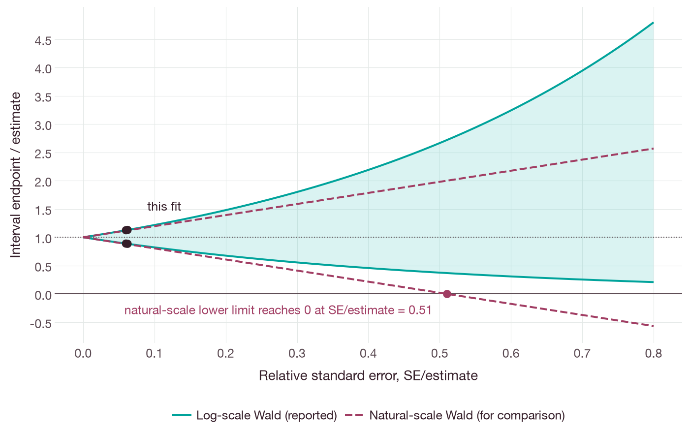
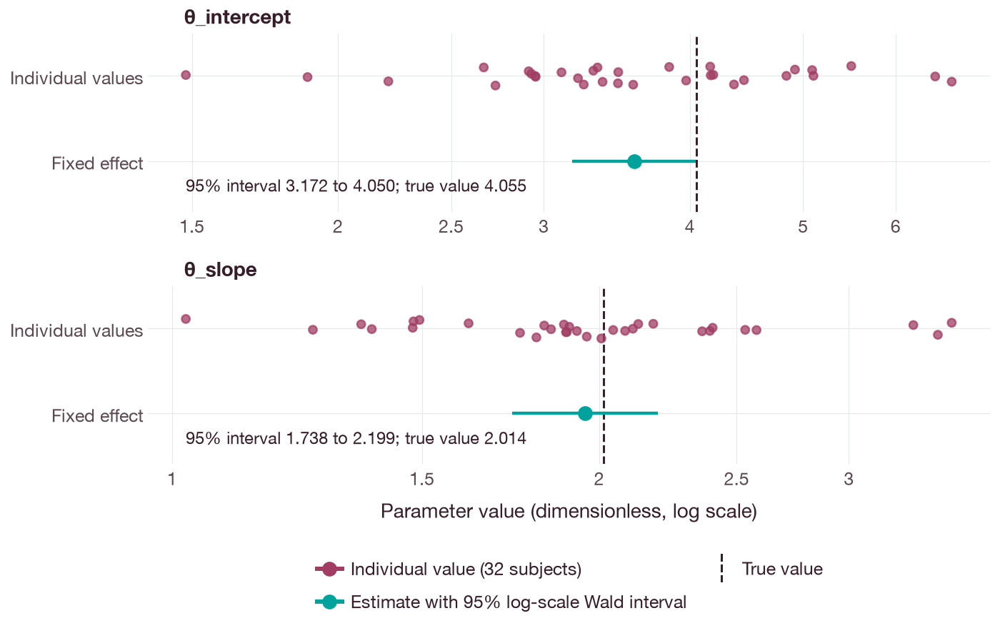
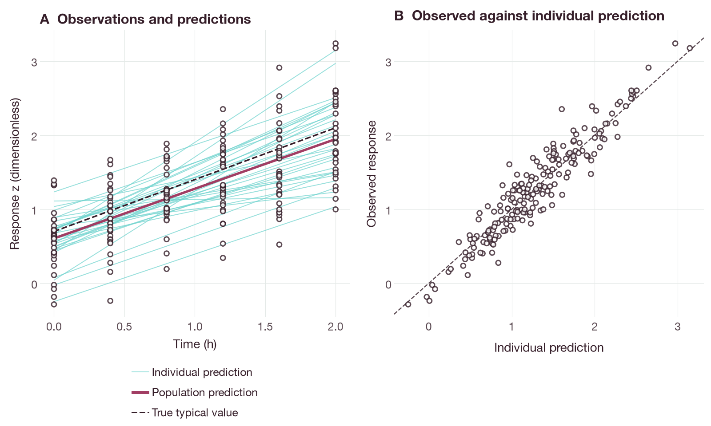

# Log-scale Wald confidence intervals for SAEM fixed effects

## Objective

When uncertainty is requested, a converged stochastic approximation
expectation–maximization (SAEM) fit [1] returns approximate 95% confidence intervals
for each fixed effect. The intervals are constructed on the log scale [2, 3] and are
therefore always positive. The fixed effects must have strictly positive bounds.

## Running the example

Install the Python package as described in
[the installation guide](../installation.md). Run the
[interval example](../examples/population_log_wald.py) from the root of the
source checkout. The example uses the included synthetic
[two-effect data generator](../examples/population_two_effects.py) to create 32
subjects with six observations each, and performs one native SAEM fit:

```sh
python docs/examples/population_log_wald.py
```

For a Rust source installation, run the same example with the compiled
command-line interface (CLI):

```sh
cargo build --release --locked -p qspquest-cli
python3 docs/examples/population_log_wald.py --cli target/release/qspquest
```

Both commands print two positive intervals, one for each dimensionless fixed
effect, with method `positive_fixed_effect_log_wald_delta_v1`. The example uses
a temporary directory and does not leave files behind.

## Requesting intervals

For a native `qspquest.fit/v0.1` request, select `kind: saem` and set
`uncertainty: true` in its population request. The same request can be executed
with `CompiledSensitivities.fit(request)` in Python, `qspquest fit` in the CLI,
or the Model Context Protocol (MCP) fitting tool. For local MCP use, set a
result artifact directory before fitting, because large population results are
returned as downloadable chunks; verify the length and SHA-256 digest of each
chunk before parsing it. Locally, two-effect SAEM allows up to 200000
evaluations. Hosted limits are smaller; for large cohorts, use a hosted job
rather than removing subjects. The intervals are read from the Python fit as
follows:

```python
population = result["population"]
intervals = population["fixed_effect_intervals"]
assert intervals["method"] == "positive_fixed_effect_log_wald_delta_v1"
assert intervals["confidence_level"] == 0.95
for interval in intervals["intervals"]:
    print(interval["name"], interval["lower"], interval["upper"], interval["unit"])
```

## Interval calculation

The interval is `exp(log(estimate) +/- 1.959963984540054 * SE/estimate)`, where
`SE` is the standard error obtained from the observed covariance matrix on the
natural scale. Each record gives the parameter name and its physical unit and
reports the estimate, the standard error on the source scale, the standard error
on the log scale and the interval endpoints. Records are given in the same order
as the fixed effects in the request.

Because the interval is symmetric on the log scale, its limits divided by the
estimate are `exp(-1.96 * SE/estimate)` and `exp(1.96 * SE/estimate)`. The lower
limit is therefore always positive. The lower limit of a Wald interval on the
natural scale, `estimate +/- 1.96 * SE`, becomes negative when `SE/estimate`
exceeds 1/1.96 = 0.51 (Figure 1). In the example, `SE/estimate` is about 0.06
for both fixed effects, and the two constructions give nearly the same interval.



**Figure 1.** Limits of a 95% Wald interval divided by the estimate, as a
function of the relative standard error `SE/estimate` (analytical). Solid lines
and shading: the log-scale interval used by QSPQuest. Dashed lines: the
natural-scale interval, calculated by the figure script for comparison only.
Points are the limits reported for the two fixed effects in the example.

## Results and diagnostics

The returned status should be checked before estimates or intervals are used.
The total `iterations` includes the final refinement steps, which are reported
separately as `saem_diagnostics.marginal_refinement_iterations`; subtracting
them gives the number of sampling iterations.

The example data were generated with `theta_intercept = exp(1.4) = 4.055` and
`theta_slope = exp(0.7) = 2.014`. In the run shown in Figure 2, the estimate of
`theta_slope` is 1.955 (95% interval 1.738 to 2.199), which contains the true
value. The estimate of `theta_intercept` is 3.584 (3.172 to 4.050); the upper
limit lies just below the true value. A single synthetic data set cannot
establish the coverage of the intervals (see Limitations). Figure 3 compares the
observations with the population and individual predictions of the fit.



**Figure 2.** Estimated fixed effects (teal points) with their 95% log-scale
Wald intervals, on a logarithmic axis. Dashed lines are the values used to
generate the synthetic data. Burgundy points are individual values,
`theta * exp(eta)`, calculated from the estimated fixed effect and the random
effect returned for each of the 32 subjects; their spread reflects
between-subject variability, not the uncertainty of the fixed effect. Points are
jittered vertically.



**Figure 3.** Synthetic observations of the response `z` (open circles; 32
subjects, six times each) and the SAEM fit. (A) Thin lines are individual
predictions; the thick line is the population prediction,
`log(theta_intercept) + (time - 1) * log(theta_slope)` at the estimates; the
dashed line is the same expression at the true values. (B) Observations against
individual predictions; the dashed line is the line of identity.

The figures were produced by `docs/examples/population_log_wald_figures.py`,
which runs the example, repeats the fit in a temporary directory, recalculates
each interval from its estimate and standard error, and checks the fitted
observations and predictions against the generated data before drawing. Install
the `docs` extra (`python -m pip install '.[docs]'`) to run it.

The `fixed_effect_intervals` field is absent if the fit did not request the
covariance, did not converge, used another method or could not compute a
covariance.

If the intervals cannot be computed, the result still contains the fit, the
estimates and the covariance, together with `fixed_effect_interval_error`, which
states the reason. A missing interval does not indicate zero uncertainty.

## Limitations

These intervals are a large-sample approximation and may not achieve 95%
coverage in small studies. They apply to fixed effects only; correlations,
variances, residual errors and covariate coefficients have no intervals in this
method.

## References

1. Delyon B, Lavielle M, Moulines E. Convergence of a stochastic approximation
   version of the EM algorithm. *Ann Stat*. 1999;27(1):94–128.
   [doi:10.1214/aos/1018031103](https://doi.org/10.1214/aos/1018031103)
2. Oehlert GW. A note on the delta method. *Am Stat*. 1992;46(1):27–29.
   [doi:10.1080/00031305.1992.10475842](https://doi.org/10.1080/00031305.1992.10475842)
3. Casella G, Berger RL. *Statistical Inference*. 2nd ed. Chapman & Hall/CRC;
   2024. Reprint of the 2002 Duxbury edition.
   [doi:10.1201/9781003456285](https://doi.org/10.1201/9781003456285)
