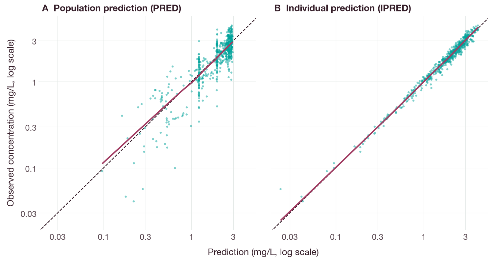
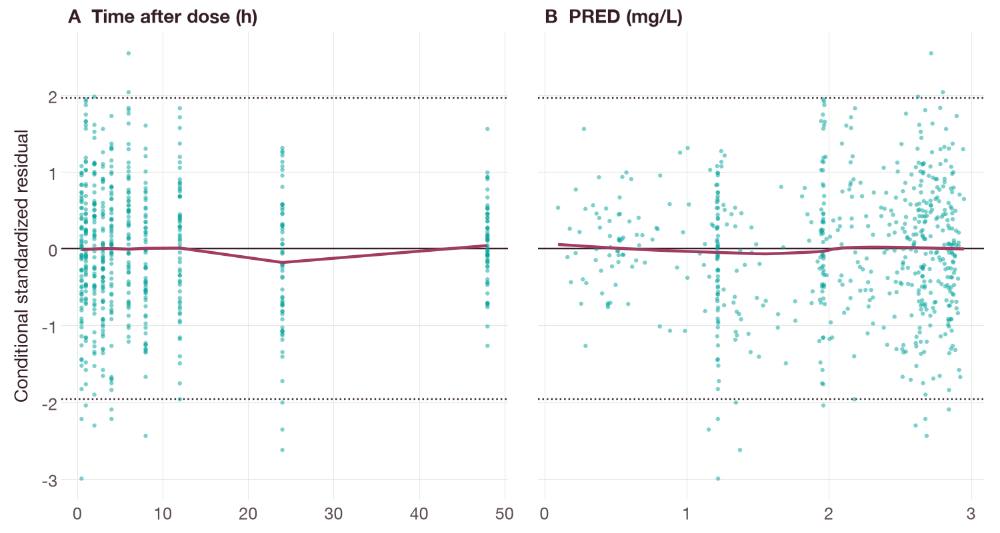
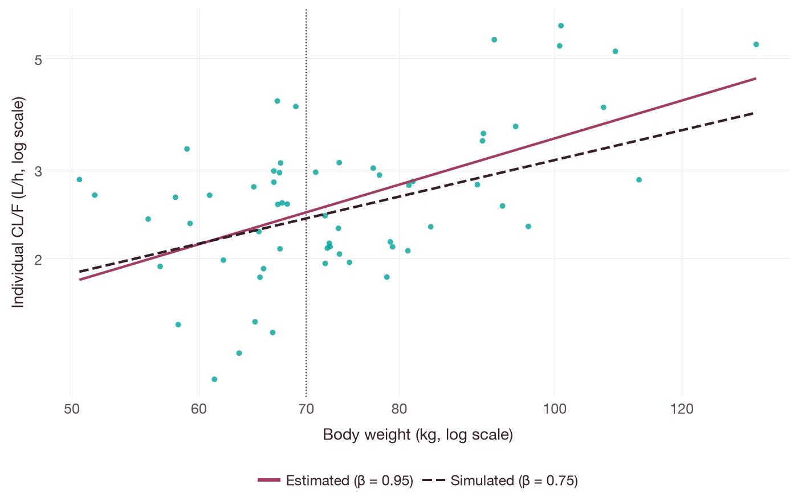
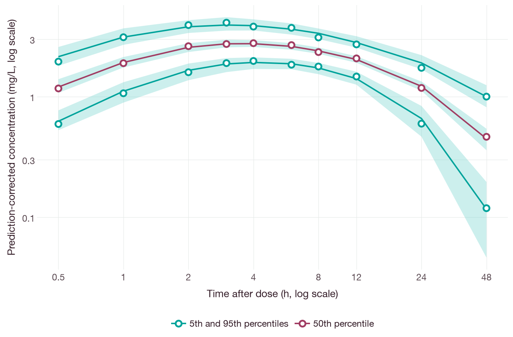
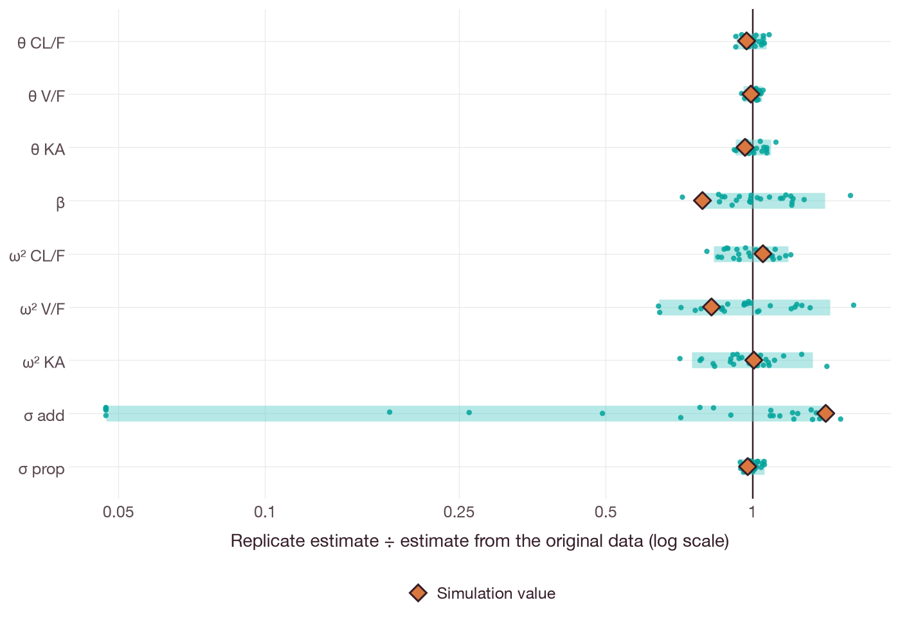

# Population pharmacokinetics of an oral drug

## Objective

This tutorial estimates the population pharmacokinetic (PK) parameters of an
orally administered drug from concentration–time records. It fits a
one-compartment model with first-order absorption, interindividual variability
(IIV) on all three structural parameters, a body-weight effect on clearance and
a combined additive and proportional residual error. It then evaluates the model
with goodness-of-fit plots, a prediction-corrected visual predictive check
(pcVPC) and a nonparametric subject bootstrap.

The drug, the cohort and all concentrations are synthetic. They were simulated
for this tutorial from stated parameter values, so every estimate can be
compared with the value that generated the data.

## Background

The population approach analyzes all subjects together with a nonlinear
mixed-effects model (Sheiner, Rosenberg & Marathe 1977). The model has three
parts (Mould & Upton 2012):

- the **structural model**, which describes the typical concentration–time
  course;
- the **statistical model**, which describes the variability of individual
  parameters around their typical values (IIV) and of observations around
  individual predictions (residual error);
- the **covariate model**, which explains part of the IIV with subject
  characteristics such as body weight.

Fixed effects (θ) are the typical parameter values. Random effects (η) are the
subject-specific deviations, with variance–covariance matrix Ω. Model building
usually proceeds from a base structural model through the statistical and
covariate models, and each step is evaluated with diagnostic plots and
simulation-based checks (Mould & Upton 2013; Karlsson & Savic 2007).

Two estimation approaches are used here. First-order conditional estimation
with interaction (FOCEI) approximates each subject's marginal likelihood about
the conditional mode of η. Stochastic approximation expectation–maximization
(SAEM) replaces the expectation step with a simulation of η by Markov chain
Monte Carlo and a decreasing stochastic-approximation step (Delyon, Lavielle &
Moulines 1999; Kuhn & Lavielle 2004, 2005).

After oral administration alone, bioavailability (F) is not identifiable.
Clearance and volume are therefore estimated as the apparent quantities CL/F
and V/F.

## Data

### Study design

The simulated study is a single-dose study in 60 subjects. Each subject receives
200 mg orally at time zero. Plasma concentrations are measured at 0.5, 1, 2,
3, 4, 6, 8, 12, 24 and 48 h after the dose, which gives 600 observations. There
are no missing samples and no concentrations below a quantification limit.

Body weight (WT, kg) is lognormally distributed with a median of
71.9 kg and a range of 50.5 to 133.5 kg (simulated).

### Simulation values

Table 1 lists the generating values. They are labeled *simulated* throughout.

**Table 1.** Simulation values.

| Quantity | Symbol | Simulated value | Unit |
| --- | --- | --- | --- |
| Apparent clearance at 70 kg | θ_CL | 2.4 | L/h |
| Apparent volume of distribution | θ_V | 60 | L |
| Absorption rate constant | θ_KA | 0.9 | 1/h |
| Allometric exponent of weight on CL/F | β | 0.75 | — |
| IIV variance of CL/F | ω²_CL | 0.09 | — |
| IIV variance of V/F | ω²_V | 0.04 | — |
| IIV variance of KA | ω²_KA | 0.16 | — |
| Additive residual SD | σ_add | 0.03 | mg/L |
| Proportional residual SD | σ_prop | 0.10 | — |

On the log scale, ω² of 0.09, 0.04 and 0.16 corresponds to approximate
coefficients of variation of 30%, 20% and 40%. The realized variances of the
60 simulated η values are 0.093, 0.054 and 0.127 for CL/F, V/F and
KA. Concentrations are generated from the analytical solution of the model, not
from the numerical solver used for estimation.

### Record format

The data are event records in the format conventional in population PK, with
one row per dose or observation (Table 2).

**Table 2.** Record columns.

| Column | Meaning |
| --- | --- |
| `ID` | Subject identifier |
| `TIME` | Time after the dose (h) |
| `DV` | Observed plasma concentration (mg/L); 0 on dose rows |
| `AMT` | Dose amount (mg) on dose rows; 0 on observation rows |
| `EVID` | Event identifier: 1 for a dose, 0 for an observation |
| `CMT` | Compartment: 1 for the depot (dose), 2 for the central compartment (observation) |
| `MDV` | Missing dependent variable: 1 on dose rows, 0 on observation rows |

The first rows of the simulated data are:

```text
 ID  TIME      DV    AMT  EVID  CMT  MDV
  1   0.0   0.000  200.0     1    1    1
  1   0.5   2.074    0.0     0    2    0
  1   1.0   2.734    0.0     0    2    0
  1   2.0   3.395    0.0     0    2    0
  1   3.0   3.287    0.0     0    2    0
```

The record adapter accepts only the columns `ID`, `TIME`, `EVID`, `DV`, `MDV`,
`AMT`, `CMT`, `RATE`, `ADDL`, `II` and `SS`. It rejects other columns, such as
`WT`. Body weight is therefore supplied separately as one value per subject.

## Model

### Structural model

The amount in the depot, A_d (mg), and in the central compartment, A_c (mg),
follow Equations 1–3:

```text
dA_d/dt = -KA · A_d                                    (1)
dA_c/dt =  KA · A_d - (CL/F)/(V/F) · A_c               (2)
C       =  A_c / (V/F)                                 (3)
```

where C is the plasma concentration (mg/L), t is time (h), KA is the
first-order absorption rate constant (1/h), CL/F is apparent clearance (L/h)
and V/F is the apparent volume of distribution (L). The oral dose is
entered into the depot as a bolus. In the model language:

```text
model oral_one_compartment
time_unit = h
parameters
  cl = 2.4 [L/h] log
  v = 60 [L] log
  ka = 0.9 [1/h] log
states
  depot = 0 [mg]
  central = 0 [mg]
dynamics
  d/dt(depot) = input_depot - ka * depot
  d/dt(central) = ka * depot - cl / v * central
outputs
  cp = central / v [mg/L]
dosing
  depot [mg] = 1
end
```

The parameters are named `cl`, `v` and `ka`. Because the data contain only
oral doses, `cl` and `v` are estimated as CL/F and V/F.

### Statistical and covariate model

The individual parameters of subject i are given by Equations 4–6:

```text
CL/F_i = θ_CL · (WT_i/70)^β · exp(η_CL,i)              (4)
V/F_i  = θ_V  · exp(η_V,i)                             (5)
KA_i   = θ_KA · exp(η_KA,i)                            (6)
```

where θ_CL is the typical CL/F of a 70 kg subject, θ_V and θ_KA are the
typical V/F and KA, β is the allometric exponent and
η_i = (η_CL,i, η_V,i, η_KA,i) ~ N(0, Ω). Ω is diagonal with elements ω²_CL,
ω²_V and ω²_KA. The weight effect is a power function centered at 70 kg
(Anderson & Holford 2008).

The estimator implements exponential covariate effects,
θ · exp(β · (x - x_ref)), where x is the covariate and x_ref its reference
value. Equation 4 is obtained exactly with x = log(WT/70) and x_ref = 0:

```text
exp(β · log(WT_i/70)) = (WT_i/70)^β                    (7)
```

The exponent β is estimated, not fixed.

Observation j of subject i, y_ij (mg/L), follows Equation 8:

```text
y_ij = f_ij + ε_ij,   ε_ij ~ N(0, σ_add² + (σ_prop · f_ij)²)   (8)
```

where f_ij is the individual prediction (mg/L), σ_add is the additive residual
SD (mg/L) and σ_prop is the proportional residual SD (dimensionless). Both SDs
are estimated.

## Estimation

### Estimator scope

The estimators differ in which parts of this model they can estimate.
Table 3 lists the limits stated in the
[Python user guide](../PYTHON-USER-GUIDE.md#fit-population-data), the
[native SAEM guide](../SAEM.md) and the [analysis guide](../ANALYSIS.md).

**Table 3.** Model features supported by each estimator.

| Estimator | Random effects | Ω | Residual error | Covariates |
| --- | --- | --- | --- | --- |
| Native FOCEI, one effect | 1 | Estimated | Fixed; or one common additive SD estimated with zero proportional SD | None |
| Native FOCEI, two effects | 2 | Fixed | Fixed | None |
| Native SAEM | 1 to 8 | Estimated, full or diagonal | Fixed; or additive, proportional or combined, estimated | Up to eight exponential effects |
| Python SAEM | 1 to 8 | Estimated, full or diagonal | Additive, proportional or combined, estimated | Up to eight exponential effects |

Native SAEM and Python SAEM run the same SAEM engine. Native SAEM adds a
marginal objective for one- and two-effect fits, and log-Wald intervals when
the residual error is also fixed and there are no covariates (see the
[SAEM guide](../SAEM.md)); for the full model, with three random effects and
two estimated residual SDs, both report a complete-data surrogate. The full model is
fitted with Python SAEM. FOCEI cannot fit it, so the native estimators are
compared on a reduced model in which only θ_CL, ω²_CL and, in one fit, β are
estimated. In the reduced model, V/F, KA and both residual SDs are fixed at the
Python SAEM estimates, not at the simulation values.

All fits start from the same records, prepared once by
`population_fit_dataset`. Native fits run the prepared request through
`CompiledSensitivities.fit_population_data`. Python SAEM runs the same
subjects through `PopulationFitDataset.fit`, which calls
`CompiledModel.fit_population`. Python SAEM accepts at most 128 subjects.

### Preparing the records

The code below consists of excerpts from the example script, where
`q(value, unit)` returns a quantity dictionary.
The template supplies the model parameters, the solver and the sensitivity
settings. The records supply the doses, the sampling times and the
observations. Dose records in `CMT` 1 go to the depot state; observation
records in `CMT` 2 map to the output `cp`:

```python
import qspquest as qq

endpoints = {2: {"output": "cp", "value_unit": "mg/L", "error": {
    "additive_sd": q(0.1, "mg/L"), "proportional_sd": 0.2}}}
dataset = qq.population_fit_dataset(
    rows, request, compartments={1: "depot"}, endpoints=endpoints,
    time_unit="h", amount_unit="mg", observation_side="post")
```

Python SAEM ignores the endpoint error and uses the residual-error model passed
to `fit`. The native fits use the endpoint error, which the script sets to the
Python SAEM estimates of σ_add and σ_prop.

### Full model: Python SAEM

```python
parameters = {
    "cl": {"initial": 2.0, "lower": 0.2, "upper": 20.0, "unit": "L/h"},
    "v": {"initial": 45.0, "lower": 5.0, "upper": 500.0, "unit": "L"},
    "ka": {"initial": 1.5, "lower": 0.05, "upper": 10.0, "unit": "1/h"},
}
omega = (np.eye(3) * 0.2).tolist()
error = {"additive": {"initial": 0.1, "lower": 0.001, "upper": 1.0},
         "proportional": {"initial": 0.2, "lower": 0.01, "upper": 1.0}}
covariates = [{"parameter": "cl", "covariate": "LOGWT70", "reference": 0.0,
               "initial": 0.0, "lower": -3.0, "upper": 3.0}]
log_weight = {sid: {"LOGWT70": math.log(weights[sid] / 70)}
              for sid in dataset.subject_ids}
fit = dataset.fit(model, parameters, omega, error,
                  covariates_by_subject=log_weight, covariates=covariates,
                  covariance="diagonal", max_iterations=1000, burn_in=200,
                  sweeps=2, tolerance=0.03, seed=20261106,
                  max_simulations=1_000_000)
```

The starting values differ from the simulation values. The iteration limit is
1000, with 200 burn-in iterations. The fit stops earlier when its convergence
check passes. The reported objective is a complete-data surrogate. It is not a
marginal likelihood and cannot be used for likelihood-ratio tests.

### Reduced model: native FOCEI and SAEM

The reduced model estimates θ_CL and ω²_CL with one lognormal random effect.
Three native fits are run: FOCEI without the weight effect, SAEM without the
weight effect and SAEM with the weight effect. The weight effect is added to
the prepared request as a `covariate_effect` with one value of log(WT/70) per
subject, in the order of `dataset.subject_ids`:

```python
body = dataset.request["problem"]["request"]
body["covariate_effect"] = {
    "parameter": "cl", "covariate": "LOGWT70",
    "subject_values": [math.log(weights[sid] / 70) for sid in dataset.subject_ids],
    "reference": 0.0, "initial": 0.0, "bounds": [-3.0, 3.0]}
population = qq.CompiledSensitivities(source, ["cl"]).fit_population_data(dataset)
```

### Model evaluation methods

Goodness of fit is assessed by plotting observations against population
predictions (PRED) and individual predictions (IPRED), and residuals against
time and PRED (Karlsson & Savic 2007). In the Python SAEM output, PRED is the
prediction with η = 0 at the subject's covariate value. IPRED is the prediction
at the posterior mean of the subject's log parameters. The residual is the
conditional standardized residual (CRES) of Equation 9:

```text
CRES_ij = (DV_ij - IPRED_ij) / sqrt(σ_add² + (σ_prop · IPRED_ij)²)   (9)
```

CRES is not a conditional weighted residual (CWRES) or a normalized prediction
distribution error. `fit_diagnostics` returns these values for each observation:

```python
diagnostics = qq.fit_diagnostics(fit)
for row in diagnostics["observations"]:
    dv, pred = row["observed"], row["prediction"]
    ipred, cres = row["individual_prediction"], row["standardized_residual"]
shrinkage = fit["diagnostics"]["eta_variance_shrinkage"]  # order of fit["random_effects"]
```

η-shrinkage is reported in the variance form of Equation 10:

```text
shrinkage_k = 1 - var(η̂_k) / ω²_k                      (10)
```

where η̂_k are the posterior mean random effects for parameter k across
subjects. The SD form, 1 - SD(η̂_k)/ω_k (Savic & Karlsson 2009), equals
1 - sqrt(1 - shrinkage_k). High shrinkage makes plots of η̂ against covariates
unreliable (Savic & Karlsson 2009).

The pcVPC simulates 200 replicates of the original design from the
final estimates, including IIV, the weight effect and residual error. It
compares the observed 5th, 50th and 95th percentiles in each time bin with 95%
intervals of the same percentiles in the simulated replicates. Prediction
correction multiplies each observed and simulated value by the ratio of the
median PRED in its bin to its own PRED. This removes the variability in the
percentiles that comes from differences in weight between subjects
(Bergstrand et al. 2011).

The VPC takes the estimates as fixed quantities and the residual SDs as
numbers. The weight effect must be passed in `covariates` with its estimate;
without it, the simulation omits the weight effect. `subjects` are the analysis
subjects returned by `dataset.to_subjects(covariates=log_weight)`:

```python
estimates = {name: q(fit["parameters"][name]["value"], unit)
             for name, unit in [("cl", "L/h"), ("v", "L"), ("ka", "1/h")]}
vpc = model.visual_predictive_check(
    subjects, estimates, fit["omega"],
    {"additive": fit["error"]["additive"],
     "proportional": fit["error"]["proportional"]},
    random_effects=fit["random_effects"],
    covariates=[{"parameter": "cl", "covariate": "LOGWT70", "reference": 0.0,
                 "estimate": fit["covariate_effects"][0]["estimate"]}],
    bins=[0, 0.75, 1.5, 2.5, 3.5, 5, 7, 10, 18, 36, 48], replicates=200,
    prediction_corrected=True, seed=4099, workers=4, max_simulations=13_000)
```

The subject bootstrap resamples 60 subjects with replacement and refits the full
model to each replicate with the same settings (Thai et al. 2014). One
`bootstrap_population` call is limited to 1,000,000 simulations. One fit of
this model needs about 160,000 simulations when it converges and up to
about 360,000 when it reaches the iteration limit. The script therefore runs
12 calls of 2 replicates each, with distinct recorded seeds, and
pools them. Percentiles are computed from the converged replicates only:

```python
batches = [model.bootstrap_population(
    subjects, parameters, omega, error, covariates=covariates,
    replicates=2, seed=7331 + batch, minimum_success_fraction=0.5,
    max_simulations=1_000_000, covariance="diagonal", max_iterations=1000,
    burn_in=200, sweeps=2, tolerance=0.03) for batch in range(12)]
records = [r for result in batches for r in result["replicates"]]
converged = [r for r in records if r["status"] == "converged"]
cl_interval = np.quantile(
    [r["parameters"]["cl"]["value"] for r in converged], [0.025, 0.975])
```

## Running the example

Install the Python package as described in
[the installation guide](../installation.md#python), and NumPy, which the
script uses to simulate the data. From the source checkout root, run the
[example script](../examples/population_pk.py):

```sh
python docs/examples/population_pk.py --output population-pk-output
```

The output directory must not exist. On the computer used to prepare this
tutorial, the run took about 20–25 min. The bootstrap took most of that time. Use
`--bootstrap-batches` to change the number of bootstrap calls and
`--vpc-replicates` to change the number of VPC replicates. The script asserts
that the fits converged, that the pcVPC is complete and that each estimate is
within the tolerances in Table 4. It stops with an error if any check fails.

**Table 4.** Recovery tolerances asserted by the example script.

| Estimate | Tolerance |
| --- | --- |
| θ_CL, θ_V | ±15% of the simulated value |
| θ_KA | ±25% of the simulated value |
| ω²_CL, ω²_V, ω²_KA | ±60% of the simulated value |
| β | ±0.40 (absolute) |
| σ_add | ±0.02 mg/L (absolute) |
| σ_prop | ±25% of the simulated value |
| θ_CL, native reduced fits | ±15% of the simulated value |

The tolerances are set from the expected sampling error with 60 subjects.
For example, the standard error of β is approximately
ω_CL/(SD(log WT) · √60). With ω_CL = 0.30 and the realized SD of log WT of
0.20, this is 0.19, so ±0.40 is about two standard errors. The θ_CL tolerance
for the reduced fits also allows for the difference between 70 kg and the
geometric mean weight of the cohort (73.8 kg), because two of these fits have no
weight effect.

The output directory contains the records (`data.csv`), the simulated subject
values (`simulated-subjects.csv`), the model (`model.qsp`), the
goodness-of-fit table (`gof.csv`), the complete fit, VPC and bootstrap results
as JSON, and `summary.json`.

The figures are drawn by a separate [figure script](../examples/population_pk_figures.py).
It checks every plotted value against the saved fit, VPC and bootstrap results
and writes the PNG files to `docs/tutorials/figures/`. It requires the `docs`
extra, which includes pandas and plotnine:

```sh
python -m pip install -e '.[docs]'
python docs/examples/population_pk_figures.py population-pk-output
```

## Results

All values in this section are from one run of the example script with the
default settings, with the SAEM engine described in the
[SAEM guide](../SAEM.md).

### Full model

Python SAEM returned status `converged` after 410 iterations and 196,980
simulations. No estimate was at a search bound. Table 5 compares the
estimates with the simulation values.

**Table 5.** Full model: simulated values, estimates (Python SAEM) and
bootstrap percentiles.

| Parameter | Unit | Simulated | Estimated | Bootstrap 2.5th–97.5th percentile |
| --- | --- | --- | --- | --- |
| θ_CL (70 kg) | L/h | 2.4 | 2.47 | 2.28–2.64 |
| θ_V | L | 60 | 60.5 | 57.9–63.2 |
| θ_KA | 1/h | 0.9 | 0.932 | 0.859–1.016 |
| β | — | 0.75 | 0.95 | 0.76–1.34 |
| ω²_CL | — | 0.09 | 0.086 | 0.071–0.101 |
| ω²_V | — | 0.04 | 0.049 | 0.031–0.070 |
| ω²_KA | — | 0.16 | 0.159 | 0.119–0.211 |
| σ_add | mg/L | 0.03 | 0.021 | 0.001–0.030 |
| σ_prop | — | 0.10 | 0.102 | 0.097–0.108 |

The bootstrap percentiles are from 24 replicates, all of which converged. In 5
of the 24 replicates, σ_add was at its lower search bound of 0.001 mg/L; the
2.5th percentile of σ_add is therefore the bound.

η-shrinkage (Equation 10) was 2.1% for CL/F, 4.1% for V/F and 8.3% for KA.
In the SD form these values are 1.0%, 2.1% and 4.2%.

### Reduced model

Table 6 lists the native fits of the reduced model. All three fits have V/F
fixed at 60.5 L, KA at 0.932 1/h, σ_add at 0.0212 mg/L and σ_prop at 0.102,
which are the Python SAEM estimates.

**Table 6.** Reduced model: native estimates of θ_CL and ω²_CL.

| Fit | Status | θ_CL (L/h) | ω²_CL | β |
| --- | --- | --- | --- | --- |
| FOCEI, no weight effect | `converged` | 2.62 | 0.113 | — |
| SAEM, no weight effect | `converged` | 2.58 | 0.119 | — |
| SAEM, with weight effect | `converged` | 2.45 | 0.084 | 0.94 |

Without the weight effect, θ_CL is the CL/F of a typical subject of this
cohort, not of a 70 kg subject. The full model predicts 2.60 L/h at the
geometric mean weight of 73.8 kg, which is close to both estimates. With
native SAEM, adding the weight effect reduced ω²_CL from 0.119 to 0.084. With
the weight effect, the native SAEM estimates of θ_CL, ω²_CL and β agree with
the full-model estimates in Table 5. Objective function values are not
compared between fits. The native fits report approximations to the marginal
likelihood, and the Python SAEM fit reports a complete-data surrogate; these
quantities are on different scales.

## Model evaluation

### Goodness of fit



**Figure 1.** Observed (simulated) concentrations against the estimated
population predictions, PRED (A), and individual predictions, IPRED (B), on log
axes. Points are observations. The dashed line is the line of identity, and the
solid line is a LOWESS smooth of the points.



**Figure 2.** Conditional standardized residuals (Equation 9) of the 600
observations against time after dose (A) and PRED (B), computed from the
Python SAEM estimates. The solid horizontal line marks zero, and the dotted
lines mark ±1.96. The curved line is a LOWESS smooth.

In Figure 1A, the observations scatter about the line of identity, and the
smooth follows it. The spread reflects IIV. The points form vertical groups
because all subjects received the same dose at the same sampling times, so
PRED differs between subjects only through body weight. In Figure 1B, the
observations lie close to the line of identity over the full concentration
range. In Figure 2, the residuals show no trend with time or PRED. Their mean
is −0.030 and their SD is 0.85. An SD below 1 is expected for residuals taken
about individual predictions that were fitted to the same observations.

### Weight effect



**Figure 3.** Estimated individual CL/F (posterior mean, points) against
simulated body weight for the 60 subjects. The solid line is the estimated
power function (Equation 4, β = 0.95), and the dashed line is the simulated
function (β = 0.75). The dotted vertical line marks the 70 kg reference weight.

The estimated exponent, 0.95, is 0.20 above the simulated value of 0.75. This
difference is about one standard error (see Running the example). The
bootstrap percentiles (0.76–1.34) lie just above the simulated value; with 24
replicates their lower end is imprecise (see Limitations). Figure 3 shows
that the IIV in CL/F is large compared with the weight effect over this
weight range, which limits the precision of β.

### Prediction-corrected VPC



**Figure 4.** Prediction-corrected VPC. Points are the 5th, 50th and 95th
percentiles of the observed concentrations at each sampling time. Lines are
the medians of the same percentiles in 200 replicates simulated from the
estimates, and shaded bands are their 95% intervals. Each bin contains one
nominal sampling time.

All 30 observed percentiles (3 percentiles in 10 bins) lie within the 95%
intervals of the corresponding simulated percentiles. The model reproduces
the central tendency and the spread of the data over the absorption and
elimination phases.

### Bootstrap



**Figure 5.** Subject bootstrap of the full model. Each point is the estimate
from one converged replicate (24 of 24), divided by the estimate from the
original data, on a log scale. Shaded bands are the 2.5th–97.5th percentiles of
the replicates. Diamonds mark the simulation values on the same scale. The
vertical line marks a ratio of 1.

For the typical values and σ_prop, the central 95% of bootstrap estimates lie
within 10% of the full-fit estimates. β and the IIV variances vary more.
σ_add has the widest distribution and includes the five replicates at the
lower bound. Eight of the nine simulation values lie within the bootstrap
percentiles. The simulated β lies just below them.

## Interpretation and limitations

The full model recovered all simulation values within the stated tolerances.
For every parameter except β, the bootstrap percentiles contained the simulation
value; the simulated β lies just below them.
The goodness-of-fit plots and the pcVPC showed no misspecification. These
results describe one simulated dataset and one seed. They are not a study of
estimator bias or interval coverage.

The analysis has the following limitations:

- **Residual error.** σ_add is weakly identified. The proportional component
  exceeds the additive component when the concentration exceeds
  σ_add/σ_prop = 0.3 mg/L (simulated values), and 97% of the observations are
  above this value.
  Studies with more observations near the quantification limit would identify
  σ_add better.
- **Bootstrap size.** The bootstrap used 24 replicates, all of which converged.
  With 24 values, the 2.5th and 97.5th percentiles are close to the smallest
  and largest values and are imprecise. When replicates fail to converge,
  excluding them can bias the intervals if failure depends on which subjects
  were resampled. Increase `--bootstrap-batches` for a reported analysis.
- **Model comparison.** The Python SAEM objective is a complete-data surrogate.
  It cannot be used for likelihood-ratio tests or for covariate selection by
  objective function. The native estimators report marginal objectives, but
  only for the reduced model in Table 6.
- **Model building.** The structural model, the diagonal Ω and the weight
  effect on CL/F were specified in advance from the simulation. No structural
  model selection or covariate search was performed. Correlations between
  random effects were not estimated.
- **Reduced models.** The native fits estimate one random effect with other
  parameters fixed. Their ω²_CL also absorbs variability that the full model
  assigns to the weight effect, V/F and KA. They illustrate the native
  estimators and are not alternatives to the full model.
- **Design.** Each subject has ten samples over 48 h, and shrinkage is low.
  With sparse sampling, shrinkage is higher, and diagnostics based on
  individual estimates are less reliable (Savic & Karlsson 2009).
- **Bioavailability.** Only oral data were simulated, so F is not estimated.
  The estimates are apparent parameters, CL/F and V/F.
- **Residuals.** The residuals are conditional standardized residuals. CWRES
  and normalized prediction distribution errors were not computed.
- **Software limits.** Python SAEM accepts at most 128 subjects, and one call of
  a Python analysis is limited to 1,000,000 simulations.

## References

1. Sheiner LB, Rosenberg B, Marathe VV. Estimation of population characteristics
   of pharmacokinetic parameters from routine clinical data. *J Pharmacokinet
   Biopharm.* 1977;5(5):445–479. doi:[10.1007/BF01061728](https://doi.org/10.1007/BF01061728)
2. Mould DR, Upton RN. Basic concepts in population modeling, simulation, and
   model-based drug development. *CPT Pharmacometrics Syst Pharmacol.*
   2012;1(9):e6. doi:[10.1038/psp.2012.4](https://doi.org/10.1038/psp.2012.4)
3. Mould DR, Upton RN. Basic concepts in population modeling, simulation, and
   model-based drug development—part 2: introduction to pharmacokinetic
   modeling methods. *CPT Pharmacometrics Syst Pharmacol.* 2013;2(4):e38.
   doi:[10.1038/psp.2013.14](https://doi.org/10.1038/psp.2013.14)
4. Delyon B, Lavielle M, Moulines E. Convergence of a stochastic approximation
   version of the EM algorithm. *Ann Stat.* 1999;27(1):94–128.
   doi:[10.1214/aos/1018031103](https://doi.org/10.1214/aos/1018031103)
5. Kuhn E, Lavielle M. Coupling a stochastic approximation version of EM with
   an MCMC procedure. *ESAIM Probab Stat.* 2004;8:115–131.
   doi:[10.1051/ps:2004007](https://doi.org/10.1051/ps:2004007)
6. Kuhn E, Lavielle M. Maximum likelihood estimation in nonlinear mixed effects
   models. *Comput Stat Data Anal.* 2005;49(4):1020–1038.
   doi:[10.1016/j.csda.2004.07.002](https://doi.org/10.1016/j.csda.2004.07.002)
7. Anderson BJ, Holford NHG. Mechanism-based concepts of size and maturity in
   pharmacokinetics. *Annu Rev Pharmacol Toxicol.* 2008;48:303–332.
   doi:[10.1146/annurev.pharmtox.48.113006.094708](https://doi.org/10.1146/annurev.pharmtox.48.113006.094708)
8. Karlsson MO, Savic RM. Diagnosing model diagnostics. *Clin Pharmacol Ther.*
   2007;82(1):17–20. doi:[10.1038/sj.clpt.6100241](https://doi.org/10.1038/sj.clpt.6100241)
9. Savic RM, Karlsson MO. Importance of shrinkage in empirical Bayes estimates
   for diagnostics: problems and solutions. *AAPS J.* 2009;11(3):558–569.
   doi:[10.1208/s12248-009-9133-0](https://doi.org/10.1208/s12248-009-9133-0)
10. Bergstrand M, Hooker AC, Wallin JE, Karlsson MO. Prediction-corrected
    visual predictive checks for diagnosing nonlinear mixed-effects models.
    *AAPS J.* 2011;13(2):143–151. doi:[10.1208/s12248-011-9255-z](https://doi.org/10.1208/s12248-011-9255-z)
11. Thai HT, Mentré F, Holford NHG, Veyrat-Follet C, Comets E. Evaluation of
    bootstrap methods for estimating uncertainty of parameters in nonlinear
    mixed-effects models: a simulation study in population pharmacokinetics.
    *J Pharmacokinet Pharmacodyn.* 2014;41(1):15–33.
    doi:[10.1007/s10928-013-9343-z](https://doi.org/10.1007/s10928-013-9343-z)
