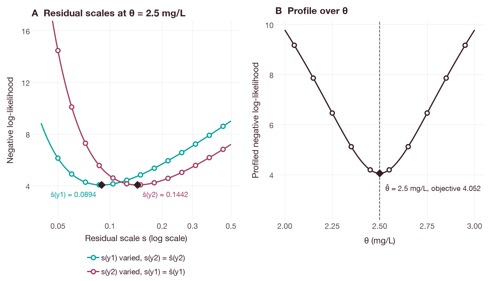
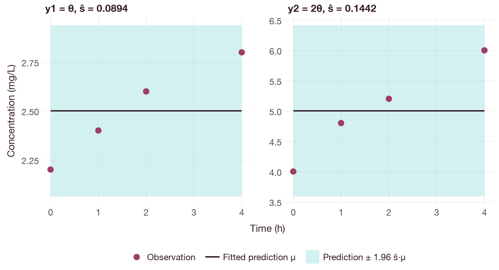

# Profiled proportional residual error in individual fitting

## Objective

This tutorial estimates bounded model parameters together with a separate
residual scale for each observed output. The residual error model is normal on
the output scale, with a standard deviation proportional to the prediction:

`Y_i ~ Normal(mu_i, (s_output * abs(mu_i))^2)`.

Here `Y_i` is an observation, `mu_i` is the corresponding model prediction and
`s_output` is the dimensionless residual scale of the output to which the
observation belongs. For each trial vector of model parameters, the conditional
maximum-likelihood estimate of the scale is exactly
`s_output = sqrt(mean((Y_i / mu_i - 1)^2))`. The scales are therefore profiled
out, and the optimizer searches over the model parameters only. This is the
proportional residual error model of population PK/PD analysis [1]; profiling
conditionally linear or scale parameters out of a nonlinear least-squares
problem is described by Bates and Watts [2].

## Running the example

The example requires a source checkout with Rust and Cargo installed. The
complete [model](../examples/profiled-proportional.qsp) and
[fit request](../examples/profiled-proportional-fit.json) are included. Run from
the repository root:

```sh
cargo run --release -p qspquest-cli -- fit \
  docs/examples/profiled-proportional.qsp \
  docs/examples/profiled-proportional-fit.json
```

The model has two constant concentration outputs, `y1 = theta` and
`y2 = 2 * theta`, each with four synthetic observations. The decay state of the
model does not affect either output.

The result contains `fit` and `residual_scales`. The expected result is a
`converged` status, `theta` close to `2.5 mg/L` and one dimensionless residual
scale per output, close to `y1 = 0.08944272` and `y2 = 0.14422205`.

Here the estimate of `theta` equals the mean of the `y1` observations and half
the mean of the `y2` observations. Figure 1 shows the negative log-likelihood as
a function of each residual scale at the estimate of `theta`, and the profiled
negative log-likelihood as a function of `theta`; each curve has its minimum at
the reported estimate. Figure 2 compares the observations with the fitted
predictions.



**Figure 1.** Negative log-likelihood of the synthetic example data. (A) As a
function of the residual scale of one output, with `theta` fixed at 2.5 mg/L and
the scale of the other output fixed at its estimate. (B) Profiled negative
log-likelihood as a function of `theta`, with each scale set to its conditional
estimate `sqrt(mean((Y_i / mu_i - 1)^2))`. Lines are the closed-form
likelihood; open circles are evaluations of the native Gaussian objective with
the same scales. Diamonds mark the estimates, at which the objective is 4.052.



**Figure 2.** Synthetic observations (points) and fitted predictions (lines) of
the outputs `y1` and `y2`. The shaded band is `mu * (1 +/- 1.96 * s_output)`,
the central 95% range of the fitted residual distribution. The observations
increase with time, whereas both model outputs are constant; the estimated
residual scales therefore include this systematic deviation.

The figures were produced by
`docs/examples/profiled_proportional_errors_figures.py`, which fits the model
with the Python interface, checks the estimate, the residual scales and the
objective against their closed-form values, and evaluates the native objective
at every plotted point. Install the `docs` extra
(`python -m pip install '.[docs]'`) to run it.

## Python and R interfaces

After [installing the Python package from source](../installation.md), run the
following from the repository root:

```python
import json
from pathlib import Path
import qspquest

source = Path("docs/examples/profiled-proportional.qsp").read_text()
request = json.loads(Path("docs/examples/profiled-proportional-fit.json").read_text())
model = qspquest.CompiledSensitivities(source, ["theta"])
plan = model.plan_fit(request)
result = model.fit(request)
print(result["fit"]["status"], result["residual_scales"])
```

After [installing the R package from source](../installation.md#r), the same
model and request are used as follows:

```r
source <- paste(readLines("docs/examples/profiled-proportional.qsp"), collapse = "\n")
request <- jsonlite::fromJSON("docs/examples/profiled-proportional-fit.json", simplifyVector = FALSE)
model <- qspquest::compile_model(source)
result <- qspquest::fit_model(model, request)
print(result$fit$status)
print(result$residual_scales)
```

The request selects `problem.kind = "profiled_proportional"`. With
`problem.kind = "individual"`, fixed residual errors are used instead.
`plan_fit` validates the request without running it; zero predictions or a zero
residual scale can still cause the fit to fail.

## Rust interface and input requirements

The Rust example also reads the complete versioned request:

```sh
cargo run --release -p qspquest-modeling --example profiled_proportional_fit -- \
  docs/examples/profiled-proportional.qsp \
  docs/examples/profiled-proportional-fit.json
```

Compile a `CompiledSensitivityDocument` with the selected parameter names, then
call `execute_fit(&FitRequest)` for the versioned workflow. The lower-level
function `fit_profiled_proportional_gaussian(&GaussianFitRequest)` accepts the
nested Gaussian request directly. To evaluate the profile likelihood and its
analytic sensitivity gradient without optimization, call
`profiled_proportional_gaussian_objective(&GaussianObjectiveRequest)`.

Finite bounds must be supplied for every selected model parameter, in the order
of the selected parameters, together with explicit simulation and derivative
tolerances. The observation `row` indexes the returned simulation grid. For
dosing experiments, explicit regimen `observations` select exactly the required
times and sides (before or after a dose); default event-inclusive grids can
contain additional rows.

For these profiled fits, every row must set `additive_sd = 0` and
`proportional_sd = 1`. These values specify that the scale is estimated; the
estimate is returned in `residual_scales`. Each observed output requires at
least two rows. Optional normal priors apply to model parameters; the scales
have no priors. The methods fit one experiment, with scales grouped by output
name.

## Limitations and troubleshooting

Censored rows, lognormal errors, combined additive and proportional errors and
nonzero fixed additive errors are rejected. Zero predictions, and data that the
model fits exactly (zero residuals), are also rejected.

Check `fit.status`, `fit.projected_gradient_norm`, `fit.evaluations` and
`fit.iterations`. A fit that reaches an evaluation or iteration limit is
incomplete, even when the parameters appear plausible. Near the optimum, solver
error can limit the accuracy of the gradient; rerun with tighter simulation and
derivative tolerances before a small change in the objective is treated as
convergence. The example uses synthetic data.

## Model Context Protocol (MCP) interface

For a user-supplied model, call `fit_individual` with the complete versioned
request in `fit_request`, including `problem.kind = "profiled_proportional"`.
`fit_population` also accepts this request. Library models can be fitted only
with their stored fitting workflow.

## References

1. Karlsson MO, Beal SL, Sheiner LB. Three new residual error models for
   population PK/PD analyses. *J Pharmacokinet Biopharm*. 1995;23(6):651–672.
   [doi:10.1007/BF02353466](https://doi.org/10.1007/BF02353466)
2. Bates DM, Watts DG. *Nonlinear Regression Analysis and Its Applications*.
   New York: Wiley; 1988.
   [doi:10.1002/9780470316757](https://doi.org/10.1002/9780470316757)
