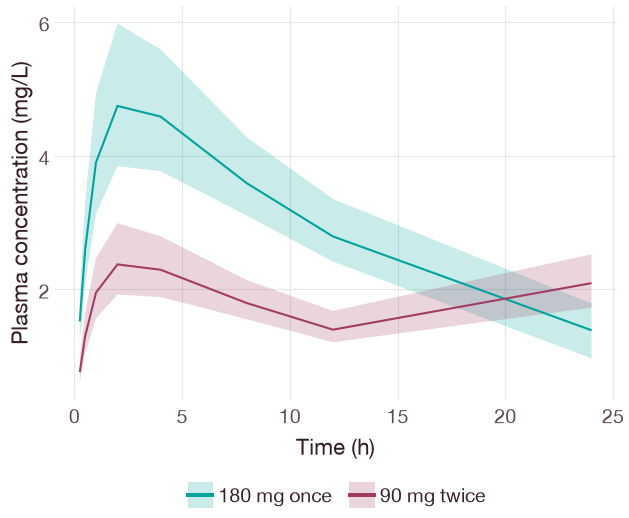
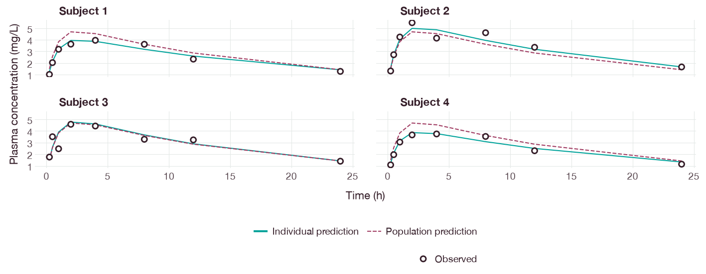
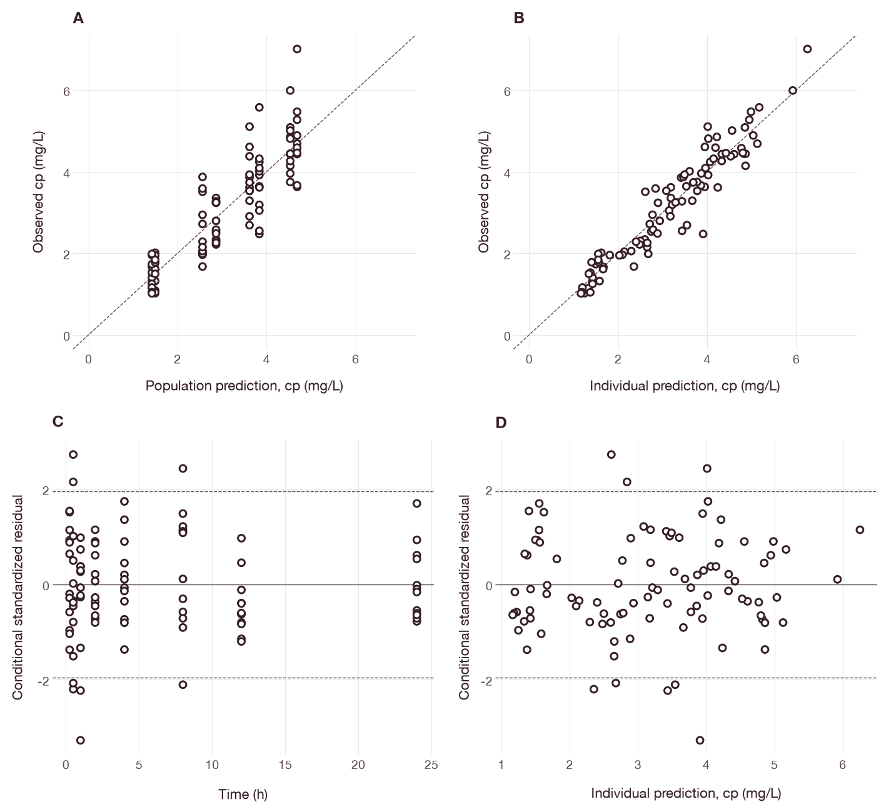
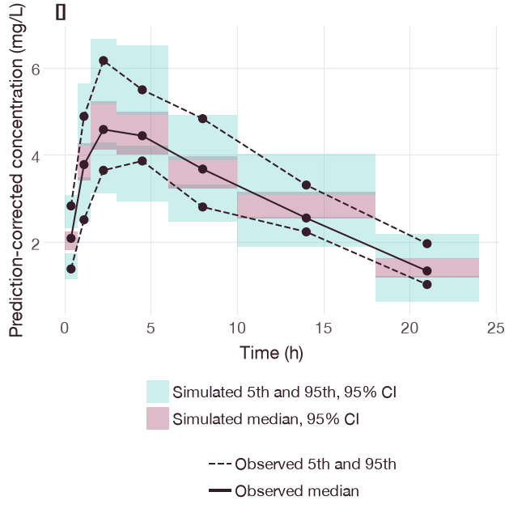
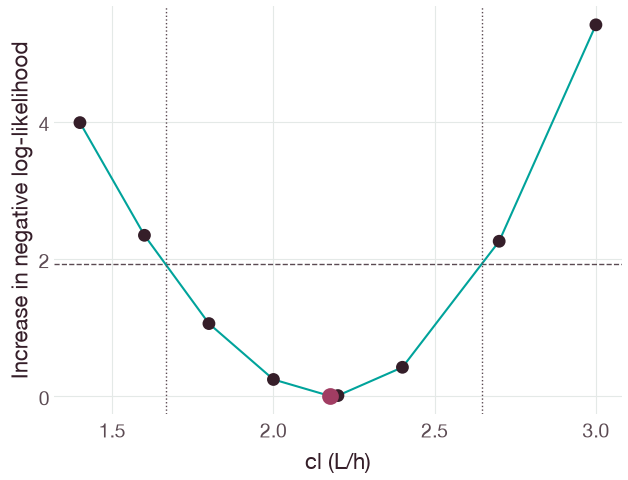
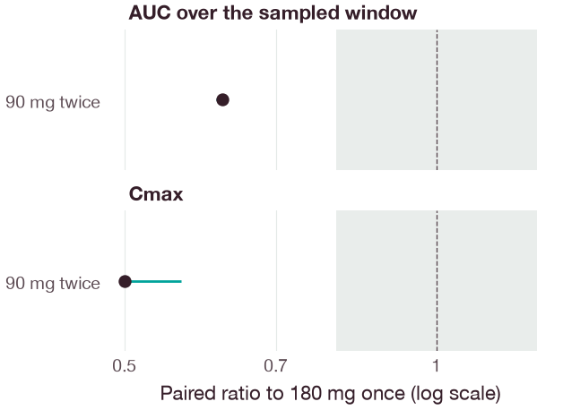
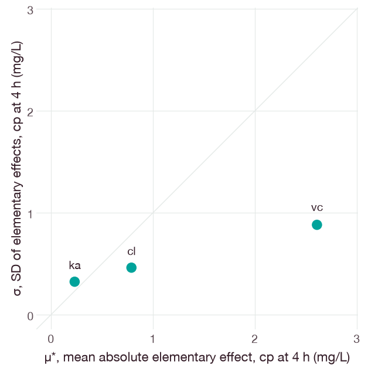
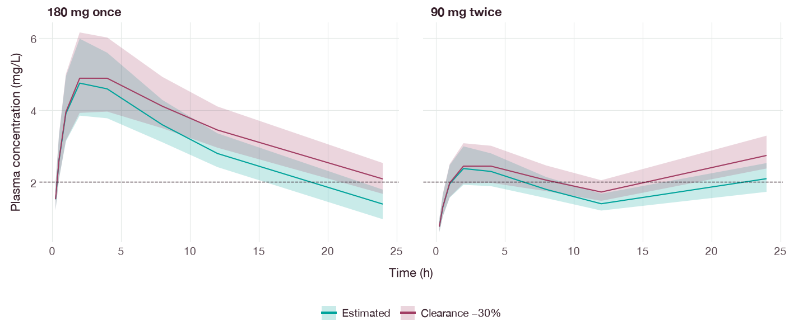
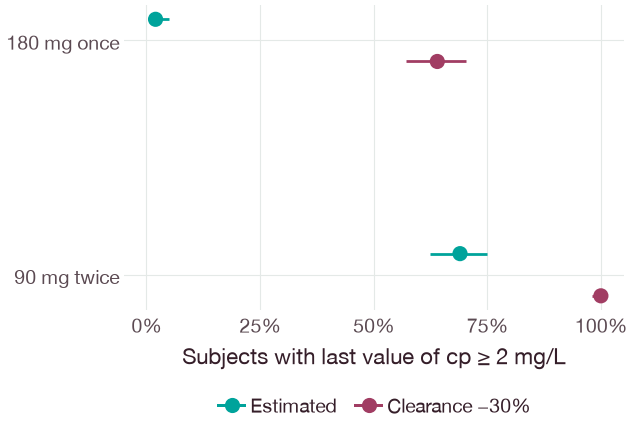

# Publication figures from pharmacometric results

## Objective

This guide shows how to turn QSPQuest results into figures for journal
articles and reports. It covers concentration–time profiles, goodness-of-fit
plots, visual predictive checks, parameter uncertainty, regimen and exposure
comparisons, and sensitivity screening. Every figure is built directly from a
QSPQuest result. Axis labels and units are read from that result, and the
figure is written at the column widths and type sizes required by the target
journal.

The drug, the subjects and all observations in the examples are synthetic.

## Prerequisites

Install the Python package with the `analysis` and `plot` extras:

```sh
python -m pip install "qspquest[plot]"
```

The `plot` extra installs pandas and plotnine. Figures are plotnine objects:
they can be displayed in a notebook, extended with `+`, or saved with
`qq.plot.save`. The R package provides the same theme, colours and journal
presets for ggplot2 (see [R](#r)).

## Background

Model evaluation in population pharmacokinetics relies on a small set of
graphical diagnostics. A review by the International Society of
Pharmacometrics Model Evaluation Group defines a core set [1]:

- observed values against population and individual predictions;
- residuals against time and against predictions;
- individual profiles with observations and predictions;
- distributions of individual random effects, interpreted with their
  shrinkage [2];
- visual predictive checks [3], or prediction-corrected visual predictive
  checks when doses or covariates differ between subjects [4].

Parameter uncertainty is usually reported as confidence intervals from
likelihood profiles or a nonparametric bootstrap. Covariate and regimen
effects on exposure are often reported as forest plots of ratios to a
reference [5]. The 0.80–1.25 range used below comes from bioequivalence
practice and is shown for orientation only.

Journals specify the final size of figures (Table 2). A figure drawn at screen
size and reduced to an 84 mm column has type that is too small to read.
QSPQuest figures are therefore designed for one column (about 85 mm) or two
columns (about 180 mm). `qq.plot.save` writes them at the journal width with
the journal's type sizes.

## Running the example

From the checkout root, run:

```sh
python docs/examples/publication_figures.py
```

The script fits the 12 synthetic subjects of the
[oral PK analysis](oral-pk-analysis.md) (seed 2026; 96 observations) and runs
each analysis shown below. It writes Figures 1–9 to `docs/tutorials/figures/`.
The population fit uses stochastic approximation expectation–maximization
(SAEM) with a diagonal between-subject covariance. It converged after 690
iterations. The run takes about 30 s on a laptop.

The core of the script is short:

```python
import qspquest as qq

population = model.fit_population(subjects, parameters, omega, error, seed=11,
                                  covariance="diagonal", sweeps=5, tolerance=0.03,
                                  max_iterations=1000, burn_in=200, max_simulations=1000000)
figure = qq.plot.goodness_of_fit(population)
qq.plot.save(figure, "figure-2")  # figure-2.pdf, figure-2.svg and figure-2.png
```

## Figure types

Table 1 lists the functions in `qspquest.plot`. Each function checks that it
received a suitable result and fails with an explanatory message otherwise.
For example, it rejects a likelihood profile passed to `profile`, mixed units
or time units, and a figure that needs intervals the result does not contain.

**Table 1.** Figure functions and the results they accept.

| Function | Accepted results | Figure |
| --- | --- | --- |
| `profile` | run result; saved table (`qq.read_table`); dict of labelled runs or tables; scan; fits | Output against time. For fits, observations are points and predictions are lines, one panel per subject. |
| `goodness_of_fit` | individual, population or native population fit; `fit_diagnostics` | Panels A–D: observed against population and individual predictions; residuals against time and against the prediction. |
| `observed_vs_predicted`, `residuals` | as above | Single panels of `goodness_of_fit`. |
| `vpc` | `visual_predictive_check` | Observed percentiles (points and lines) over the confidence intervals of simulated percentiles (shaded boxes) in each time bin. Prediction-corrected checks are labelled as such. |
| `vpc_blq` | `visual_predictive_check` with LLOQ values | Observed and simulated fractions below the lower limit of quantification. |
| `parameters` | likelihood profile; bootstrap; native fit with fixed-effect intervals | Estimates with confidence intervals, as ratios to the estimate on a log scale. Each row gives the estimate and interval in its own unit. |
| `bootstrap` | `bootstrap_population` | Distribution of converged replicate estimates with the percentile interval. |
| `likelihood_profile` | `profile_likelihood` | Increase in negative log-likelihood against the parameter, with the likelihood-ratio threshold. |
| `regimens` | `compare_regimens`, or a dict of them keyed by model | Median and outer-percentile band of simulated profiles per regimen; models are overlaid in one panel per regimen. |
| `target_attainment` | `compare_regimens`, or a dict of them keyed by model | Fraction of virtual subjects whose metric meets a target, with Wilson intervals. |
| `exposure` | `compare_regimens` | Per-subject AUC, Cmax, Cmin, Tmax or last value; lines join the same virtual subject across regimens. |
| `exposure_ratio` | `compare_regimens` | Paired ratio of each regimen to the reference, with a reference range. |
| `random_effects` | `fit_population` | Distribution of individual random effects (η) with shrinkage, or η against covariates. |
| `trace` | `fit_data`, `fit_population` | Parameter estimates over optimizer simulations or SAEM iterations. |
| `morris` | Morris screening | Mean absolute elementary effect (μ*) against their standard deviation (σ) [6]. |
| `scan` | parameter scan | Trajectories coloured by one varied parameter, or a heat map of a trajectory summary over two parameters. |
| `steady_state` | periodic steady state | Pre-cycle amount of each state at periodic steady state. |

Residuals are those recorded by the fit. For individual fits and the SAEM fit,
the standardized residual is the observed value minus the individual (or model)
prediction, divided by the residual-error standard deviation at that
prediction. These conditional residuals are not conditional weighted residuals
(CWRES) [7] or normalized prediction distribution errors. The y axis is labelled
"Conditional standardized residual", and dashed lines mark ±1.96. Native
population fits record no residual-error standard deviation per row, so their
residuals are shown unscaled, in the unit of the observation.

## Results

### Simulated exposure under two regimens



**Figure 1.** Simulated plasma concentration after 180 mg once (teal) and
90 mg twice, 12 h apart (burgundy). Lines are medians and bands span the 5th to
95th percentiles of 200 virtual subjects. The subjects are drawn from the
estimated population distribution and are the same in both regimens. Curves
exclude residual error. Source: `qq.plot.regimens(comparison)`.

### Individual fits



**Figure 2.** Observed plasma concentrations (points) and SAEM predictions for
subjects 1–4. Solid lines are individual predictions from the posterior mean
log parameters; dashed lines are population predictions. Lines join the
predictions at the observation times. Observations are synthetic. Source:
`qq.plot.profile(population, subjects=["1", "2", "3", "4"])`.

### Goodness of fit



**Figure 3.** Goodness-of-fit plots for the SAEM fit to 96 synthetic
observations. (A) Observed concentration against population prediction and
(B) against individual prediction; dashed lines are the lines of identity.
(C) Conditional standardized residuals against time and (D) against individual
prediction; dashed lines mark ±1.96. Source: `qq.plot.goodness_of_fit(population)`.

### Prediction-corrected visual predictive check



**Figure 4.** Prediction-corrected visual predictive check [4] with 200
simulated replicates of the 12-subject design (seed 7). Points joined by lines
are the observed 5th, 50th and 95th percentiles at the midpoint of each time
bin. Shaded boxes are 95% Monte Carlo confidence intervals of the simulated
median (burgundy) and of the simulated 5th and 95th percentiles (teal) in each
bin. Source: `qq.plot.vpc(vpc)`.

### Parameter uncertainty



**Figure 5.** Likelihood profile for clearance in an individual fit to subject
1. Each point is the minimum negative log-likelihood with clearance fixed and
the other parameters re-estimated. The dashed line is the threshold for a 95%
likelihood-ratio interval (Δ = 1.92), and dotted lines mark the interpolated
interval, 1.67–2.65 L/h, around the estimate of 2.17 L/h (burgundy). Source:
`qq.plot.likelihood_profile(profile)`.

The same result gives a parameter table with `qq.plot.parameters(profile)`. A
bootstrap result gives both a parameter table and the replicate distributions
(`qq.plot.bootstrap`).

### Exposure ratio



**Figure 6.** Ratio of AUC over the sampled 24 h window, and of Cmax, for 90 mg
twice relative to 180 mg once in the same 200 virtual subjects. Points are
median ratios and bars span the 5th to 95th percentiles of the paired ratios.
The grey band is the 0.80–1.25 range. Ratios are calculated from the simulated
per-subject metrics; they are not estimated from data. Source:
`qq.plot.exposure_ratio(comparison)`.

### Sensitivity screening



**Figure 7.** Morris elementary-effects screening [6] of the plasma
concentration 4 h after a 180 mg oral dose. Clearance (1–3 L/h), central
volume (20–45 L) and absorption rate constant (0.5–2 h⁻¹) were varied with
six trajectories on a four-level grid (seed 3). μ* is the mean absolute
elementary effect and σ is the standard deviation of the elementary effects.
The diagonal marks σ = μ*. Source: `qq.plot.morris(morris, label="cp at 4 h")`.

### Two models and target attainment

The script repeats the regimen comparison with clearance reduced by 30%, using
the same seed and therefore the same 200 virtual subjects. A dict of
comparisons keyed by model overlays the two in one figure.



**Figure 8.** Simulated plasma concentration for the estimated parameters
(teal) and with clearance reduced by 30% (burgundy). Lines are medians and
bands span the 5th to 95th percentiles of 200 virtual subjects, the same in
both models. The dashed line is a target concentration of 2 mg/L. Source:
`qq.plot.regimens({"Estimated": comparison, "Clearance −30%": reduced},
target=2.0)`.



**Figure 9.** Fraction of the 200 virtual subjects with a concentration of at
least 2 mg/L at 24 h, the last sampled time. Bars are 95% Wilson score
intervals. With the estimated parameters, 2% of subjects reached the target
after 180 mg once and 69% after 90 mg twice; with clearance reduced by 30%,
the fractions were 64% and 100%. Source:
`qq.plot.target_attainment(models, "endpoint", 2.0, direction="above")`.

The metrics available for attainment are those of each virtual subject over
the sampled window: AUC, Cmax, Cmin, Tmax, the last sampled value and the time
above a threshold. A target on the window maximum, such as a cell count that
must stay at or below a limit, is `metric="cmax"` with `direction="below"`.
`qq.tables.target_attainment` returns the counts and intervals as a table.

## Saved tables and model overlays

The MCP `save_csv` tool, the CLI and the Python first run save a trajectory as
a CSV file with a `.manifest.json` file beside it. The manifest records the
unit and meaning of every column, the model identity and the CSV digest.
`qq.read_table` reads such a pair. It checks the digest, the header, the row
and event counts and the pre-then-post order of rows at a dose time, and
takes every unit from the manifest. The result plots like a run:

```python
source = qq.read_table("study/source-model.csv")
extended = qq.read_table("study/extended-model.csv")
qq.plot.profile({"Source model": source, "Extended model": extended}, output="cp", log=True)
```

Outputs are named by their model name where the manifest records one. A
column without a declared unit is labelled "unit not declared".

Dict keys may be (series, panel) pairs. The figure then colours lines by the
first element and draws one panel per second element:

```python
runs = {("Source model", "q180 d"): a, ("Extended model", "q180 d"): b,
        ("Source model", "q365 d"): c, ("Extended model", "q365 d"): d}
qq.plot.profile(runs, output="cd19_cells", log=True)
```

`write_analysis_report` uses the same colours. Its `comparison` argument also
accepts a dict of comparisons keyed by model; colour then identifies the model
and the line pattern identifies the regimen. Its `runs` argument overlays
labelled runs or saved tables, one plot per shared output.

## Saving at journal sizes

`qq.plot.save(figure, path, journal=..., width=...)` sets the figure width and
type sizes, then writes the files. A path without a suffix writes PDF, SVG and
PNG; a suffix writes one format. By default, figures designed for one column
are written at the single-column width and others at the double-column width;
`width` also accepts `"single-column"`, `"double-column"` or a width in mm. The
height keeps the figure's aspect ratio and is limited to the journal maximum.

**Table 2.** Journal presets used by `save` and `theme_qspquest`.

| Preset | Single / double column (mm) | Maximum height (mm) | Type size (pt) | Font | Source |
| --- | --- | --- | --- | --- | --- |
| `cpt-psp` (default) | 86 / 178 | 170 | 8; tick labels 7 | DM Sans, else Helvetica or Arial | CPT:PSP author guidelines [8] |
| `jpkpd` | 84 / 174 | 234 | 8 | Helvetica or Arial | J Pharmacokinet Pharmacodyn guidelines [10] |
| `nature` | 89 / 183 | 170 | 7; tick labels 6 | Helvetica or Arial | Nature figure guide [11, 12] |

Notes on Table 2:

- The CPT: Pharmacometrics & Systems Pharmacology author guidelines give
  86 mm for a single image and 178 mm for a multipart image [8]. They give no
  maximum height; the preset keeps 170 mm. Wiley's general figure guidance
  allows widths of 80–180 mm [9].
- Springer asks for type of 8–12 pt [10]. Nature allows 5–7 pt [11, 12]. No
  single size satisfies both, so the type size follows the preset.
- Reference lines are 0.5 pt, model lines 0.75 pt, interval bars 1 pt and
  grid lines 0.4 pt. These meet the minimum of 0.3 pt [10] and the range of
  0.25–1 pt [11].

The output files have these properties:

- **PDF.** Fonts are embedded as TrueType (Type 42) subsets and the text stays
  editable, as Nature requires [12].
- **SVG.** Text is drawn as glyph outlines by default, so the file looks the
  same on every computer. Use `svg_text="text"` for editable text; the font
  must then be installed on the reader's computer [13].
- **PNG.** Written at 600 dpi by default, the minimum for combination artwork
  in Springer journals [10]. Use `dpi=1200` for line art in those journals.
- **Metadata.** Creation dates and software names are omitted. Rerunning the
  script with the same inputs, package versions and fonts therefore gives the
  same files.

Figures do not contain captions or titles; journals require captions in the
text [9, 10]. Panel letters in `goodness_of_fit` are upper case. Nature asks for
lower-case panel letters [12]; replace them with `labs(title="a")` on each
panel when needed.

## Colour and accessibility

Categorical colours are teal, burgundy and peach, always in that order. They
are the UniBio Intelligence brand hues, darkened where needed. On white, each
colour has a contrast ratio of at least 3:1, and every pair remains
distinguishable under simulated protanopia, deuteranopia and tritanopia. Red
and green are not used together [14].

Magnitudes use a single-hue sequential scale, from light to dark teal.
Observations are always dark points and model predictions are always lines.
Population and individual predictions also differ in line type, so the figures
can be read in greyscale.

At most three groups are coloured. With more groups, the functions draw one
panel per group.

### Style definitions

The plotting package has two layers:

- **`qspquest.plot.style`** holds the theme, scales, palette and `save`. It
  does not depend on pharmacometric results.
- **`qspquest.plot.pkpd`** holds the figure functions. They use only the style
  layer's public functions.

All colours, line weights, font lists and journal presets are defined in one
style file, `spec/style/figure-style.json`. No colour is written in code. The script
`scripts/generate_figure_style.py` writes the copies used by the Python and R
packages. From the same file it also generates:

- CSS custom properties (`spec/style/figure-style.css`);
- an ES module with D3-ready schemes (`spec/style/figure-style.mjs`), so web
  applications can use the same colours.

The style file defines a light mode and a dark mode. In dark mode the burgundy
is lightened to `#B44A74`, because `#A13D63` has a contrast ratio of only
2.8:1 against the dark surface. To use the dark colours:

- in Python, call `qq.plot.set_mode("dark")` before building a figure;
- in R, set `options(qspquest.style_mode = "dark")`.

`qq.plot.palette()`, `qq.plot.sequential()`, `qq.plot.diverging()` and
`qq.plot.color("ink")` return the colours of the current mode for custom
figures.

## Tables for custom figures

`qq.to_frame(result, table)` returns the data behind each figure as a long
pandas DataFrame with unit columns. `qq.tables.tables(result)` lists the
available tables; the first is the default. The tables are listed below; the
default table comes first in each row.

| Result | Tables |
| --- | --- |
| Run | `trajectory` |
| Individual fit | `observations`, `parameters`, `trace` |
| Population fit | `observations`, `parameters`, `random_effects`, `individual_parameters`, `trace` |
| Native population fit | `observations`, `parameters` |
| VPC | `bins`, `blq` |
| Likelihood profile | `profile`, `parameters` |
| Bootstrap | `replicates`, `parameters` |
| Regimen comparison | `curves`, `subjects`, `summary` |
| Exposure summary | `metrics` |
| Morris screening | `effects`, `elementary_effects` |
| Scan | `trajectory`, `parameters` |
| Periodic steady state | `states` |

The theme and scales apply to custom figures:

```python
from plotnine import aes, geom_boxplot, ggplot, labs

subjects = qq.to_frame(comparison, "subjects")
auc = subjects[subjects["metric"] == "auc"]
figure = (ggplot(auc, aes("regimen", "value", fill="regimen")) + geom_boxplot()
          + qq.plot.scale_fill_qspquest()
          + labs(x="", y=f"AUC ({auc['unit'].iloc[0]})")
          + qq.plot.theme_qspquest())
qq.plot.save(figure, "figure-s1")
```

`AnalysisResult.to_frame(table)` gives the same tables for results returned by
`CompiledModel` methods.

## R

The R package provides the same theme, colours and journal presets for ggplot2.
ggplot2 is optional; the plotting functions stop with a message when it is not
installed. The functions accept native R results directly:

```r
library(qspquest)
result <- simulate_model(model, request)
figure <- qspquest_plot_profile(result, label = "Plasma concentration")
qspquest_save_figure(figure, "figure-1", journal = "jpkpd")
```

`qspquest_plot_observed_predicted`, `qspquest_plot_residuals` and
`qspquest_plot_fitted_profile` accept the result of `fit_population_data()`.
`qspquest_plot_parameters` draws the fixed-effect intervals of a native
population fit. `qspquest_plot_morris` and `qspquest_plot_scan` draw Morris
screening and parameter scans. `theme_qspquest()`,
`scale_colour_qspquest()`, `scale_fill_qspquest()` and
`scale_fill_qspquest_continuous()` apply the style to any ggplot2 figure. PDF
files are written with the Cairo device where available, which embeds fonts.

## Limitations

- Figures show what the result records. No intervals, residual
  standardizations or summary statistics are computed beyond those in the
  result. The exception is the paired ratios in `exposure_ratio`, which are
  computed from the per-subject metrics of the comparison.
- The visual predictive check stores percentiles per time bin, not the
  individual observations. Observed points are therefore not drawn in the VPC.
- Lines in fitted profiles join predictions at the observation times only. For
  smooth curves, simulate the fitted parameters on a dense time grid and use
  `qq.plot.profile` on that run.
- On a logarithmic axis, non-positive values are omitted and the number
  omitted is reported in a warning.
- The plotting helpers do not compute CWRES, normalized prediction distribution
  errors or numerical predictive checks.

## References

1. Nguyen THT, Mouksassi M-S, Holford N, et al. Model evaluation of continuous
   data pharmacometric models: metrics and graphics. *CPT Pharmacometrics Syst
   Pharmacol.* 2017;6(2):87–109. https://doi.org/10.1002/psp4.12161
2. Savic RM, Karlsson MO. Importance of shrinkage in empirical Bayes estimates
   for diagnostics: problems and solutions. *AAPS J.* 2009;11(3):558–569.
   https://doi.org/10.1208/s12248-009-9133-0
3. Karlsson MO, Holford N. A tutorial on visual predictive checks. PAGE 17
   (2008) Abstr 1434. https://www.page-meeting.org/?abstract=1434
4. Bergstrand M, Hooker AC, Wallin JE, Karlsson MO. Prediction-corrected
   visual predictive checks for diagnosing nonlinear mixed-effects models.
   *AAPS J.* 2011;13(2):143–151. https://doi.org/10.1208/s12248-011-9255-z
5. U.S. Food and Drug Administration. Population pharmacokinetics: guidance
   for industry. February 2022. https://www.fda.gov/media/128793/download
6. Morris MD. Factorial sampling plans for preliminary computational
   experiments. *Technometrics.* 1991;33(2):161–174.
   https://doi.org/10.1080/00401706.1991.10484804
7. Hooker AC, Staatz CE, Karlsson MO. Conditional weighted residuals (CWRES): a
   model diagnostic for the FOCE method. *Pharm Res.* 2007;24(12):2187–2197.
   https://doi.org/10.1007/s11095-007-9361-x
8. CPT: Pharmacometrics & Systems Pharmacology. Author guidelines: figures.
   https://ascpt.onlinelibrary.wiley.com/page/journal/21638306/guidetoauthors
9. Wiley. Guidelines for the preparation of figures.
   https://authors.wiley.com/author-resources/Journal-Authors/Prepare/manuscript-preparation-guidelines.html/figure-preparation.html
10. Journal of Pharmacokinetics and Pharmacodynamics. Submission guidelines:
    artwork and illustrations. https://link.springer.com/journal/10928/submission-guidelines
11. Nature. Final submission. https://www.nature.com/nature/for-authors/final-submission
12. Nature Research Figure Guide: preparing figures, our specifications.
    https://research-figure-guide.nature.com/figures/preparing-figures-our-specifications/
13. Matplotlib. Fonts in Matplotlib. https://matplotlib.org/stable/users/explain/text/fonts.html
14. Wong B. Points of view: color blindness. *Nat Methods.* 2011;8(6):441.
    https://doi.org/10.1038/nmeth.1618
