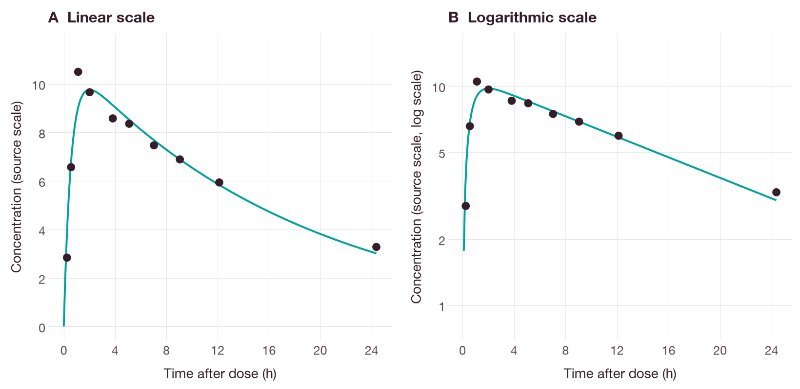
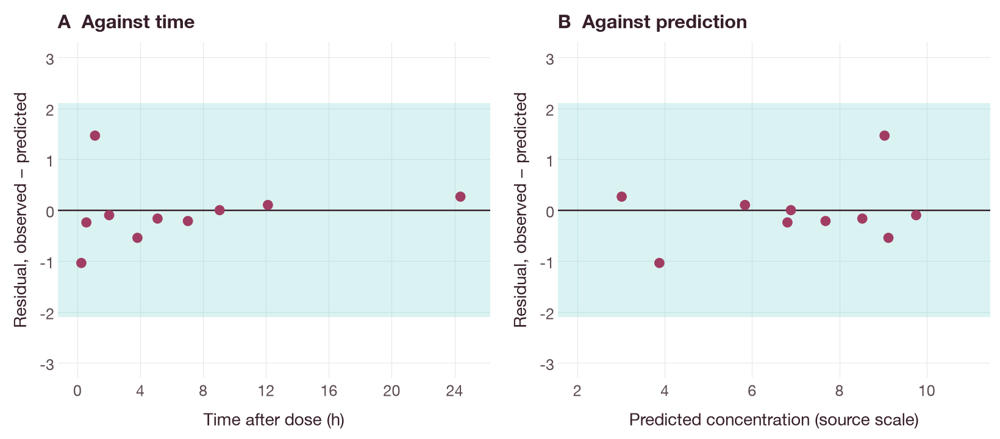
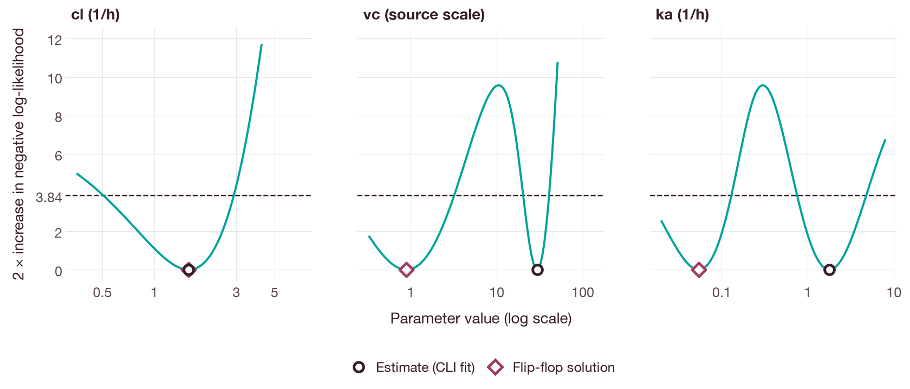

# Fitting published theophylline concentrations from one subject

## Objective

This tutorial fits a one-compartment model with first-order oral absorption to
the concentrations of subject 1 in the `theo_sd` dataset and compares the
predictions with the observed concentration–time curve. The observations are
published data distributed with the validation companion repository; they are
not simulated recovery data. The companion includes the dataset attribution and
license notices.

## Running the example

The example requires Python 3.11 or later, Git, a built QSPQuest command-line
interface (CLI) and the matching
[validation repository](https://github.com/unibio-intelligence/qspquest-validation).
R and additional Python packages are not required. In the complete engine
checkout, first complete the [source installation](../installation.md), then
check out the validation revision that this example reads:

```sh
git clone https://github.com/unibio-intelligence/qspquest-validation.git ../qspquest-validation
git -C ../qspquest-validation checkout 7b98a5613b39c6cfd535349b26e7740d51bf41e5
python3 -B ../qspquest-validation/scripts/verify.py
python3 -B docs/examples/published_theophylline.py \
  --validation ../qspquest-validation \
  --cli ./target/release/qspquest \
  --out ../theophylline-fit
```

If the validation repository has already been cloned, omit the clone but still
check out the pinned revision. Use a new output directory. The script verifies
the checksums of the data files before fitting.

## Data and model

The archived `nlmixr2data` 2.0.10 `theo_sd` dataset contains the first-day
observations from the theophylline dataset used in nlme [1] and NONMEM [2] examples.
This workflow uses one subject, a dose at time zero and ten post-dose
observations from 0.25 to 24.37 hours. The archived fitting contract excludes
the predose observation.

The model has a depot and a central compartment, a first-order absorption rate
constant `ka`, an elimination rate constant `cl / vc` and the output
`cp = central / vc`. The complete `.qsp` model, observations, bounds, initial
estimates and solver settings are copied to the output directory. The fit uses
the backward differentiation formula (BDF) solver and a Gaussian residual error
model with a fixed additive standard deviation of 2.1 on the numerical scale of
the source data, without a proportional component or a prior. The estimated
parameters are `cl`, `vc` and `ka`.

Amount, volume and concentration are stored without a physical unit (unit `1`,
on the numerical scale of the source data), and time is in hours. Consequently,
`cl` is reported in `1/h`, `vc` in `1` and `ka` in `1/h`. These estimates should
not be reported as clearance or volume in physical units; that requires a model
with physical units.

## Results

The command prints `status: converged`, `observations: 10` and estimates close to
the following values:

| Parameter | Estimate | Declared unit |
| --- | ---: | --- |
| `cl` | 1.58591 | `1/h` |
| `vc` | 29.39343 | `1` |
| `ka` | 1.77741 | `1/h` |

Small differences between builds are expected. The negative log-likelihood is
approximately 17.03261. `fit.json` contains the convergence status, bounds,
projected-gradient norm and evaluation counts. `receipt.json` records the
validation revision and the inputs used.

`observed-predicted.csv` lists the ten time points, the fitted concentrations
and the residuals (`observed - predicted`). At 1.12 hours the observed value is
10.5 and the prediction is approximately 9.0353; a converged fit does not pass
through every observation.

Figure 1 compares the fitted concentration–time curve with the ten
observations. The residuals are shown in Figure 2. All ten are smaller in
magnitude than the fixed residual standard deviation of 2.1; the largest is the
residual of 1.46 at 1.12 hours.



**Figure 1.** Observed concentrations of subject 1 in `theo_sd` (points) and
the concentration predicted by the fitted model (line), simulated with the CLI
and the `diffsol_bdf` solver at the estimates in the table above. (A) Linear
scale. (B) Logarithmic scale. Concentrations are on the numerical scale of the
source data.



**Figure 2.** Residuals (observed − predicted) from `observed-predicted.csv`
against time after dose (A) and against the predicted concentration (B). The
shaded band is ±2.1, one fixed residual standard deviation.

Figure 3 shows the profile likelihood of each parameter. For each value of one
parameter, the other two were re-estimated by minimizing the analytical negative
log-likelihood of the same model and residual error model. The profiles of `vc`
and `ka` each have a second minimum, at `vc` ≈ 0.89 and `ka` ≈ 0.054 `1/h`,
with the same likelihood as the reported estimate. This parameter set
interchanges `ka` and the elimination rate constant `cl / vc` and leaves `cl`
unchanged; it gives the same predicted concentrations. Data from an oral dose
alone therefore do not determine which of the two rate constants describes
absorption [3]. The reported estimate is the solution with `ka` greater than
`cl / vc`, the ordering of the initial estimates in the request.



**Figure 3.** Profile likelihood of `cl`, `vc` and `ka`, calculated with the
analytical solution of the model: twice the increase in the negative
log-likelihood above its minimum, with the other two parameters re-estimated at
each value. Circles mark the estimate returned by the CLI; diamonds mark the
parameter set with `ka` and `cl / vc` interchanged. The dashed line at 3.84 is
the threshold for an approximate 95% profile likelihood interval.

## Figures

The figures were produced by `docs/examples/published_theophylline_figures.py`,
which uses plotnine with the shared style in `docs/examples/figure_style.py`.
The script runs the example above in a temporary directory, checks the fit
against the values reported here and the CLI predictions against the analytical
solution, and writes the figures to `docs/tutorials/figures/`. It requires the
built CLI, the validation checkout at the pinned revision and the `docs` extra
(`python -m pip install '.[docs]'`):

```sh
python3 -B docs/examples/published_theophylline_figures.py \
  --validation ../qspquest-validation --cli ./target/release/qspquest
```

## Limitations

The residual pattern and the fixed residual error assumption should be examined
before the model is interpreted. This single-subject fit does not estimate
population variability and does not establish clinical suitability. It does not
reproduce the population analysis of the original study.

## Troubleshooting

- A manifest mismatch indicates that the companion checkout differs from the
  revision pinned by the engine. Check out the revision shown above; do not
  bypass checksum verification.
- If the fit does not converge, retain `fit.json` and inspect its status and
  bounds. Increasing the budgets does not establish that the model or the
  residual error assumptions are appropriate for the observations.
- If the output directory already exists, choose another name. The script does
  not overwrite earlier results.

The construction of an observation model for other data is described in the
[oral pharmacokinetic analysis tutorial](oral-pk-analysis.md). The full stored comparison
matrix and the data notices are given in the validation companion's `METHODS.md`
and `THIRD_PARTY_NOTICES.md`.

## References

1. Pinheiro JC, Bates DM. *Mixed-Effects Models in S and S-PLUS*. New York:
   Springer; 2000. [doi:10.1007/b98882](https://doi.org/10.1007/b98882)
2. Boeckmann AJ, Sheiner LB, Beal SL. *NONMEM Users Guide, Part V: Introductory
   Guide*. NONMEM Project Group, UCSF; 1994.
3. Yáñez JA, Remsberg CM, Sayre CL, Forrest ML, Davies NM. Flip-flop
   pharmacokinetics – delivering a reversal of disposition: challenges and
   opportunities during drug development. *Ther Deliv*. 2011;2(5):643–672.
   [doi:10.4155/tde.11.19](https://doi.org/10.4155/tde.11.19)
