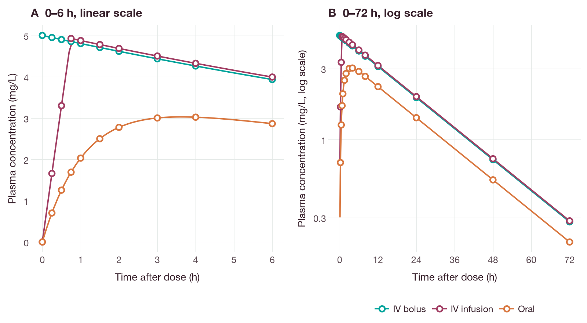
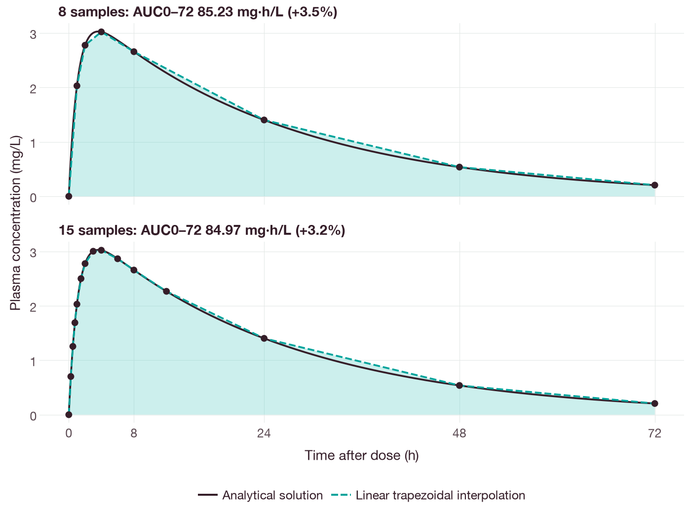
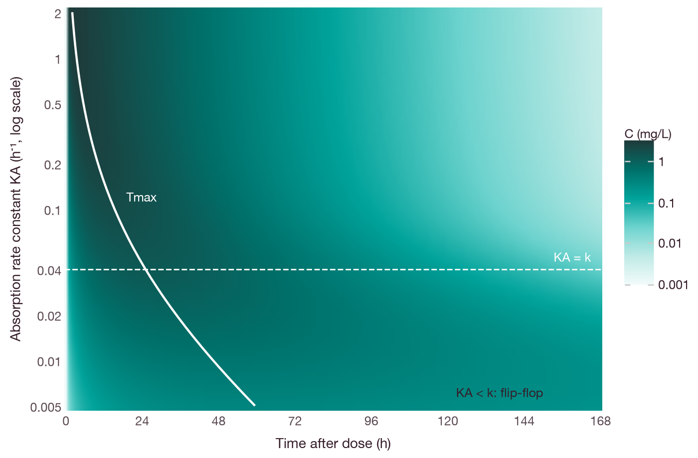
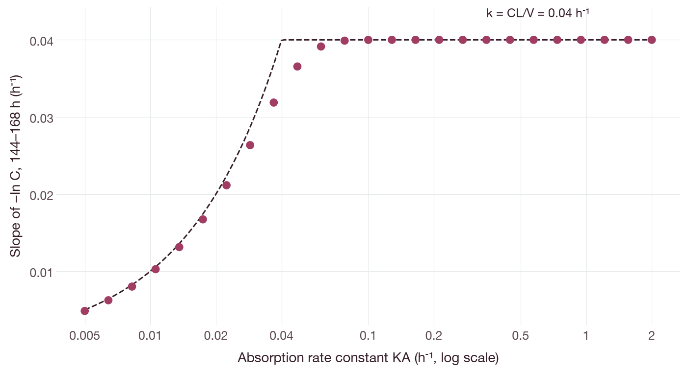

# Single-dose pharmacokinetics after intravenous and oral administration

## Objective

This tutorial simulates the plasma concentration–time profile of a drug after a
single 300 mg dose given by three routes: intravenous (IV) bolus, IV infusion
over 0.75 h, and oral administration. The profiles are used to show:

- how the route of administration affects the maximum concentration (Cmax) and
  the time at which it occurs (Tmax);
- why oral data give the apparent clearance (CL/F) rather than the clearance;
- how the sampling schedule affects the reported Cmax, Tmax and area under the
  concentration–time curve (AUC);
- how slow absorption changes the terminal phase (flip-flop kinetics).

The drug, its parameters and all results are synthetic.

## Background

In a one-compartment model with first-order elimination, the rate of
elimination is proportional to the amount of drug in the body. The elimination
rate constant is `k = CL/V`, where `CL` is the clearance and `V` is the volume
of distribution, and the half-life is `t½ = ln 2 / k`. For a dose `D`, the
plasma concentration `C(t)` is given by Equations 1–3.

| Route | Concentration | Equation |
| --- | --- | --- |
| IV bolus | `C(t) = (D/V) e^(−kt)` | (1) |
| IV infusion of duration `T` | `C(t) = (D/T)/CL · (1 − e^(−kt))` for `t ≤ T`; `C(t) = C(T) e^(−k(t−T))` for `t > T` | (2) |
| Oral dose, first-order absorption | `C(t) = F·D·KA / (V(KA − k)) · (e^(−kt) − e^(−KA·t))` | (3) |

`KA` is the first-order absorption rate constant and `F` is the oral
bioavailability. Equation 3 is the solution for two consecutive first-order
processes. It was first derived for chains of radioactive decay [1], and its
application to oral absorption, including the case `KA = k`, is reviewed by
Garrett [2]. Integration of Equations 1–3 from zero to infinity gives
`AUC0–∞ = F·D/CL`, with `F = 1` for IV administration.

## Model

| Parameter | Symbol | Value | Unit |
| --- | --- | ---: | --- |
| Clearance | `CL` | 2.4 | L/h |
| Volume of distribution | `V` | 60 | L |
| Absorption rate constant | `KA` | 0.9 | h⁻¹ |
| Oral bioavailability | `F` | 0.7 | — |
| Elimination rate constant (derived) | `k` | 0.04 | h⁻¹ |
| Half-life (derived) | `t½` | 17.3 | h |

The model is written as a `linear_pk` declaration with a central compartment and
an absorption depot:

```text
model synthetic_route_comparison
 time_unit = h
parameters
 cl = 2.4 [L/h] log estimated
 v = 60 [L] log estimated
 ka = 0.9 [1/h] log estimated
linear_pk
 amount_unit = mg
 clearance = cl
 compartment central volume v = 0 [mg]
 depot depot absorption ka = 0 [mg]
outputs
 cp = central / v [mg/L]
end
```

From this declaration, QSPQuest generates the differential equations
`dA_depot/dt = −KA·A_depot` and `dA_central/dt = KA·A_depot − (CL/V)·A_central`.
Each parameter has a unit, and the dimensions of every expression are checked
when the model is compiled. A model that gives `cl` in L instead of L/h is
therefore rejected. Compatible units are converted; for example, 40 mL/min is
read as 2.4 L/h. The full syntax is described in [linear PK
kernels](../LINEAR-PK-KERNELS.md) and [model equations](../modeling.md).

## Dosing and simulation

An IV dose is given into `central` and an oral dose into `depot`. The
bioavailability is part of the dose record:

```python
import qspquest as qq

model = qq.CompiledModel(open("single-dose-output/model.qsp").read())
iv_bolus = qq.bolus("central", 300, "mg")
iv_infusion = qq.infusion("central", 300, "mg", duration=0.75)
oral = qq.bolus("depot", 300, "mg", bioavailability=0.7)

times = [0, 0.25, 0.5, 0.75, 1, 1.5, 2, 3, 4, 6, 8, 12, 24, 48, 72]
result = model.run(qq.run_request(end=72, times=times, administrations=[oral],
                                  solver="analytic_linear_pk"))
```

Each request names its solver. `analytic_linear_pk` computes the exact solution
of the linear system with a matrix exponential [3]. `diffsol_bdf` integrates the
same equations numerically with a backward differentiation formula (BDF) method.
The example script runs every route with both solvers.

## Running the example

Install the Python package with the analysis extra
([Python installation](../installation.md#python)). From the root of the source
checkout, run:

```sh
python docs/examples/single_dose_pk.py --out single-dose-output
```

The output directory must not already exist. The script prints:

```text
Model with cl in L rejected: expression dimensions differ: mass/time versus mass (line 11, column 33)

Route         Cmax (mg/L)  Tmax (h)  AUC0-72 (mg*h/L)
IV bolus            5.000      0.00            121.68
IV infusion         4.926      0.75            121.62
Oral                3.021      4.00             84.97
Maximum difference from the analytical solution: 1.5e-14 mg/L (45 concentrations)
Maximum difference between analytic and BDF solutions: 2.3e-08 mg/L

AUC0-inf (analytical): IV 125.0 mg*h/L, oral 87.5 mg*h/L; CL/F = 3.429 L/h

Oral dose: effect of the sampling schedule
Schedule              Tmax (h)  Cmax (mg/L)  AUC0-72 (mg*h/L)  Error (%)
8 samples                 4.00        3.021             85.23       3.49
15 samples                4.00        3.021             84.97       3.17
every 0.05 h              3.60        3.028             82.36       0.00
Analytical                3.62        3.028             82.36

Extended release (KA = 0.02 1/h, k = 0.04 1/h): slope of ln C, 24-48 h 0.0001, 96-120 h -0.0174, 288-312 h -0.0199 1/h
```

To regenerate the figures in this tutorial, install the `docs` extra and run
`python docs/examples/single_dose_pk_figures.py`. The script repeats the
simulations, compares each simulated value with the analytical solution and
writes the figures to `docs/tutorials/figures/`.

The last digits of the two maximum differences depend on the platform. The
output directory contains the model (`model.qsp`), a table of simulated,
analytical and BDF concentrations (`concentrations.csv`) and a summary
(`summary.json`).

## Results

### Concentration–time profiles

At all 45 time points, the simulated concentrations agree with Equations 1–3 to
within 1.5e-14 mg/L, and the analytic and BDF solutions agree to within
2.3e-8 mg/L. The IV bolus gives the highest Cmax, 5.0 mg/L at the time of the
dose. The infusion gives a slightly lower Cmax (4.93 mg/L) at the end of the
infusion. After the oral dose, Cmax is lower again (3.02 mg/L) and occurs later,
because the drug must first be absorbed (Figure 1).



**Figure 1.** Plasma concentration after a single 300 mg dose of the synthetic
drug. Open circles are concentrations simulated with `analytic_linear_pk` at the
15 sampling times; lines are the analytical solutions (Equations 1–3). (A) First
6 h on a linear scale. (B) 0–72 h on a logarithmic scale, where the elimination
phase of each route is a straight line with slope −`k`.

### Bioavailability and apparent clearance

`AUC0–∞` is 125 mg·h/L after IV administration and 87.5 mg·h/L after oral
administration; their ratio is `F = 0.7`. `KA` changes the shape of the oral
profile but not its AUC. Without IV data, `CL` and `F` cannot be estimated
separately. A model fitted to oral data alone estimates the apparent clearance
`CL/F` (here 3.43 L/h) and the apparent volume `V/F`, and these parameters
should be reported as such. The [oral PK fitting tutorial](oral-pk-analysis.md)
fits a model of this type to synthetic oral data.

### Effect of the sampling schedule

`exposure_summary(result, "cp")` reports Cmax and Tmax at the sampled times.
It computes AUC by the linear trapezoidal rule between samples and does not
extrapolate beyond the last sample. The oral profile was summarized with three
sampling schedules (Table 1).

**Table 1.** Exposure metrics for the oral dose with three sampling schedules.

| Schedule | Tmax (h) | AUC0–72 (mg·h/L) | Difference from analytical AUC0–72 (%) |
| --- | ---: | ---: | ---: |
| 8 samples (0, 1, 2, 4, 8, 24, 48 and 72 h) | 4.00 | 85.23 | +3.5 |
| 15 samples (7 additional samples from 0.25 h to 12 h) | 4.00 | 84.97 | +3.2 |
| Every 0.05 h | 3.60 | 82.36 | 0.0 |
| Analytical (Equation 3) | 3.62 | 82.36 | — |

The additional early samples reduce the AUC error only slightly; most of the
error arises in the 24 h intervals of the elimination phase. On a declining
exponential curve, the straight line between two samples lies above the curve,
so the linear trapezoidal rule overestimates the AUC [4]. Yeh and Kwan compared
the linear trapezoidal rule with other integration methods [5], and Purves
recommended a logarithmic rule for declining concentrations [6]. The reported
Tmax is always one of the sampling times. The analytical Tmax,
`ln(KA/k)/(KA − k)` = 3.62 h, lies between the samples at 3 h and 4 h.



**Figure 2.** Linear trapezoidal interpolation (dashed line) between simulated
samples (points) compared with the analytical oral profile (solid line, Equation
3). The shaded area is the AUC computed by the trapezoidal rule. The difference
from the analytical AUC0–72 is concentrated in the 24 h intervals of the
elimination phase.

### Extended-release formulation and flip-flop kinetics

An extended-release formulation was represented by setting `KA` to 0.02 h⁻¹ for
a single request; the model itself was not changed:

```python
extended = qq.run_request(end=312, times=[24, 48, 96, 120, 288, 312],
                          administrations=[oral], solver="analytic_linear_pk",
                          parameters={"ka": qq.quantity(0.02, "1/h")})
```

`KA` is now smaller than `k` (0.04 h⁻¹). The slope of ln C between 288 h and
312 h is −0.0199 h⁻¹, close to −`KA` rather than −`k`. The terminal phase
therefore reflects absorption rather than elimination, a condition known as
flip-flop kinetics [7]. A half-life calculated from this slope (35 h) would
overestimate the elimination half-life (17.3 h). The slope reported here is
calculated from two simulated concentrations. It is not a noncompartmental
estimate of λz; QSPQuest does not yet provide noncompartmental analysis (see the
[PK/PD tutorials](pk-pd-journeys.md#exposure-metrics-and-nca)).

Figure 3 extends this example to 41 values of `KA` between 0.005 and 2 h⁻¹.
Above the line `KA = k`, the decline after the peak is governed by elimination;
below it, the decline is governed by absorption and is slower. Figure 4 shows
the slope of −ln C between 144 h and 168 h for 25 values of `KA`. The slope
approaches `min(KA, k)`. Near `KA = k` it converges slowly, because both
exponential terms in Equation 3 are still of similar size at 168 h.



**Figure 3.** Simulated plasma concentration (color, logarithmic scale) after a
300 mg oral dose as a function of time and `KA`. Each row is one simulation, and
every value agrees with Equation 3 to within 1e-9 mg/L. The solid line is the
analytical Tmax, `ln(KA/k)/(KA − k)`. The dashed line marks `KA = k`.



**Figure 4.** Slope of −ln C between 144 h and 168 h after a 300 mg oral dose.
Points are calculated from simulated concentrations; the dashed line is the
limiting value `min(KA, k)`.

## Figures

The figures were produced by `docs/examples/single_dose_pk_figures.py`, which
uses plotnine with the shared style in `docs/examples/figure_style.py`. The
script reads no files: it repeats each simulation and checks it against the
analytical solution before drawing. Install the `docs` extra
(`python -m pip install '.[docs]'`) to run it.

## Limitations

The example uses a one-compartment model with linear elimination and first-order
absorption, without residual (measurement) error. Drugs with multicompartment
distribution, nonlinear elimination or more complex absorption require other
models. The [multiple-dose tutorial](multiple-dose-pk.md) applies the same model
to repeated dosing.

## References

1. Bateman H. The solution of a system of differential equations occurring in
   the theory of radioactive transformations. *Proc Cambridge Philos Soc*.
   1910;15:423–427.
2. Garrett ER. The Bateman function revisited: a critical reevaluation of the
   quantitative expressions to characterize concentrations in the one
   compartment body model as a function of time with first-order invasion and
   first-order elimination. *J Pharmacokinet Biopharm*. 1994;22(2):103–128.
   [doi:10.1007/BF02353538](https://doi.org/10.1007/BF02353538)
3. Moler C, Van Loan C. Nineteen dubious ways to compute the exponential of a
   matrix, twenty-five years later. *SIAM Rev*. 2003;45(1):3–49.
   [doi:10.1137/S00361445024180](https://doi.org/10.1137/S00361445024180)
4. Chiou WL. Critical evaluation of the potential error in pharmacokinetic
   studies of using the linear trapezoidal rule method for the calculation of
   the area under the plasma level–time curve. *J Pharmacokinet Biopharm*.
   1978;6(6):539–546. [doi:10.1007/BF01062108](https://doi.org/10.1007/BF01062108)
5. Yeh KC, Kwan KC. A comparison of numerical integrating algorithms by
   trapezoidal, Lagrange, and spline approximation. *J Pharmacokinet Biopharm*.
   1978;6(1):79–98. [doi:10.1007/BF01066064](https://doi.org/10.1007/BF01066064)
6. Purves RD. Optimum numerical integration methods for estimation of
   area-under-the-curve (AUC) and area-under-the-moment-curve (AUMC).
   *J Pharmacokinet Biopharm*. 1992;20(3):211–226.
   [doi:10.1007/BF01062525](https://doi.org/10.1007/BF01062525)
7. Yáñez JA, Remsberg CM, Sayre CL, Forrest ML, Davies NM. Flip-flop
   pharmacokinetics – delivering a reversal of disposition: challenges and
   opportunities during drug development. *Ther Deliv*. 2011;2(5):643–672.
   [doi:10.4155/tde.11.19](https://doi.org/10.4155/tde.11.19)
